# 产品需求文档 — V1.0 后台管理

| 项 | 值 |
|---|---|
| 产品名称 | Shang Pivot（工程）/ Shang 商城后台（管理端 UI） |
| 产品版本 | V1.0 后台管理（首个版本，无前置依赖） |
| 文档版本 | V3.0 |
| 文档状态 | As-built（与当前实现对齐） |
| 产品负责人 | jean |
| 创建日期 | 2026-09-13 |
| 最后更新 | 2026-09-23 |

> **版本边界（先读这条）**
> 本文只描述 **V1.0 后台管理**。V1.0 是先写的版本，因此本文**不包含任何后续版本的内容**——不写购物端页面、不写会员/运营位/评价/出入库单/定时上架/订单导出，也不把后续版本的规则当作本版已实现的能力来讲。
> 后续增量一律在 `PRD-V2.0-购物网站.md`（可含 V1 基线）与后续版本 PRD 中描述。本文出现的「目标版本」字样只出现在「不包含」清单里，用于划边界。
> 版本时间线：**V1.0 → V2.0 → V2.1 → V3.0 → V4.0**，详见 [`../00-product/roadmap.md`](../00-product/roadmap.md)。

> **命名说明**：工程与后台产品名为 **Shang Pivot / Shang**；登录页标题「Shang 商城后台」，侧栏与站点配置键 `site.name` 默认 `Shang Pivot`。菜单名与页面标题**同名同义**（如侧栏「商品列表」⇒ 页面标题也是「商品列表」）。

# 1. 产品说明

## 1.1 目的

定义 V1.0 后台管理的功能范围、业务流程、字段规则、交互与弹窗、验收标准，并与当前已落地的管理端实现对齐，作为设计、开发、测试的共同基线。

## 1.2 范围

**包含**：后台登录与 JWT 鉴权、RBAC（用户、角色、菜单/权限、部门、字典、操作日志）、商品中心（类目与品牌合并页、属性、SPU/SKU、上下架）、库存查询与调整、订单列表与发货、售后审核、MinIO 文件上传、系统设置（KV）、工作台、多标签页壳层、全套弹窗与提示规范。

**不包含（本版不做，括号为目标版本）**：顾客端购物与下单（V2.0）、微信小程序（V2.1）、智能客服（V3.0）、营销与自由装修（V4.0）、真实支付与真实物流、仓库管理独立页面、出入库单据（V2.0）、定时上架（V2.0）、订单导出与来源端筛选（V2.0）、会员管理（V2.0）、忘记密码自助流程。

## 1.3 交付形态

单一 Web 管理端（桌面浏览器），账号密码登录。数据为「可运营的商品/库存数据 + 演示订单/售后单」，用于验证后台履约能力。

# 2. 产品概述

## 2.1 背景

Shang Pivot 按「供给 → 交易 → 服务」分期交付。V1.0 先交付 **Web 管理后台（供给侧）**：可配置的账号权限体系 + 可售卖的商品/库存数据 + 基于演示数据的履约（发货/售后）管理面，为后续版本的顾客端提供可运营的数据基础。

## 2.2 目标

- 管理员可自行配置权限体系（菜单/按钮权限树），不依赖开发改代码。
- 运营可独立完成商品上架与库存调整。
- 演示订单可发货，演示售后可审核。
- 商品主图可上传（MinIO）并在列表/编辑页展示。
- 关键操作可审计（操作日志可查可导出）。

## 2.3 出口标准

1. 后台账号按角色/权限登录并受限（侧栏与按钮按权限码显隐）。
2. 可创建类目 → 品牌 → 属性 → 商品（SPU/SKU）并上下架，草稿可删除。
3. 可查询、调整库存，有低库存预警 Tab（演示数据含低库存与关注两档）。
4. 演示订单可发货，售后可审核（同意/拒绝）。
5. 图片上传可用（商品主图）。
6. 操作日志与演示种子数据就绪（默认超管 `admin` / `Admin@123`）。

## 2.4 演示种子数据（与实现一致）

| 数据 | 规模 | 说明 |
|---|---|---|
| 商品（SPU） | 32 | 在售 30 · 草稿 1 · 下架 1（草稿/下架用于演示状态分支，不在顾客端展示） |
| 规格单品（SKU） | 47 | 含多规格组合（如 iPhone 15 Pro 3 个规格） |
| 一级类目 | 8 | 手机 · 电脑/办公 · 家电 · 数码配件 · 家居收纳 · 美妆个护 · 食品生鲜 · 运动户外 |
| 库存预警 | 低库存 3 · 关注 2 | 低库存：Mate X5 / ThinkPad X1 Carbon / ROG 枪神 笔记本 |
| 演示订单 | 6 | 待发货 2 · 待付款 1 · 待收货 1 · 已完成 1 · 已关闭 1 |
| 演示售后单 | 1 | 仅退款 · 待审核 · 关联已完成订单 |
| 后台账号 | 1 | `admin` / `Admin@123`（超级管理员） |

> 种子由 Flyway 迁移写入（`V1`～`V7` 为 V1.0 基线，`V13` 菜单对齐，`V17` 补齐预警与状态分支的演示数据）。

# 3. 用户与角色

## 3.1 角色

本版本仅后台用户（Web）。顾客在后续版本引入。

**种子角色（开箱即用）**：仅「超级管理员」`SUPER_ADMIN`，绑定全部权限；演示账号 `admin`。

**推荐自建角色**（由超管在「角色管理」创建，本版本不强制预置）：

| 角色（建议名） | 职责 | 登录方式 |
|---|---|---|
| 超级管理员 | 全部功能，含权限体系与系统设置 | 用户名 + 密码 |
| 运营 | 类目/品牌/属性/商品/上下架、订单发货、售后审核 | 用户名 + 密码 |
| 仓库 | 库存查询、调整、预警 | 用户名 + 密码 |
| 客服坐席 | 售后审核 | 用户名 + 密码 |

## 3.2 权限矩阵（推荐配置）

✓ = 建议勾选。实际以「菜单与权限」+「角色管理」中的勾选为准，超管可随时调整。

| 功能 | 超级管理员 | 运营 | 仓库 | 客服坐席 |
|---|---|---|---|---|
| 用户/角色/菜单/部门/字典 | ✓ | × | × | × |
| 操作日志 | ✓ | × | × | × |
| 商品列表（含上下架） | ✓ | ✓ | × | × |
| 库存查询/调整 | ✓ | ✓ | ✓ | × |
| 订单列表/发货 | ✓ | ✓ | × | × |
| 售后审核 | ✓ | ✓ | × | ✓ |
| 系统设置 | ✓ | × | × | × |

权限执行规则：

1. 侧栏由登录用户的菜单树（`DIR`/`MENU`，可见且启用）动态生成；无权限的菜单不显示。接口 menus 为空时使用静态兜底导航。
2. 按钮按权限码（如 `product:on`、`product:off`、`order:ship`、`aftersale:audit`）显隐。
3. 接口层要求已登录 JWT；细粒度能力以权限码约定为准。
4. 超级管理员角色和账号不可删除，不能禁用自己。
5. 数据范围（角色级）：`ALL` 全部 / `DEPT` 本部门 / `SELF` 仅本人。

# 4. 使用场景

**场景 1：配置一个受限账号**
超管在「菜单与权限」维护权限树 → 「角色管理」新建角色并勾选权限/数据范围 → 「用户管理」新建用户并分配角色 → 该用户登录后只看到被授权的菜单和按钮。

**场景 2：上架一款多规格商品**
运营在「类目与品牌」备好类目/品牌/属性 → 「商品列表」新增 → 填名称、类目、品牌、主图、详情 → 填规格维度并「生成 SKU」→ 填售价/库存 → 存草稿或保存并上架。

**场景 3：补货与低库存预警**
仓库在「库存管理」切到「低库存」Tab → 看到低库存与关注两档 → 点调整 → 输入增减数量 → 库存更新并留流水。

**场景 4：发货与售后审核（演示数据）**
运营在「订单列表」对待发货单录入承运商与运单号并发货 → 订单变为待收货；在「售后管理」审核 → 同意或拒绝。

# 5. 信息架构

## 5.1 模块结构（与侧栏一致）

```text
Shang 商城后台
├── 概览
│   └── 工作台
├── 商品中心
│   ├── 商品列表 / 新增·编辑商品（SPU + SKU）
│   ├── 类目与品牌（类目树 + 品牌 + 属性）
│   └── 库存管理（全部 / 低库存）
├── 订单中心
│   ├── 订单列表（状态 Tab + 发货）
│   └── 售后管理（审核）
└── 系统管理
    ├── 用户 / 角色 / 菜单与权限 / 部门 / 字典
    ├── 操作日志
    └── 系统设置（配置 KV）
```

壳层能力：顶部多标签页（KeepAlive）、面包屑、用户下拉退出。

## 5.2 页面清单

菜单名与页面标题同名同义；下表「页面」列即侧栏菜单名，也是页面大标题。

| 页面 | 入口 | 功能 |
|---|---|---|
| 登录页 | 系统入口 | 账密登录；标题「Shang 商城后台」 |
| 工作台 | 登录后首页 | 在售 SPU / SKU 总数 / 低库存预警 / 待发货订单；低库存表；去上架 |
| 用户管理 | 系统管理 | 用户增改、启禁用、重置密码、角色绑定 |
| 角色管理 | 系统管理 | 角色、权限树勾选、数据范围 |
| 菜单与权限 | 系统管理 | 目录/菜单/按钮/接口权限树维护 |
| 部门管理 | 系统管理 | 部门树增删改查 |
| 字典管理 | 系统管理 | 字典类型与项（主从） |
| 操作日志 | 系统管理 | 查询、详情、CSV 导出 |
| 类目与品牌 | 商品中心 | 类目树、品牌、属性（旧品牌路由跳转本页） |
| 商品列表 | 商品中心 | 查询、上架/下架、批量下架、删除草稿 |
| 商品编辑 | 商品列表 | 新增/编辑 SPU、双规格生成 SKU |
| 库存管理 | 商品中心 | 三态查询、调整、低库存 Tab |
| 订单列表 | 订单中心 | 状态 Tab、详情、发货 |
| 售后管理 | 订单中心 | 状态 Tab、详情、审核 |
| 系统设置 | 系统管理 | 按分类的配置 KV 编辑（敏感值脱敏） |

## 5.3 优先级

P0 = 本版本必须且已落地；P1 = 本版本内可后置；P2 = 延期（注明目标版本）。

# 6. 业务流程

状态迁移由系统校验，页面展示不能直接改业务状态。

## 6.1 订单状态与后台可触发的迁移

本版订单来自演示种子数据。状态词表与后台职责如下：

| 状态 | 含义 | V1.0 是否出现 | 谁能迁移 |
|---|---|---|---|
| 待付款 | 订单已提交，未支付 | 有（1 单） | 后续版本顾客端（支付/取消/超时） |
| 待发货 | 已支付，等待后台发货 | 有（2 单） | **后台发货** → 待收货 |
| 待收货 | 已发货，等待签收 | 有（1 单） | 后续版本顾客端（确认收货） |
| 已完成 | 交易完成 | 有（1 单） | 后续版本顾客端 |
| 已关闭 | 取消或超时关闭 | 有（1 单） | 后续版本顾客端与超时任务 |

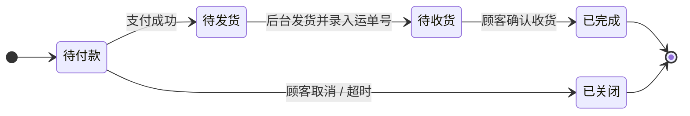

**本版后台唯一驱动的迁移是「待发货 → 待收货」**（录入承运商与运单号，同时扣减库存）。其余迁移由后续版本的顾客端引入，本版只保证状态字段与展示与之兼容。

规则：
1. 仅「待发货」可发货；其他状态点发货给出明确拒绝提示（见 §8.13）。
2. 发货后不可修改收货地址（本版不提供改地址入口）。
3. 发货动作与库存扣减在同一事务内完成，任一 SKU 不足则整单回滚。

## 6.2 售后状态与后台可触发的迁移

| 状态 | 含义 | V1.0 是否出现 | 谁能迁移 |
|---|---|---|---|
| 待审核 | 顾客已提交，等待后台处理 | 有（1 单） | **后台同意/拒绝** |
| 退款中 | 审核通过，退款处理中 | 无（审核通过即同请求内推进） | 后台（模拟退款） |
| 已完成 | 退款成功 | 无 | 后台（模拟退款） |
| 已拒绝 | 审核拒绝 | 无 | 后台 |

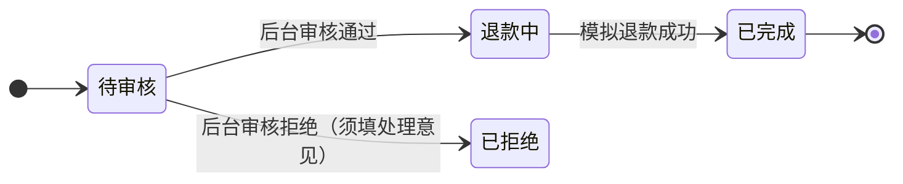

规则：
1. 审核通过才执行退款；本版为**模拟退款**，通过后在同一个请求内推进到「已完成」。
2. 拒绝必须填写处理意见，留空则内联报错。
3. 同一售后单重复审核按状态校验拒绝（非「待审核」不可再审）。

## 6.3 库存流转与不变式

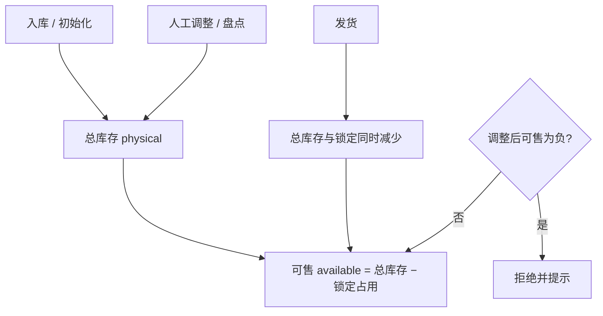

**不变式**：`总库存 ≥ 锁定占用 ≥ 0`；**可售库存 = 总库存 − 锁定占用**（不落库，实时计算）。

本版只能由「库存调整」与「发货出库」改变库存；下单锁库由后续版本的顾客端引入。

## 6.4 商品上架

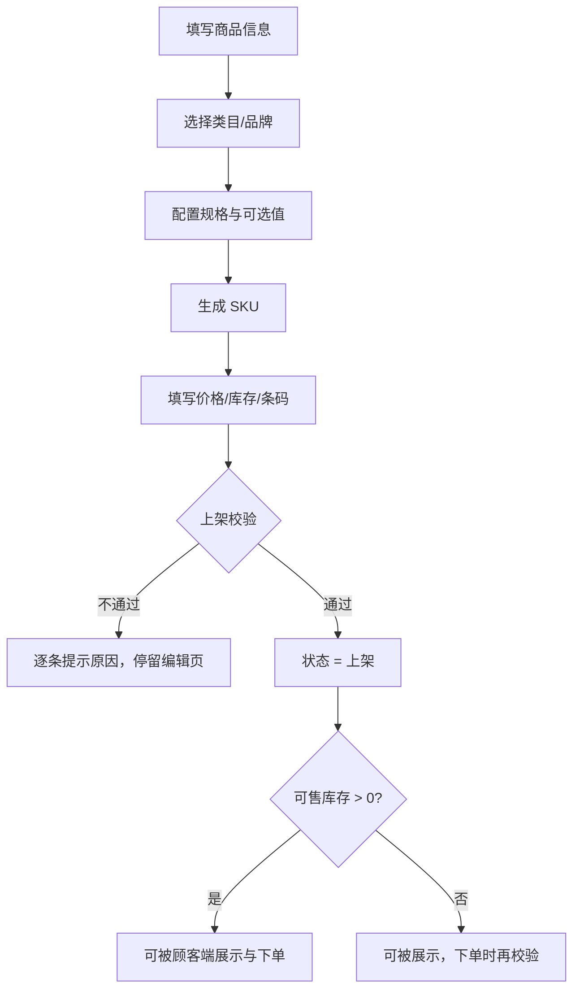

上架校验：已传主图、至少 1 个 SKU 且已填售价（>0）。**库存为 0 允许上架**。

## 6.5 登录与权限

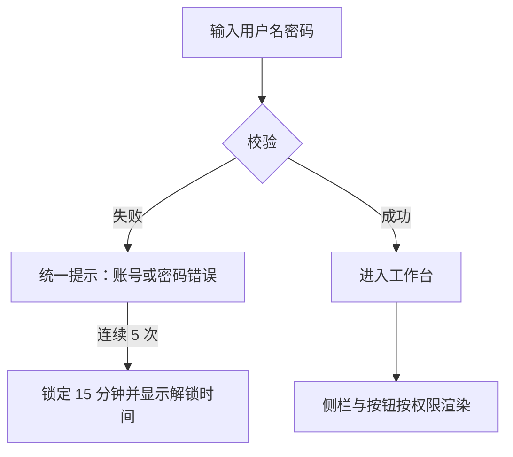

# 7. 功能需求总览

| ID | 模块 | 功能 | 优先级 | 详设 |
|---|---|---|---|---|
| FR-001 | 登录 | 账密登录、失败锁定、登出 | P0 | §8.1 |
| FR-002 | 用户管理 | 用户增删改查、启禁用、重置密码 | P0 | §8.2 |
| FR-003 | 角色管理 | 角色、权限绑定、数据范围 | P0 | §8.3 |
| FR-004 | 菜单与权限 | 权限树维护、侧栏与按钮权限 | P0 | §8.4 |
| FR-005 | 部门管理 | 部门树增删改查 | P0 | §8.5 |
| FR-006 | 字典管理 | 字典类型与项 | P0 | §8.6 |
| FR-007 | 操作日志 | 记录、查询、详情、导出 | P0 | §8.7 |
| FR-008 | 类目管理 | 类目树增删改查 | P0 | §8.8 |
| FR-009 | 品牌管理 | 品牌增删改查、归属类目 | P0 | §8.8 |
| FR-010 | 属性管理 | 属性、规格值维护 | P0 | §8.9 |
| FR-011 | 商品编辑 | SPU + 规格 + SKU 维护 | P0 | §8.10 |
| FR-012 | 商品列表 | 查询、聚合展示 | P0 | §8.11 |
| FR-013 | 上下架 | 上架校验、单个/批量下架、删除草稿 | P0 | §8.11 |
| FR-014 | 文件上传 | 图片上传与引用 | P0 | §8.15 |
| FR-015 | 库存查询/调整 | 三态查询、手动调整 | P0 | §8.12 |
| FR-016 | 库存预警 | 阈值、低库存/关注两档、筛选 | P1 | §8.12 |
| FR-017 | 仓库 | 默认仓种子；无独立管理页 | P2 | §8.12 |
| FR-018 | 订单列表 | 列表、详情 | P0 | §8.13 |
| FR-019 | 订单发货 | 承运商 + 运单号、状态流转 | P0 | §8.13 |
| FR-020 | 售后管理 | 列表、详情 | P0 | §8.14 |
| FR-021 | 售后审核 | 同意/拒绝 | P0 | §8.14 |
| FR-022 | 系统设置 | 配置 KV（分类 Tab、敏感脱敏） | P0 | §8.16 |
| FR-023 | 工作台 | 统计摘要、低库存入口 | P0 | §8.17 |
| FR-024 | 弹窗与提示 | 全站统一的确认/表单/拒绝/提示规范 | P0 | §8.18 |

# 8. 功能与页面详设

每节结构固定：**截图 → 输入规则 → 弹窗与提示 → 交互 → 业务规则**。截图目录 [`shots/`](./shots/)，全部由原型渲染脚本生成（`.stitch/原型/render-shots.mjs`）。

原型：`.stitch/原型/admin/`，本地预览 `http://127.0.0.1:8765`。
**版本纪律**：V1 页面用 `window.__NAV_VERSION__='v1'` 渲染侧栏，因此本节所有截图里**不存在**后续版本的菜单项（会员管理、站点品牌、首页运营位、评价管理、出入库单）。弹窗总览见 [`shots/dialogs.png`](./shots/dialogs.png) 与 §8.18。

## 8.0 全局交互规范

| 场景 | 约定 |
|---|---|
| 表单 | 必填标 `*`；失焦或提交时校验；错误文案在控件下方（内联）；弹窗内校验失败**不关弹窗** |
| 破坏性操作 | 删除 / 禁用 / 下架 / 发货 / 冻结类操作先二次确认，文案含对象名称 |
| 提交 | 按钮 loading 并禁用防重复；成功 / 失败 Toast |
| 列表 | 加载骨架屏；空态给引导（如「去新增」）；默认每页 10 条；分页贴底固定 |
| 数字 | 金额与数量右对齐、等宽数字；时间东八区 |
| 权限 | 无权限不展示入口；直链访问后端拒绝并提示 |
| 库存列 | 同时可读：总库存 / 锁定占用 / 可售 |
| 弹窗遮罩 | 点击遮罩与 ESC 关闭；纯提示类（只有一个「知道了」）也允许遮罩关闭 |
| 拒绝类提示 | 用「知道了」单按钮；不提供「取消」以免误导可重试 |

## 8.1 登录（FR-001）

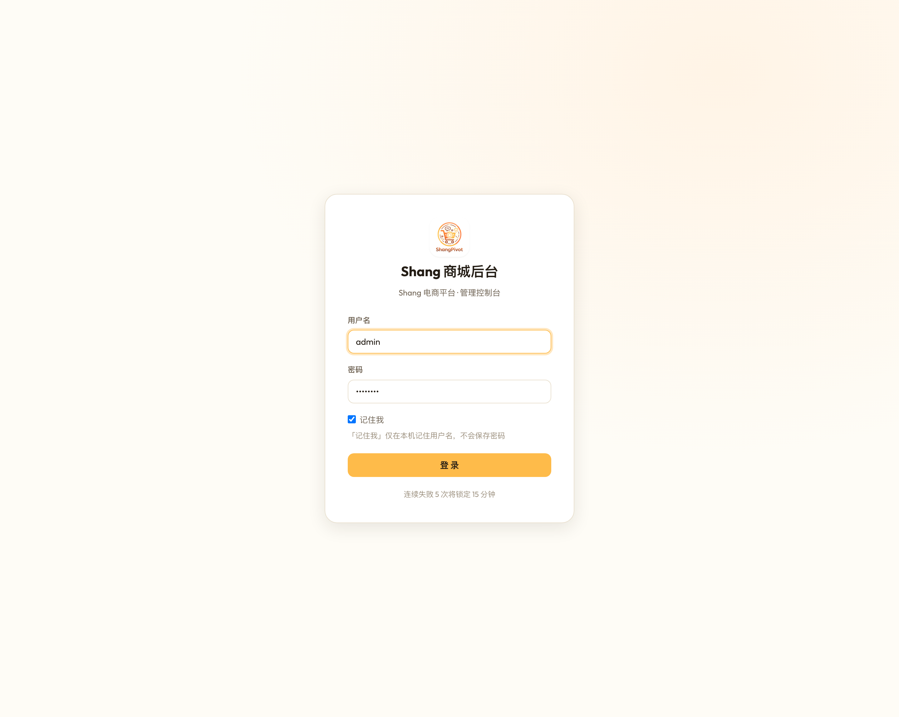

### 输入规则

| 字段 | 必填 | 规则 | 错误提示 |
|---|---|---|---|
| 用户名 | 是 | 4～30 字符，字母开头，仅字母、数字、下划线 | 请输入正确的用户名 |
| 密码 | 是 | 8～20 位，须包含字母和数字 | 密码为 8～20 位字母和数字组合 |
| 记住我 | 否 | 勾选后仅持久化**用户名**（不保存密码、不改变令牌存储策略） | — |

### 弹窗与提示

| 触发 | 类型 | 标题 | 内容要点 | 按钮 |
|---|---|---|---|---|
| 提交后校验失败 | 提示 | 账号或密码错误 | 不区分用户名不存在还是密码错误；统一返回本条提示；失败登录会写操作日志 | 重新输入 |
| 同一账号连续失败第 6 次 | 提示（须含解锁时间） | 账号已锁定 | 「连续第 6 次登录失败，该账号已锁定 15 分钟」，并给出**具体解锁时间**（如「请在 14:32 后重试」）；说明连续失败 5 次将锁定 15 分钟 | 知道了 |
| 使用被禁用账号登录 | 提示 | 账号已禁用 | 该账号已被禁用，无法登录后台；请联系超级管理员在「用户管理」中启用后重试；禁用账号的在线会话立即失效 | 知道了 |

### 交互

- 页头文案：「Shang 商城后台」/「Shang 电商平台 · 管理控制台」。
- 提交时按钮进入加载态，防止重复提交。
- 登录页在视口内居中，无滚动。
- 令牌存于浏览器 localStorage（access + refresh）；登出后 access 加入黑名单失效。
- 令牌失效后跳转登录页；登录成功后回到 `redirect` 原页面或工作台。
- 本版无「忘记密码」自助入口；密码重置由超管在「用户管理」操作。

### 业务规则

1. 同一账号连续失败 5 次，锁定 15 分钟（Redis 计数），登录页提示「连续失败 5 次将锁定 15 分钟」。
2. 被禁用的账号不能登录。

## 8.2 用户管理（FR-002）

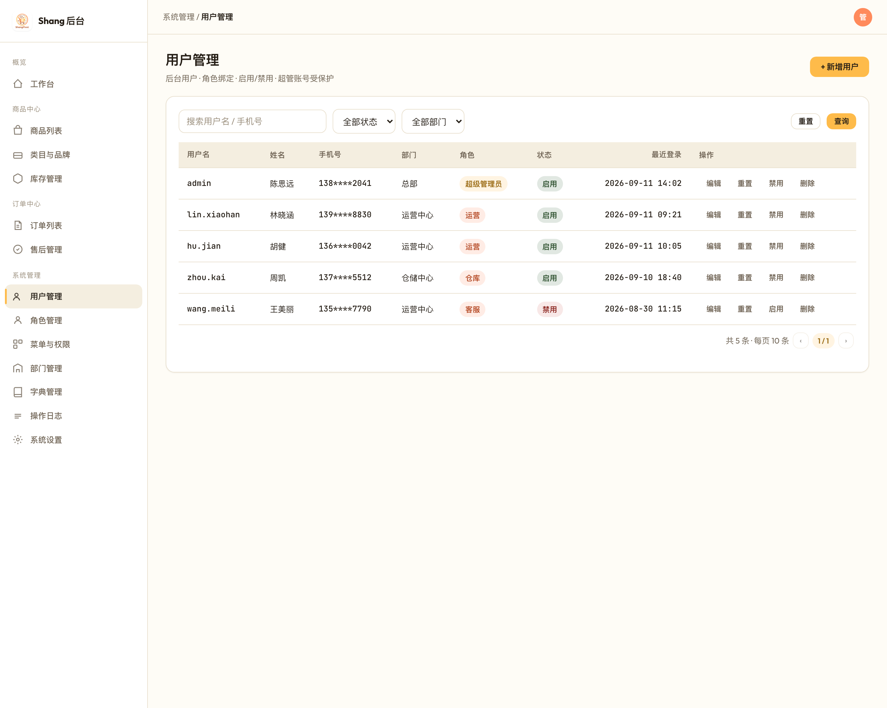

### 输入规则

| 字段 | 必填 | 规则 | 错误提示 |
|---|---|---|---|
| 用户名 | 是 | 4～30 字符，字母开头，仅字母、数字、下划线；全局唯一；创建后不可改 | 用户名已存在 |
| 姓名 | 是 | 1～30 字符 | 请输入姓名 |
| 密码 | 是（新增） | 8～20 位，须包含字母和数字 | 密码为 8～20 位字母和数字组合 |
| 手机号 | 否 | 11 位数字，1 开头；全局唯一 | 手机号格式不正确 / 手机号已存在 |
| 邮箱 | 否 | 邮箱格式 | 邮箱格式不正确 |
| 角色 | 是 | 至少选择一个（多选） | 请选择角色 |
| 状态 | 是 | 启用 / 禁用 | — |

> 列表展示部门列（来自账号关联）；本版新增/编辑表单不强制选部门（部门模块独立维护，后续可补绑定 UI）。

### 弹窗与提示

| 触发 | 类型 | 标题 | 内容要点 | 按钮 |
|---|---|---|---|---|
| 「+ 新增用户」/「编辑」 | 表单 | 新增用户 / 编辑用户 | 上述字段；编辑时用户名只读 | 取消 / 保存 |
| 「重置」 | 输入 | 重置密码 | 标题含对象用户名（如「重置『lin.xiaohan』的密码」）；新密码遵循 8～20 位字母+数字；重置后旧密码立即失效 | 取消 / 确认重置 |
| 「禁用」 | 确认 | 禁用确认 | 禁用后该账号不能登录，已发令牌按鉴权策略失效 | 取消 / 确认禁用 |
| 「启用」 | 确认 | 启用确认 | 启用后该账号可立即登录 | 取消 / 确认启用 |
| 「删除」 | 危险确认 | 删除确认 | 文案含对象名称；删除后不可恢复 | 取消 / 确认删除 |
| 对超管账号点删除 | 拒绝 | 不可删除 | 超级管理员账号不可删除 | 知道了 |
| 对自己点禁用 | 拒绝 | 不能禁用自己 | 不能禁用当前登录账号 | 知道了 |

### 交互

- 关键字（用户名/手机号）+ 状态 + 部门筛选；新增、编辑、重置、禁用、删除、分页 10 条。
- 成功/失败一律 Toast 反馈（如「已创建」「已更新」「密码已重置」「已启用/已禁用」「已删除」）。
- 保存前校验用户名/姓名非空，缺失给内联错误并停留弹窗。

### 业务规则

1. 列表支持按用户名关键字、状态筛选；分页每页 10 条。
2. 禁用用户后不可再登录。
3. 重置密码、禁用、删除操作需二次确认。

## 8.3 角色管理（FR-003）

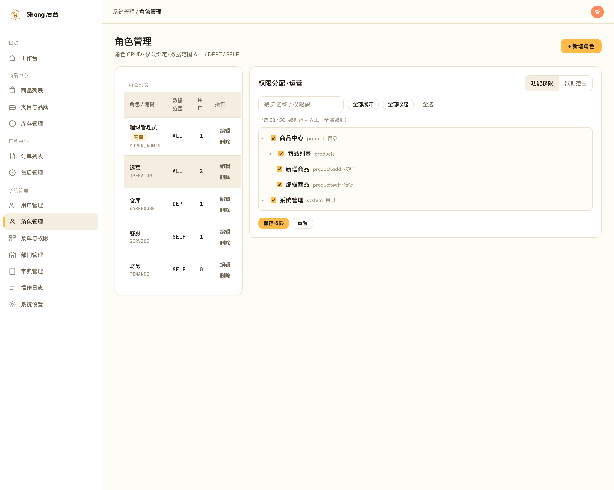

### 输入规则

| 字段 | 必填 | 规则 | 错误提示 |
|---|---|---|---|
| 角色编码 | 是（新增） | 2～30 字符，仅字母、数字、下划线；全局唯一；创建后不可修改 | 角色编码已存在 |
| 角色名称 | 是 | 1～30 字符 | 请输入角色名称 |
| 数据范围 | 是 | `ALL` 全部 / `DEPT` 本部门 / `SELF` 仅本人 | — |

### 弹窗与提示

| 触发 | 类型 | 标题 | 内容要点 | 按钮 |
|---|---|---|---|---|
| 「+ 新建角色」 | 表单 | 新建角色 | 编码/名称/数据范围；保存前校验非空，缺失给内联错误 | 取消 / 创建 |
| 勾选权限树后「保存权限」 | 确认 | 保存权限 | 保存后写回角色；该角色用户重新登录或刷新会话后获得新权限 | 取消 / 确认保存 |
| 「删除」 | 危险确认 | 删除确认 | 文案含角色名（如「确认删除角色『运营』？」） | 取消 / 确认删除 |
| 删除仍有用户使用的角色 | 拒绝 | 不可删除 | 该角色下仍有用户，请先调整用户角色 | 知道了 |
| 删除超级管理员等内置角色 | 拒绝 | 不可删除 | 内置角色不可删除 | 知道了 |

### 交互（权限树）

- 左侧选角色，右侧加载权限树；可切换「功能权限 / 数据范围」。
- 支持关键字筛选、父子勾选联动与半选。
- 勾选父节点自动勾选全部子节点；取消同理。
- 未选角色时点「保存权限」提示「请先选择角色」。

### 业务规则

1. 超级管理员角色不可删除。
2. 删除角色前校验用户引用；有用户使用时拒绝删除。
3. 种子仅预置 `SUPER_ADMIN`；运营/仓库/客服等由超管按需创建。

## 8.4 菜单与权限（FR-004）

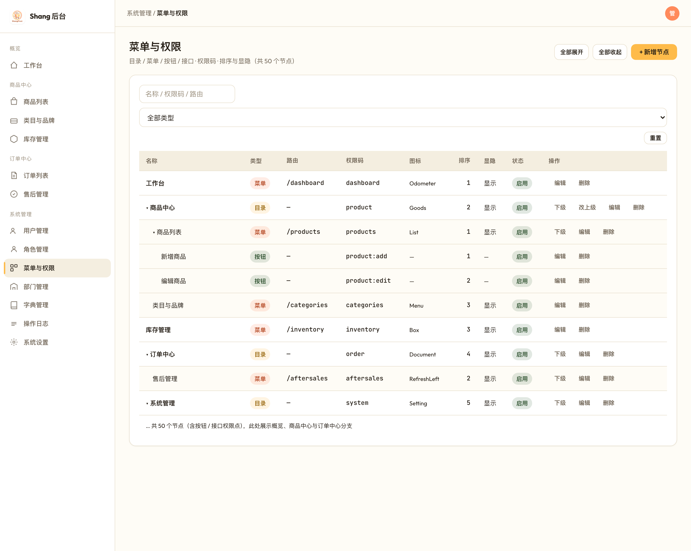

一棵权限树同时维护目录、菜单、按钮（可选接口）节点，驱动侧栏与按钮显隐。

### 输入规则

| 字段 | 必填 | 规则 | 错误提示 |
|---|---|---|---|
| 节点类型 | 是 | 目录 / 菜单 / 按钮 / 接口 | — |
| 名称 | 是 | 1～30 字符 | 请输入名称 |
| 权限码 | 是（按钮/接口） | 2～50 字符，仅字母、数字、冒号、下划线；全局唯一 | 权限码已存在 |
| 上级节点 | 否 | 下拉树单选，不选则为顶级 | 不能选择自己或子孙作为上级 |
| 排序 | 是 | 0～999 整数 | — |
| 可见 | 是 | 是/否；仅目录和菜单生效 | — |
| 图标 | 否 | 从系统图标库下拉选择，不支持手填 | — |

### 弹窗与提示

| 触发 | 类型 | 标题 | 内容要点 | 按钮 |
|---|---|---|---|---|
| 「+ 新增」/「编辑」 | 表单 | 新增节点 / 编辑节点 | 上述字段；类型为目录/菜单时隐藏权限码 | 取消 / 保存 |
| 「删除」 | 危险确认 | 删除确认 | 提示先移除子节点与角色引用；删除后该节点的侧栏入口与按钮权限一并失效 | 取消 / 确认删除 |
| 上级节点选到自己或子孙 | 拒绝 | 不能选择该节点 | 上级节点不能是自己或自己的子孙，否则权限树会成环 | 知道了 |

### 业务规则

1. 侧栏按当前用户的目录+菜单节点（可见且启用）动态生成，按排序值排列。
2. 按钮节点不生成侧栏入口，其权限码控制按钮显隐。
3. 修改权限树后，当前用户侧栏立即刷新；已登录的其他用户下次进入生效。
4. 删除节点前校验子节点与角色引用，有引用则拒绝。

## 8.5 部门管理（FR-005）

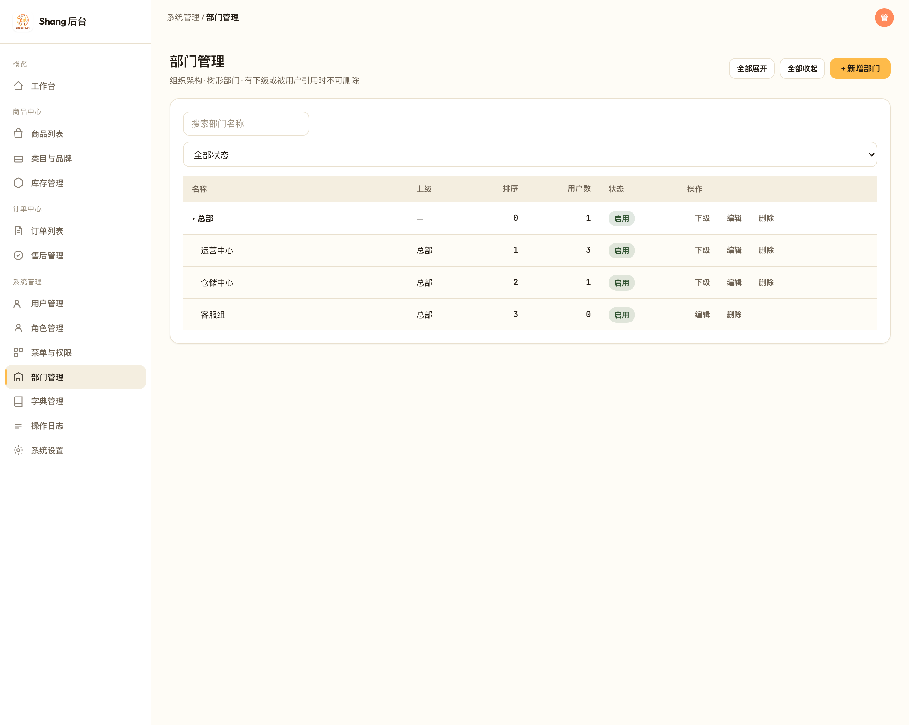

### 输入规则

| 字段 | 必填 | 规则 | 错误提示 |
|---|---|---|---|
| 部门名称 | 是 | 1～30 字符；同级不重名 | 同级已存在同名部门 |
| 上级部门 | 否 | 下拉树；不选则为顶级 | — |
| 排序 | 是 | 0～999 整数 | — |
| 状态 | 是 | 启用/禁用 | — |

### 弹窗与提示

| 触发 | 类型 | 标题 | 内容要点 | 按钮 |
|---|---|---|---|---|
| 「+ 新增」/「编辑」 | 表单 | 新增部门 / 编辑部门 | 上述字段 | 取消 / 保存 |
| 「删除」 | 危险确认 | 删除确认 | 文案含部门名 | 取消 / 确认删除 |
| 删除仍有下级部门的节点 | 拒绝 | 不可删除 | 请先删除或迁移下级部门 | 知道了 |
| 删除被用户引用的节点 | 拒绝 | 不可删除 | 该部门下仍有用户，请先调整用户所属部门 | 知道了 |

### 交互

- 树形展示；新增子节点 / 删除需确认；同级重名在保存时内联报错。

## 8.6 字典管理（FR-006）

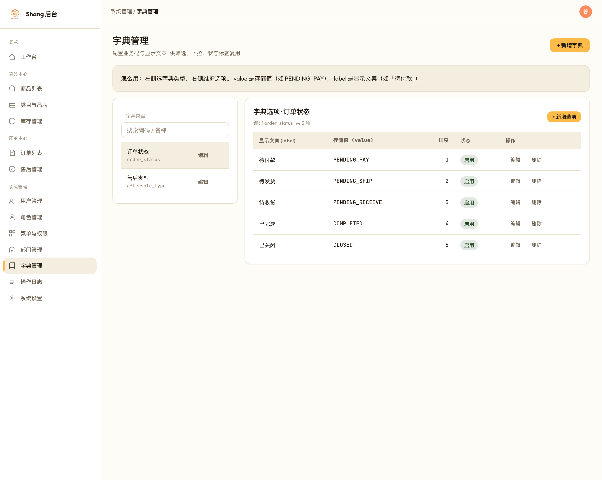

字典维护「业务存储值 → 显示文案」的对照（如订单状态的码值与中文），供各功能页面取选项。

| 对象 | 字段 | 必填 | 规则 |
|---|---|---|---|
| 字典类型 | 类型编码 | 是 | 2～50 字符，仅字母、数字、下划线；全局唯一 |
| 字典类型 | 类型名称 | 是 | 1～30 字符 |
| 字典项 | 显示文案 | 是 | 1～50 字符 |
| 字典项 | 存储值 | 是 | 1～50 字符；同一类型内唯一 |

### 弹窗与提示

| 触发 | 类型 | 标题 | 内容要点 | 按钮 |
|---|---|---|---|---|
| 「+ 新增类型」/「编辑」 | 表单 | 新增字典类型 / 编辑字典类型 | 类型编码、类型名称 | 取消 / 保存 |
| 「+ 新增项」/「编辑」 | 表单 | 新增字典项 / 编辑字典项 | 显示文案、存储值；同类型内存储值唯一 | 取消 / 保存 |
| 「删除」字典项 | 危险确认 | 删除确认 | 文案含字典项名称；删除后引用该值的页面选项同步消失 | 取消 / 确认删除 |

### 交互

- 左侧字典类型列表，右侧当前类型的字典项（主从联动）。类型或项变更后，引用该字典的页面选项同步更新。

## 8.7 操作日志（FR-007）

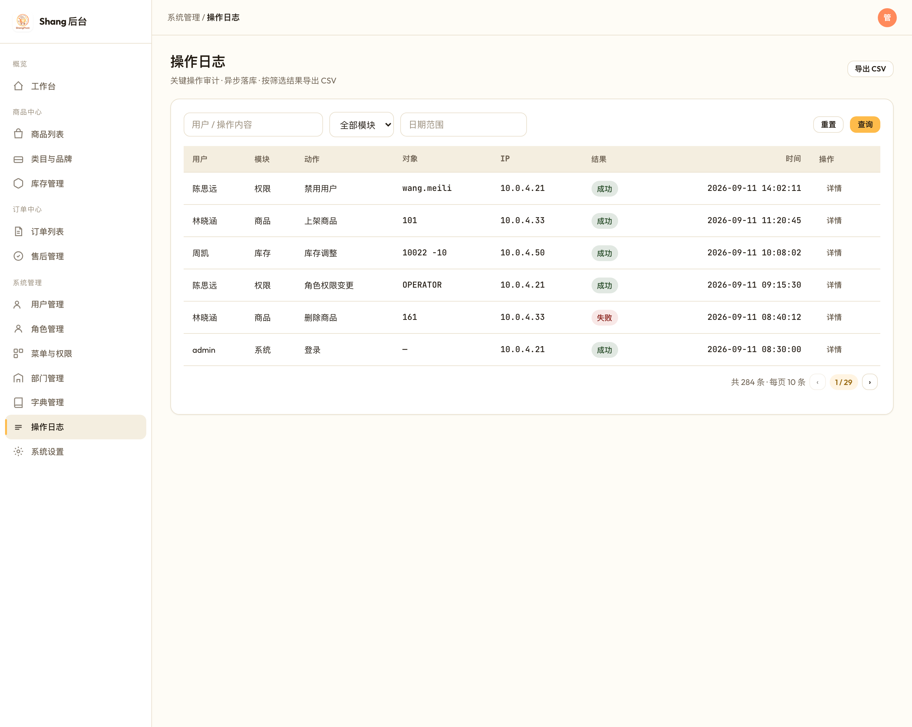

### 记录范围

以下操作必须留痕：登录/登出，用户/角色/菜单/部门/字典变更，商品/库存/订单/售后/系统设置的关键写操作。

### 记录内容

操作人、操作时间、模块、动作、对象、参数摘要、结果（成功/失败）、来源 IP、TraceId。

### 弹窗与提示

| 触发 | 类型 | 标题 | 内容要点 | 按钮 |
|---|---|---|---|---|
| 「详情」 | 弹窗 | 日志详情 | 完整参数（可折叠 JSON 视图）、结果、来源 IP、TraceId；敏感参数以掩码显示 | 关闭 |
| 「导出」 | 确认 | 导出确认 | 导出**当前筛选结果**为 CSV；导出动作本身也写日志 | 取消 / 开始导出 |

### 业务规则

1. 日志不可修改、不可删除。
2. 支持按操作人、模块、日期范围筛选；分页每页 10 条。
3. 敏感参数（密码、密钥）不记录原文，以掩码显示。
4. 日志写入不阻塞业务操作。

## 8.8 类目与品牌（FR-008、FR-009）

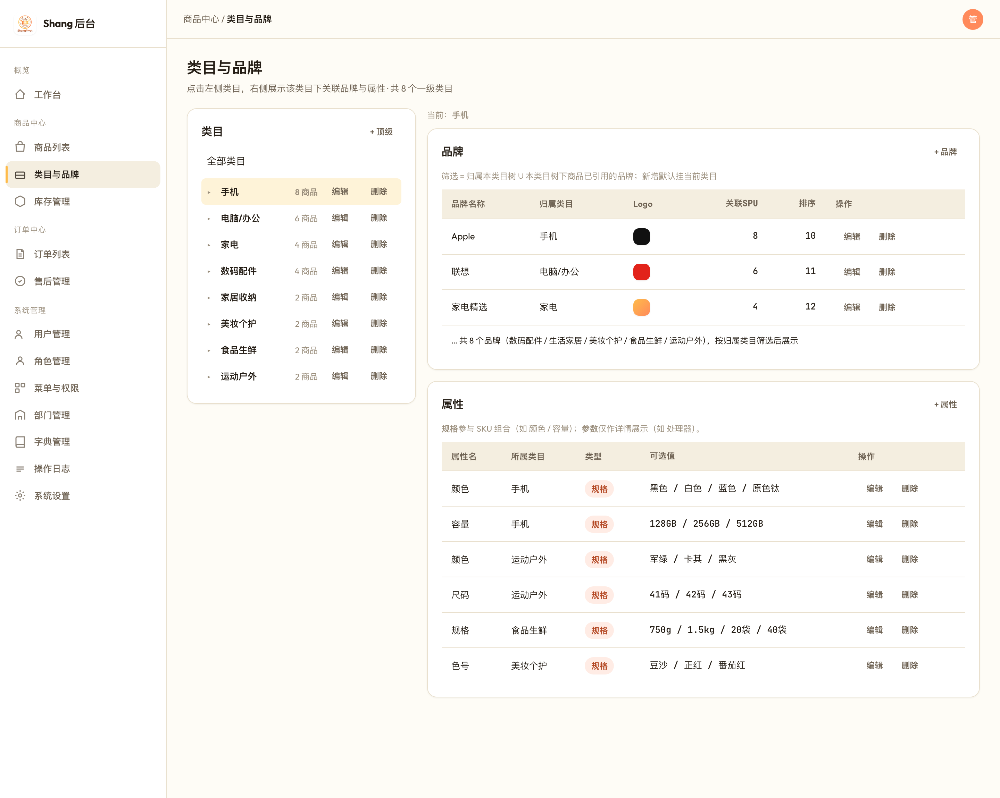

一个合并页面：左侧类目树，右侧上部品牌、下部属性。点击左侧类目（含「全部类目」）联动刷新右侧。

### 类目

| 字段 | 必填 | 规则 | 错误提示 |
|---|---|---|---|
| 类目名称 | 是 | 1～30 字符；同级不重名 | 同级已存在同名类目 |
| 上级类目 | 否 | 下拉树；不选则为顶级 | — |
| 排序 | 是 | 0～999 整数 | — |
| 状态 | 是 | 启用/禁用 | — |

### 品牌

| 字段 | 必填 | 规则 | 错误提示 |
|---|---|---|---|
| 品牌名称 | 是 | 1～30 字符；同一类目下不重名 | 该类目下已存在同名品牌 |
| 归属类目 | 是 | 默认为当前选中类目 | 请选择类目 |
| 品牌 Logo | 否 | 1 张；jpeg/png/webp；≤10MB；建议 256×256 | 图片格式或大小不符合要求 |

### 弹窗与提示

| 触发 | 类型 | 标题 | 内容要点 | 按钮 |
|---|---|---|---|---|
| 类目「+ 新增」/「编辑」 | 表单 | 新增类目 / 编辑类目 | 名称/上级类目/排序/状态 | 取消 / 保存 |
| 类目「删除」 | 危险确认 | 删除确认 | 文案含类目名 | 取消 / 确认删除 |
| 删除被商品或属性引用的类目 | 拒绝 | 不可删除 | 该类目下仍有商品或属性，请先处理引用 | 知道了 |
| 品牌「+ 新增」/「编辑」 | 表单 | 新增品牌 / 编辑品牌 | 名称/归属类目/Logo；未选类目时内联提示「请选择类目」 | 取消 / 保存 |
| 属性「+ 新增」/「编辑」 | 表单 | 新增属性 / 编辑属性 | 所属类目/名称/类型/可选值；未选类目时内联提示「请先选择类目」 | 取消 / 保存 |

### 业务规则

1. 支持多级类目，建议不超过 3 级；被商品或属性引用的类目不可删除，提示先处理引用。
2. 品牌列表显示关联商品数；侧栏无独立品牌入口，旧品牌路由跳转到本页。

## 8.9 属性管理（FR-010）

> 属性在「类目与品牌」页右侧维护，无独立侧栏页；截图见 §8.8。

| 字段 | 必填 | 规则 | 错误提示 |
|---|---|---|---|
| 所属类目 | 是 | 新增属性须先选中类目 | 请先选择类目 |
| 属性名称 | 是 | 1～30 字符；同一类目下不重名 | 该类目下已存在同名属性 |
| 属性类型 | 是 | 规格（参与 SKU 生成）/ 参数（仅展示） | — |
| 可选值 | 否 | 以「/」分隔；每项 1～20 字符；不可重复 | 可选值不可重复 |

## 8.10 商品新增 / 编辑（FR-011）

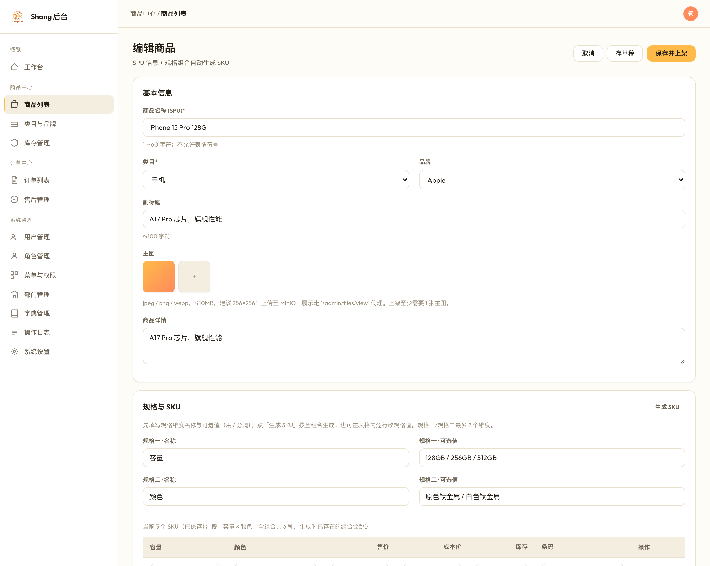

新增与编辑同一页面。保存后为草稿，上架见 §8.11。

### 商品（SPU）输入规则

| 字段 | 必填 | 规则 | 错误提示 |
|---|---|---|---|
| 商品名称 | 是 | 1～60 字符；可含中文、字母、数字、常用符号；不允许表情符号 | 请输入商品名称（60 字以内） |
| 副标题 | 否 | ≤100 字符 | 副标题不超过 100 字 |
| 所属类目 | 是 | 树形下拉单选 | 请选择类目 |
| 品牌 | 否 | 下拉单选（可选） | — |
| 主图 | 上架时是 | 1 张；jpeg/png/webp；≤10MB；经 MinIO 上传组件 | 上架需要至少一张主图 |
| 商品详情 | 否 | 文本/HTML（多行输入） | — |

> 本版编辑页为单主图上传，不做多图排序与视频。

### 规格与 SKU

| 项 | 规则 |
|---|---|
| 规格维度 | 最多 2 个（规格一 / 规格二）；可选值用 `/` 分隔 |
| 生成 SKU | 点「生成 SKU」按维度值**全组合**生成；已存在的组合跳过（保留其价格/库存） |
| 单规格 | 规格二留空时按单规格 SKU 处理 |

SKU 行内字段（表格中直接编辑）：

| 字段 | 必填 | 规则 | 错误提示 |
|---|---|---|---|
| 规格值 | 是 | 1～20 字符 | 请填写规格值 |
| 售价 | 是 | 金额，最多两位小数 | 售价格式不正确 |
| 成本价 | 否 | 同售价格式 | 成本价格式不正确 |
| 库存 | 是 | ≥0 整数 | 请填写库存 |
| 条码 | 否 | 字母或数字 | — |

### 弹窗与提示

| 触发 | 类型 | 标题 | 内容要点 | 按钮 |
|---|---|---|---|---|
| 「保存并上架」且校验不通过 | 提示（逐条） | 无法上架 | 逐条列出原因：至少一张主图 / 至少一个已填售价的 SKU；停留本页，已填内容不丢失 | 去补充 |
| 「生成 SKU」 | 确认（带预览） | 生成 SKU | 预览全部组合；标注哪些已存在（跳过，显示现有价格/库存）、哪些为新增待填 | 取消 / 确认生成 |
| SKU 行「删」 | 危险确认 | 删除 SKU | 文案含规格组合（如「128GB / 原色钛金属」）；保存后该 SKU 及其库存记录一并删除，不可恢复 | 取消 / 确认删除 |
| 「存草稿」 | 确认 | 存为草稿 | 保存后状态为草稿，顾客端不可见，可继续编辑或上架 | 取消 / 确认保存 |
| 选择非法/超大主图 | 提示 | 图片不符合要求 | 仅支持 jpeg/png/webp，单张不超过 10MB；上传失败可重试，不影响已填表单 | 重新选择 |

### 交互

- 「存草稿」保存为草稿；「保存并上架」执行上架校验，不通过停留本页并提示。
- 规格值在表格内逐行编辑。
- 上传组件：选文件后校验类型（JPG/PNG/WEBP），不合格直接提示；上传中显示进度并禁止重复选择；失败可重试；支持预览与清除。
- 上架成功后 Toast「已保存并立即上架」；存草稿成功 Toast「草稿已保存」。

## 8.11 商品列表与上下架（FR-012、FR-013）

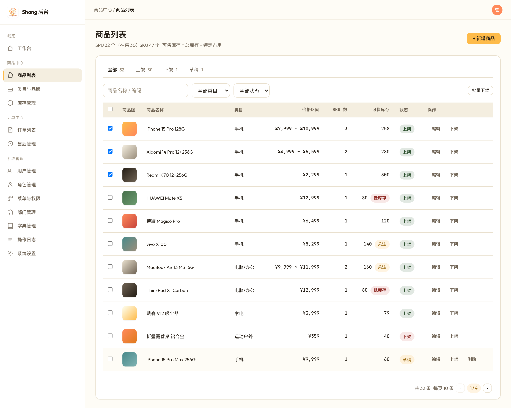

### 列表

| 项 | 规则 |
|---|---|
| Tab | 全部 / 上架 / 下架 / 草稿（带条数） |
| 筛选 | 关键字（名称/编码）、类目、状态（草稿/上架/下架） |
| 展示列 | 商品图、商品名称、类目、价格区间（如 ¥599 或 ¥7,999～¥10,999）、SKU 数、可售库存、状态、操作 |
| 分页 | 每页 10 条，贴底固定，显示「共 N 条 · 每页 10 条 · 当前页/总页」 |
| 操作 | 新增、编辑、上架、下架、删除（**仅草稿行显示删除**） |
| 预警标识 | 可售 ≤ 阈值显示「低库存」；阈值 < 可售 ≤ 阈值×1.5 显示「关注」 |

### 弹窗与提示

| 触发 | 类型 | 标题 | 内容要点 | 按钮 |
|---|---|---|---|---|
| 「上架」且校验不通过 | 提示（逐条） | 无法上架 | 逐条提示原因（缺主图 / 无已填售价的 SKU）；商品保持原状态 | 知道了 |
| 「下架」 | 危险确认 | 下架确认 | 文案含商品名；下架后顾客端不可见、不可下单 | 取消 / 确认下架 |
| 勾选后「批量下架」 | 危险确认 | 批量下架 | 文案含勾选数量（如「确认下架已勾选的 3 个商品？」）；未勾选时提示「请先勾选商品」 | 取消 / 确认下架（N） |
| 草稿行「删除」 | 危险确认 | 删除草稿 | 文案含商品名并注明不可恢复 | 取消 / 确认删除 |
| 对非草稿删除 | 拒绝 | 仅草稿可删除 | 删除按钮只在草稿行显示；接口层对非草稿返回 409「仅草稿可删」 | 知道了 |

### 上下架规则

1. 单个或勾选批量操作；批量下架需确认，且只处理当前为「上架」的行。
2. 上架校验不通过逐条提示原因。
3. 上架后商品可被顾客端展示；下架后不可见。
4. 删除仅限草稿；删除时级联删除该 SPU 下的 SKU 与库存记录。

## 8.12 库存管理（FR-015～FR-017）

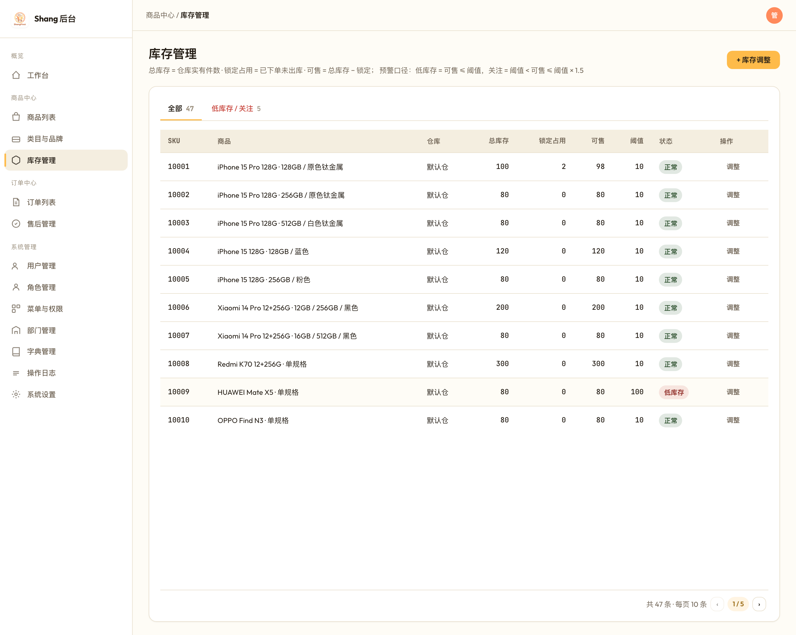

### 库存查询

| 项 | 规则 |
|---|---|
| Tab | 全部 / 低库存 / 关注（带条数；预警档 = 可售 ≤ 阈值 × 1.5） |
| 展示列 | SKU、商品、仓库、总库存、锁定占用、可售、阈值、状态 |
| 释义 | 总库存 = 实物数量；锁定占用 = 已下单未出库；可售 = 总库存 − 锁定占用 |
| 状态口径 | **低库存**：可售 ≤ 阈值；**关注**：阈值 < 可售 ≤ 阈值×1.5；其余为正常 |
| 分页 | 每页 10 条 |

### 库存调整

| 字段 | 必填 | 规则 | 错误提示 |
|---|---|---|---|
| 数量变化 | 是 | 整数，可正可负（界面按「增加 / 减少」录入） | 请输入调整数量 |
| 仓库 | 是 | 默认使用种子「默认仓」 | — |
| 原因 | 是 | 本版固定为「后台手工调整」 | — |

> 实现：单个表单弹窗，含只读库存摘要与增减录入，调整前预演可售；破坏不变式时弹「无法调整」并拒绝（§10.A FIX-V1-04）。

### 弹窗与提示

| 触发 | 类型 | 标题 | 内容要点 | 按钮 |
|---|---|---|---|---|
| 「调整」 | 表单 | 库存调整 | 展示当前总库存/锁定/可售；录入增减数量、仓库、原因；数量为空或 0 给内联错误 | 取消 / 确认调整 |
| 调整后可售为负 | 拒绝 | 无法调整 | 调整后总库存会小于锁定占用（可售为负），已拒绝；请先处理占用或改为调增 | 知道了 |

### 预警与仓库

1. 阈值按 SKU × 仓库维护；低于阈值的记录在「低库存」Tab 列出，并给出「关注」次档。
2. 仓库：后端 API 已具备；**无独立仓库管理页**。种子创建「默认仓」。
3. 出入库单据：本版不做，用「库存调整」覆盖补货（目标版本 V2.0）。

## 8.13 订单列表（FR-018、FR-019）

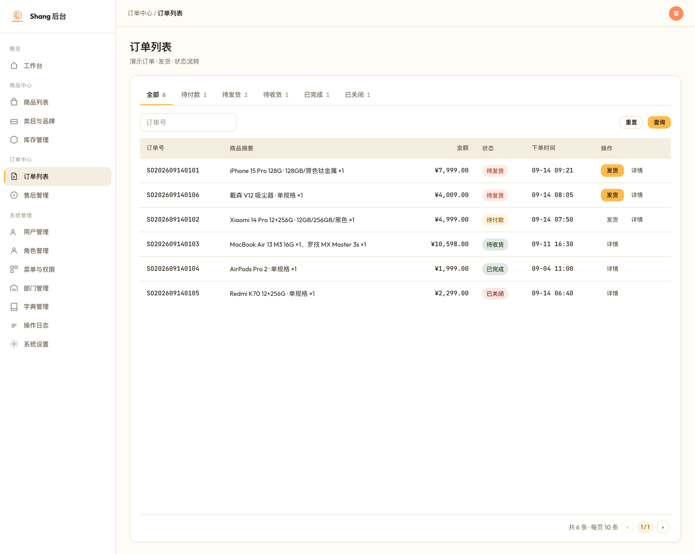

订单数据由演示种子产生；本版用演示订单验证管理功能（订单来源见 §2.4）。

### 列表

| 项 | 规则 |
|---|---|
| Tab | 全部 / 待付款 / 待发货 / 待收货 / 已完成 / 已关闭（带条数） |
| 筛选 | 订单号 |
| 展示列 | 订单号、商品摘要、金额、状态、下单时间、操作 |
| 操作 | 详情、发货（仅待发货行显示） |
| 分页 | 每页 10 条 |

### 详情（抽屉）

订单号、下单时间、收货人（手机号脱敏）、收货地址、备注、商品项（商品/规格/单价/数量/小计）、金额（商品金额/运费/实付）、状态时间线；底部可折叠「原始数据（JSON 调试视图）」。抽屉底部提供「发货」快捷入口。

> 实现：右侧抽屉（`DetailDrawer`），含状态时间线与可折叠 JSON 调试视图（§10.A FIX-V1-03）。

### 发货

| 字段 | 必填 | 规则 | 错误提示 |
|---|---|---|---|
| 承运商 | 否 | 下拉选择，默认「模拟快递」 | — |
| 运单号 | 是 | 非空 | 请录入运单号（内联） |

### 弹窗与提示

| 触发 | 类型 | 标题 | 内容要点 | 按钮 |
|---|---|---|---|---|
| 「详情」 | 抽屉 | 订单详情 | 见上；含状态时间线，未达节点标记「待操作」 | 关闭 / 发货 |
| 「发货」 | 表单 | 订单发货 | 摘要行含订单号/商品/数量/金额；承运商 + 运单号；说明「发货后订单进入待收货，并按订单明细扣减库存（总库存与锁定同时减少），操作不可撤销」 | 取消 / 确认发货 |
| 运单号留空提交 | 内联错误 | — | 运单号下方红字「请录入运单号」，**不关弹窗** | — |
| 对非「待发货」点发货 | 拒绝 | 当前状态不可发货 | 展示当前状态与原因；说明仅待发货可发货、待付款订单需顾客完成支付 | 知道了 |

### 规则

1. 仅待发货可发货（权限码 `order:ship`）。
2. 发货后订单变待收货，并在同一事务内扣减库存；任一 SKU 不足则整单回滚。
3. 发货后不可修改收货地址；本版不提供备注/改地址入口（目标版本 V2.0）。

## 8.14 售后管理（FR-020、FR-021）

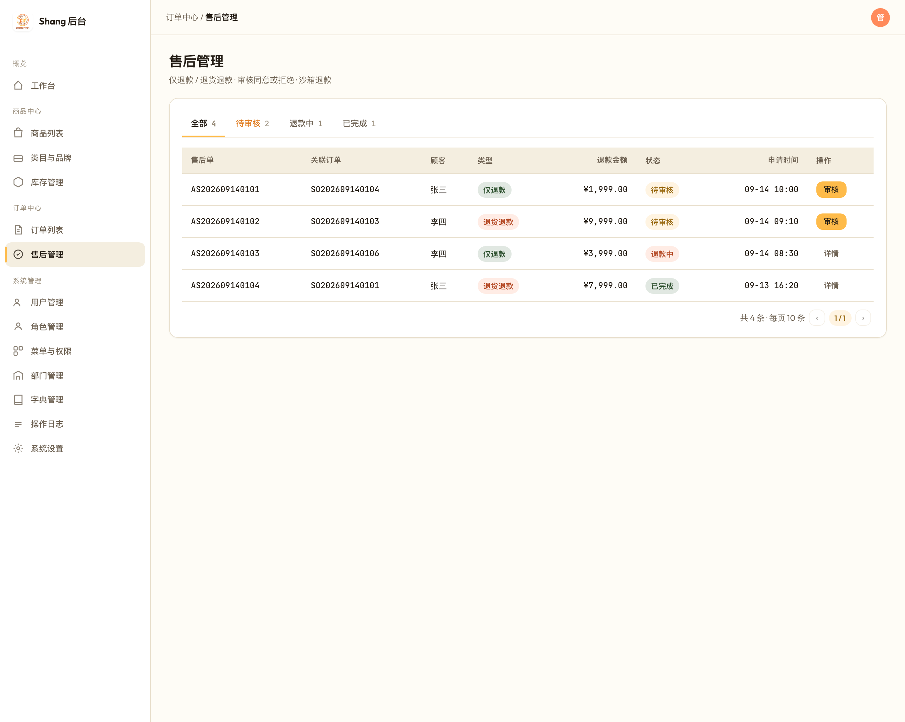

售后数据由演示种子产生（1 条待审核的仅退款单）。

### 列表

Tab：全部 / 待审核 / 退款中 / 已完成 / 已拒绝；展示列：售后单号、关联订单号、会员、类型（仅退款 / 退货退款）、退款金额、状态、操作。

### 详情（抽屉）

售后单号、类型、原因、关联订单、退款金额、处理意见、进度时间线。

> 实现：右侧抽屉（`DetailDrawer`），含进度时间线与审核页脚操作（§10.A FIX-V1-03）。

### 审核

| 操作 | 权限码 | 结果 |
|---|---|---|
| 同意 | `aftersale:audit` | 进入退款流程（本版为模拟退款，通过后同请求内推进到已完成） |
| 拒绝 | `aftersale:audit` | 填写处理意见后变为已拒绝 |

### 弹窗与提示

| 触发 | 类型 | 标题 | 内容要点 | 按钮 |
|---|---|---|---|---|
| 「详情」 | 抽屉 | 售后详情 | 见上 | 关闭 |
| 「同意」 | 确认 | 同意售后 | 摘要行含售后单号/类型/金额/会员；说明将进入退款流程，通过后按退款金额处理 | 取消 / 确认同意 |
| 「拒绝」 | 表单 | 拒绝售后 | 处理意见**必填**，留空给内联错误；拒绝后顾客可查看拒绝原因 | 取消 / 确认拒绝 |
| 对非「待审核」重复审核 | 拒绝 | 当前状态不可审核 | 仅待审核的售后单可审核 | 知道了 |

### 规则

1. 审核通过才执行退款（模拟退款）；退款成功才完成。
2. 顾客修改申诉流程依赖顾客端，不在本版范围（目标版本 V2.0）。

## 8.15 文件上传（FR-014）

> 嵌入商品编辑、品牌 Logo 等页的上传组件，无独立管理页。

1. 支持格式：图片 jpeg/png/webp（组件默认）。
2. 单张 ≤10MB；建议商品主图与品牌 Logo 使用 256×256。
3. 上传后业务字段保存 objectKey；展示经 `/admin/files/view` 代理，列表与编辑页可预览。
4. 选择文件后先本地校验类型与体积，不合格立即提示且不发请求。
5. 多图排序、视频、私有凭证：本版未做完整 UI（后续增强）。

## 8.16 系统设置（FR-022）

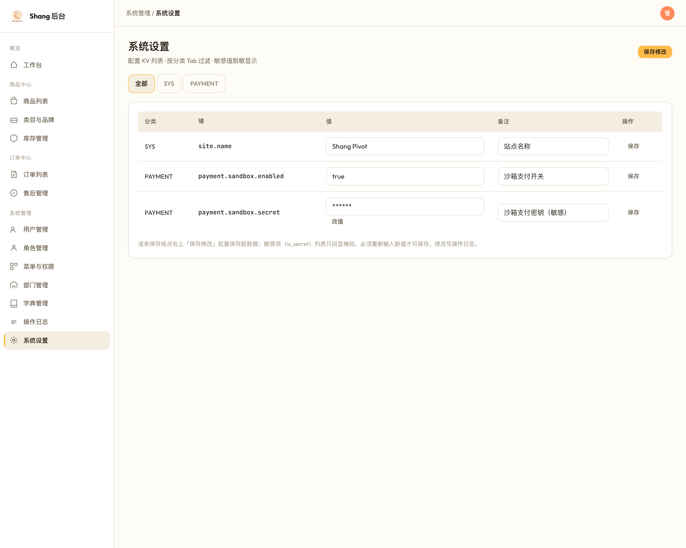

页面标题与侧栏菜单同名「系统设置」。以 **配置 KV 列表**呈现，按 `category` 分 Tab（含「全部」），非分组表单。

| 已种子配置 | category | 说明 |
|---|---|---|
| `site.name` | SYS | 默认 `Shang Pivot` |
| `payment.sandbox.enabled` | PAYMENT | 沙箱支付开关，默认 `true` |
| `payment.sandbox.secret` | PAYMENT | 敏感项示例；列表只回显掩码 `******` |

### 弹窗与提示

| 触发 | 类型 | 标题 | 内容要点 | 按钮 |
|---|---|---|---|---|
| 行内「保存」 | 确认 | 保存确认 | 保存该键新值；修改写操作日志 | 取消 / 确认保存 |
| 「保存修改」（批量） | 确认 | 保存修改 | 列出有改动的键名清单；说明保存后立即生效并写日志 | 取消 / 确认保存 |
| 敏感项「改值」 | 输入 | 修改敏感配置 | 新值必填；保存后列表仍显示掩码，原文不落日志 | 取消 / 保存 |
| 敏感项未输入新值就保存 | 拒绝 | 无法保存 | 敏感配置请输入新值后再保存；掩码不是真实值，直接提交会把密钥覆盖成掩码 | 知道了 |

### 规则

1. 逐条或批量保存脏数据；敏感项（`is_secret`）掩码显示，需输入新值再保存。
2. 修改写操作日志。
3. 本版只维护上表配置键；其他键由后续版本按需追加。

## 8.17 工作台（FR-023）

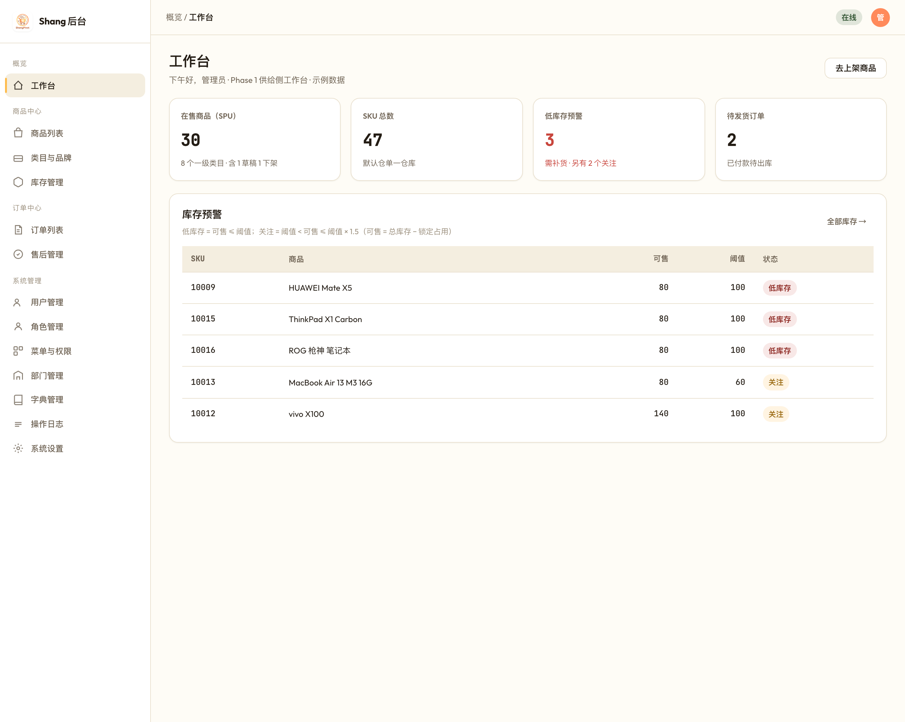

1. 副标题：「Phase 1 供给侧工作台」。
2. 统计卡（均可点击进入对应列表）：在售商品（SPU）、SKU 总数、低库存预警、待发货订单。
3. 低库存表：列出低库存与关注两档 SKU（SKU、商品、可售、阈值、状态）。
4. 右上「去上架商品」跳转商品编辑。

### 交互

- 统计卡进入对应列表（商品列表 / 库存管理 / 订单列表）；无权限模块不出现在侧栏。
- 数字口径与 §2.4 演示种子一致：在售 SPU 30 · SKU 总数 47 · 低库存预警 3 · 待发货订单 2。

## 8.18 弹窗与提示规范（FR-024）

全套弹窗一次性归档在 **弹窗与交互图鉴**：[`shots/dialogs.png`](./shots/dialogs.png)（原型 `.stitch/原型/admin/dialogs.html`）。共 53 个样例（50 弹窗 + 3 抽屉），按模块分组，每条标注「怎么触发」。

### 五类弹窗与对应关系

| 类型 | 用途 | 头部图标 | 按钮 | Element Plus 对应 |
|---|---|---|---|---|
| 确认 | 可逆但需确认的操作（启用、保存、批量下架） | 中性 `info` | 取消 + 主按钮 | `ElMessageBox.confirm` |
| 危险确认 | 删除、下架、冻结等破坏性操作 | `danger` / `warn` | 取消 + `btn-danger` | `ElMessageBox.confirm`（danger 型） |
| 表单 | 新增/编辑实体、发货、库存调整、审核拒绝 | 中性 `info` | 取消 + 保存 | `ElDialog` |
| 输入 | 重置密码、修改敏感值 | `warn` | 取消 + 保存 | `ElMessageBox.prompt` |
| 拒绝/提示 | 状态不允许、引用冲突、校验未通过 | `warn` | 仅「知道了」 | `NoticeDialog`（组件） |
| 抽屉 | 订单/售后/日志详情 | — | 关闭（+ 快捷动作） | `ElDrawer` |

### 通用校验与反馈

| 场景 | 处理 |
|---|---|
| 表单字段不合法 | **内联**红字提示在控件下方，弹窗不关闭 |
| 跨字段/业务校验失败（如上架缺主图） | 弹窗内**逐条列出**原因，便于一次性修正 |
| 操作成功 | Toast（如「已创建」「已保存并立即上架」「已确认发货」） |
| 操作失败 | Toast 显示后端原因；不改变页面已有状态 |
| 重复提交 | 按钮进入 loading 并禁用 |
| 权限不足 | 入口不渲染；直链接口返回 403，前端提示「无权限」 |

# 9. 非功能需求

## 9.1 性能

- 列表页加载 ≤1 秒（常规网络）。
- 支持多管理员同时操作，数据不串。

## 9.2 安全

- 密码加密存储（BCrypt），不显示原文。
- 登录失败锁定（§8.1）。
- 敏感配置（密钥、Secret）脱敏展示，不回显原文。
- 错误提示不泄露内部实现信息。
- 操作日志不落明文密码与密钥。

## 9.3 兼容

- Chrome、Edge、Safari 最近两个大版本。

# 10.A 原型 ↔ 实现一致性台账（V1.0）

> **读法**：本版经历了一轮「原型改、实现跟」的对齐。本节把**曾经存在过的差距**逐条留档，标注现在的落地方式与证据，便于回归时核对。
> 状态口径：`已落地` = 代码可复现且与原型/图鉴一致。

## 10.A.1 已落地的对齐项

| 编号 | 项 | 原型/本文定义 | 本轮落地方式 |
|---|---|---|---|
| FIX-V1-01 | 低库存 Tab 分页过滤错位 | 低库存 Tab 应列出全部低库存记录，`total` 为真实条数 | 过滤从「分页后页内」下推到 SQL（`physical_stock - locked_stock <= low_threshold`），新增 `warnOnly` 覆盖「低库存 + 关注」预警档，排序按缺口升序（越缺越靠前） |
| FIX-V1-02 | 预警档位口径不一致 | 三档：低库存（可售 ≤ 阈值）/ 关注（阈值 < 可售 ≤ 阈值 × 1.5）/ 正常 | 抽出唯一实现 `shang-admin-web/src/utils/stock.ts`，工作台与库存管理共用 `stockTier()` / `stockTierTone()`；工作台原先把阈值以上全标「关注」的问题一并修掉 |
| FIX-V1-03 | 详情形态 | §8.7 / §8.13 / §8.14 规定订单、售后、日志详情用**右侧抽屉** | 新增 `components/DetailDrawer.vue`，三处详情统一改为抽屉（订单详情含状态时间线与可折叠 JSON，售后详情含进度时间线，日志详情含可折叠 `JsonViewer`） |
| FIX-V1-04 | 库存调整录入 | §8.12 规定「数量变化 + 仓库 + 原因」的表单弹窗 | 用 `components/FormDialog.vue` 实现：只读摘要（总库存 / 锁定 / 可售）+ 增减录入 + 仓库 + 固定原因，实时预演「调整后可售」，为负时给 `alert-warn` 并拒绝 |
| FIX-V1-05 | 拒绝类弹窗 | §8.18 规定拒绝类用「知道了」单按钮，文案含对象与原因 | 新增 `components/NoticeDialog.vue`，落地：超管不可删除、不能禁用自己、角色被引用、内置角色不可删除、上级节点不能选自己或子孙、部门被引用、部门有下级、类目被引用、品牌/属性被引用、仅草稿可删、非待发货不可发货、调整破坏不变式 |
| FIX-V1-06 | 商品列表筛选形态 | §8.11 规定状态用 **Tab**（全部 / 上架 / 下架 / 草稿，带条数） | 状态下拉框改为 Tab，条数由后端 `total` 逐状态取回，不写死 |
| FIX-V1-07 | 字段级校验 | §8.18 规定字段错误**内联**在控件下方且弹窗不关闭 | 全站表单弹窗改为 `.error-text` 内联；跨字段业务校验在弹窗内**逐条列出**（上架校验、交易设置校验） |
| FIX-V1-08 | 命令式弹窗与英文按钮 | 全站弹窗须为统一形态、按钮为中文 | 命令式调用（`ElMessageBox.prompt/alert/confirm`）在后台全量清零，改由三个共享组件承载；补配 Element Plus `zh-cn` locale（此前按钮显示成 `Cancel`） |
| FIX-V1-09 | 遗留演示目录实体 | 类目树 / 品牌表 / 商品列表应与原型一致 | `V19` 清除 `V1__init` 遗留的「数码电器 / 手机通讯 / 家居生活」类目、「示例品牌」、演示 SPU「示例智能手机 X1」及其 SKU/库存/流水，使一级类目回到 8 个、品牌 8 个、SPU 32 个 |
| FIX-V1-10 | 原型自身缺口（品牌/属性删除） | PRD FR-009「品牌增删改查」、FR-010「属性维护」 | 原型原先只有「编辑」按钮 —— 属原型缺口而非实现缺口。已给原型补上 `编辑 + 删除` 与 `dlg-brand-del` / `dlg-attr-del` 两个确认弹窗，实现同步恢复删除能力 |

| FIX-V1-11 | 登录页忘记密码（幽灵入口） | PRD §8.1 明确「本版无忘记密码自助入口」 | 原型 `login.html` 残留一个 `忘记密码？` 死链，重渲截图后带进了 PRD 图。已从原型移除并重渲；实现侧本就没有该入口 |
| FIX-V1-12 | 用户管理关键字范围 | §8.2 规定关键字匹配**用户名 / 手机号** | 前端只把关键字映射到 `username`，后端把两者当独立 AND 条件。已改为前端关键字同时传 `username`+`phone`，后端用 OR 分组，单框可搜手机号 |

## 10.A.2 共享地基（新增，供后续页面复用）

| 文件 | 作用 |
|---|---|
| `shang-admin-web/src/assets/modal.css` | 弹窗 / 抽屉 / 提示块样式，与 `.stitch/原型/admin/modal.css` 同源 |
| `shang-admin-web/src/components/FormDialog.vue` | 表单 / 确认弹窗（宽度档、语义图标、loading 防重复、ESC 与遮罩关闭） |
| `shang-admin-web/src/components/NoticeDialog.vue` | 拒绝 / 提示（仅「知道了」，不误导可重试） |
| `shang-admin-web/src/components/DetailDrawer.vue` | 右侧详情抽屉 |
| `shang-admin-web/src/utils/stock.ts` | 库存预警档位的**唯一定义处** |

> 后续新增弹窗一律用上述组件与类，禁止再写 `ElMessageBox.prompt` 或行内布局样式。

# 10. 边界用例与验收

## 10.1 边界用例

| 场景 | 期望 |
|---|---|
| 删除被商品引用的类目 | 拒绝，提示先处理引用 |
| 同商品下重复规格组合 | 生成 SKU 时跳过已存在组合，不产生重复行 |
| 上架库存为 0 的 SKU | 允许；展示但下单时再校验（后续版本） |
| 上架缺主图 / 缺售价 | 拒绝，逐条提示原因，停留编辑页 |
| 调整库存导致可售为负 | 拒绝并提示 |
| 对非草稿删除商品 | 拒绝（409「仅草稿可删」） |
| 对非待发货订单发货 | 拒绝并提示当前状态 |
| 售后拒绝未填处理意见 | 内联报错，不能提交 |
| 禁用在线用户 | 其会话立即失效 |
| 删除超级管理员角色或账号 | 拒绝 |
| 登录连续失败 5 次 | 第 6 次锁定 15 分钟并显示解锁时间 |
| 上传非法类型或超大文件 | 拒绝并提示原因 |
| 上传失败 | 可重试，不影响已填表单 |
| 重复点击保存/发货 | 只生效一次，不产生重复数据 |
| 无权限访问受限功能 | 页面不显示入口，后台拒绝并提示 |
| 敏感配置直接保存掩码 | 拒绝，提示需输入新值 |

## 10.2 验收矩阵

状态标记：✅ 已实现并可复现（对齐过程见 §10.A）· ⬜ 未实现

| ID | 验收项 | 预期结果 | 关联 | 状态 |
|---|---|---|---|---|
| AC-001 | 正确账密登录 | 进入工作台，侧栏按权限渲染 | FR-001/004 | ✅ |
| AC-002 | 错误密码 | 统一失败提示 | FR-001 | ✅ |
| AC-003 | 连续 5 次失败 | 第 6 次锁定 15 分钟并显示解锁时间 | FR-001 | ✅ |
| AC-004 | 受限角色登录 | 只见授权菜单与按钮 | FR-002～004 | ✅ |
| AC-005 | 类目→品牌→属性→商品→SKU 全链 | 校验与联动正确 | FR-008～011 | ✅ |
| AC-006 | 名称/编码重复 | 拒绝并提示已存在 | FR-002/003/008 | ✅ |
| AC-007 | 上架缺主图/售价/SKU | 拒绝并逐条提示，停留编辑页 | FR-013 | ✅ |
| AC-008 | 库存 0 上架 | 允许 | FR-013 | ✅ |
| AC-009 | 调整库存破坏不变式 | 拒绝 | FR-015 | ✅ |
| AC-010 | 低库存预警 | 低库存 Tab 可筛出低库存与关注两档 | FR-016 | ✅ |
| AC-011 | 订单发货 | 状态变待收货，库存出库 | FR-019 | ✅ |
| AC-012 | 售后同意/拒绝 | 状态机正确流转，拒绝须填意见 | FR-021 | ✅ |
| AC-013 | 图片上传 | 商品主图可上传、预览 | FR-014 | ✅ |
| AC-014 | 敏感配置 | 密钥脱敏显示，不回显原文，未填新值拒绝保存 | FR-022 | ✅ |
| AC-015 | 统一分页 | 每页 10 条，显示共 N 条 | 全部列表 | ✅ |
| AC-016 | 弹窗规范 | 五类弹窗（确认/危险/表单/输入/拒绝）与抽屉均已落地且形态一致，校验失败不关弹窗 | FR-024 | ✅ |
| AC-017 | 商品状态分支 | 可演示上架、下架、草稿三种状态与对应操作 | FR-013 | ✅ |
| AC-018 | 工作台口径 | 统计卡数字与演示种子一致（30 / 47 / 3 / 2），预警档位与库存管理同源 | FR-023 | ✅ |

## 10.3 出口 Checklist

- [x] 登录、权限全链可用（含受限角色验证：自建角色即可验证）
- [x] 商品全链可建可上架（库存 0 允许），草稿可删除、下架可再上架
- [x] 库存三态展示、调整、预警可用，不变式恒成立
- [x] 演示订单可发货；演示售后可审核
- [x] 图片上传与展示可用
- [x] 操作日志可查、可导出
- [x] 系统设置可保存，敏感项脱敏
- [x] 弹窗与提示规范落地，图鉴与实现一一对应
- [ ] §10.1 边界用例全部回归通过（建议回归时勾选）
- [x] 演示数据一键初始化（Flyway 种子：账号、权限、32 SPU / 47 SKU、6 订单、1 售后单）

# 11. 里程碑

| 里程碑 | 内容 | 状态 |
|---|---|---|
| M1.1 | 登录与权限体系 | 已完成 |
| M1.2 | 商品管理 | 已完成 |
| M1.3 | 库存查询与调整 | 已完成 |
| M1.4 | 订单与售后管理 | 已完成 |
| M1.5 | 系统设置与演示数据 | 已完成 |
| M1.6 | 弹窗与交互规范补齐 + 原型/截图版本化 | 已完成 |

# 12. 变更记录

| 版本 | 日期 | 修改人 | 内容 |
|---|---|---|---|
| V0.1 | 2026-09-13 | jean | 初稿 |
| V0.2 | 2026-09-14 | jean | 与实现对齐：动态侧栏、权限树交互、字典主从、日志详情导出、统一分页、品牌归属类目、SKU 规格生成 |
| V1.0 | 2026-09-19 | jean | 按专业模板重构：元信息、角色权限矩阵、场景、FR/AC 编号 |
| V1.1 | 2026-09-19 | jean | 分期命名改为版本管理（P1→V1.0 等） |
| V2.0 | 2026-09-19 | jean | 产品化重构：文档自包含，移除技术设计引用；补齐字段写入规则与组件约束 |
| V2.1 | 2026-09-19 | jean | 原型图补齐与统一；补齐部门/字典截图 |
| V2.2 | 2026-09-19 | jean | As-built 对齐：产品名、信息架构、种子角色、登录策略、单主图、KV 设置、订单/售后字段 |
| V2.3 | 2026-09-19 | jean | 系统设置改为与实现一致的 KV 列表 |
| V2.4 | 2026-09-19 | jean | §9 按「截图 → 功能 → 交互」重写 |
| V2.5 | 2026-09-19 | jean | §8 与原 §9 合并为「功能与页面详设」 |
| **V3.0** | **2026-09-23** | **jean** | **版本纪律重构**：删除全部后续版本内容（购物端流程图、定时上架、出入库、会员、订单导出、C 端产生的数据口径），改为「不包含」边界声明；新增 §8.18 弹窗与提示规范（53 个弹窗图鉴）；每节新增「弹窗与提示」表；页面标题与菜单名统一（商品列表/订单列表/菜单与权限/系统设置）；新增 §2.4 演示种子数据表；AC 扩至 18 条并新增商品状态分支与工作台口径验收；截图全部按 V1 侧栏重渲 |
| **V3.1** | **2026-09-23** | **jean** | **差距登记与两处实现修正**：新增 §10.A 实现差距清单（5 项标「原型已定义 · 实现待补」，并在 §8 各节内联标注）；修正低库存 Tab 的分页过滤错位（下推到 SQL）；抽出 `utils/stock.ts` 统一预警三档口径（工作台原先把阈值以上全标「关注」，库存管理无「关注」档）；AC-016 状态改为 ◐ 部分 |
| **V3.2** | **2026-09-23** | **jean** | **原型→实现全量对齐**：§10.A 由「差距清单」改为「一致性台账」，10 项全部落地（抽屉形态、库存调整表单、全套拒绝类弹窗、商品列表状态 Tab、内联校验、命令式弹窗清零 + Element Plus 中文 locale、清理遗留演示目录实体 V19、补齐原型的品牌/属性删除）；新增 §10.A.2 共享地基（modal.css + 三个弹窗组件 + utils/stock.ts）；AC-016 恢复 ✅ |
| **V3.3** | **2026-09-23** | **jean** | **文档图校正 + 幽灵入口清理**：发现原型 `login.html` 残留「忘记密码？」死链（PRD 明确本版无该入口），重渲后曾被带进 PRD 图 —— 已移除并重渲；用户管理关键字改为同时匹配用户名/手机号（前后端各改一处）；§10.A 增补 FIX-V1-11/12 |
