# 产品需求文档 — V2.0 购物网站

| 项 | 值 |
|---|---|
| 产品名称 | 尚品汇（C 端品牌） |
| 产品版本 | V2.0 购物网站（依赖 V1.0 后台管理） |
| 文档版本 | V3.0 |
| 文档状态 | Delivered（顾客端与后台补全均已落地） |
| 产品负责人 | jean |
| 创建日期 | 2026-09-14 |
| 最后更新 | 2026-09-23 |

> **版本边界（先读这条）**
> 本文描述 **V2.0**。按版本时间线，V2.0 **可以包含 V1.0 的内容**（V1 是它依赖的基线，V1 已有的功能本文只引用不重述），但**不得包含 V3.0 与 V4.0 的内容**。
> 因此本文**不出现**：智能客服与人工坐席（V3.0）、客服入口占位、优惠券/促销/秒杀/直播/自由装修（V4.0）。
> V1.0 的完整规则见 [`PRD-V1.0-后台管理.md`](./PRD-V1.0-后台管理.md)。版本时间线：**V1.0 → V2.0 → V2.1 → V3.0 → V4.0**，详见 [`../00-product/roadmap.md`](../00-product/roadmap.md)。

# 1. 产品说明

## 1.1 目的

定义 V2.0 购物网站的功能范围、业务流程、字段规则、交互与弹窗、验收标准，作为设计、开发、测试的依据。

## 1.2 范围

**包含**：顾客端（Web + H5）的登录、浏览、搜索、购物车、下单、支付（模拟）、订单、售后、评价、个人中心；后台为支撑真实交易补齐的功能（会员管理、站点品牌、首页运营位、交易配置、评价管理、出入库单、定时上架、订单导出）。

**不包含**：微信小程序（V2.1）、智能客服（V3.0）、优惠券与促销、活动/直播、自由装修（V4.0）、真实支付与真实物流（本版本均为模拟）。

## 1.3 交付边界

本版本交付 Web 桌面端与 H5 移动端，同一网址按屏幕宽度自动切换布局。微信小程序排 V2.1。

## 1.4 对 V1.0 的改动范围（只改这三处）

V1.0 已交付的后台页面在本版本**保持不变**，仅三处增量：

| V1 页面 | V2 增量 | 说明 |
|---|---|---|
| 订单列表 | 增加手机尾号、来源端筛选与「导出当前筛选」；详情增加来源端、支付单号、支付时间 | FR-022 |
| 商品编辑 | 增加「上架方式：立即 / 定时 / 仅草稿」 | FR-023 |
| 系统设置 | 在原有 KV 列表上增加「交易」配置分组（同页 Tab，非独立页面） | FR-020 |

其余 V1 页面（工作台、用户/角色/菜单/部门/字典、操作日志、类目与品牌、商品列表、库存管理、售后管理）**零改动**。

# 2. 产品概述

## 2.1 背景

V1.0 已交付后台管理与商品库存数据，但平台没有顾客和真实交易。V2.0 让顾客在 Web 与 H5 完成完整购买，产生真实订单由后台履约。

## 2.2 目标

- 顾客可完成「浏览 → 加购 → 下单 → 支付 → 收货 → 评价 → 售后」完整闭环。
- 游客可浏览，注册会员可购买。
- 后台可运营真实订单、会员与首页内容。

## 2.3 出口标准

1. Web 与 H5 各自登录，登录态互不影响。
2. 订单状态机与超时关单正确（见 §6.2）。
3. 下单锁库存、取消/超时释放、发货出库，库存三态一致。
4. 模拟支付成功后订单变待发货。
5. 后台可对真实订单发货、审核售后。
6. 游客可浏览，会员可下单。
7. 后台可更换站点 Logo、站点名与 Slogan，可配置首页 Banner 与活动位选品，顾客端生效。

## 2.4 演示种子数据（与实现一致）

| 数据 | 规模 | 说明 |
|---|---|---|
| 会员 | 7 | 手机号脱敏展示（如 `138****0001`），含 1 个冻结态用于演示 |
| 商品（SPU） | 30 在售 | 全部来自 V1.0 目录，C 端只展示上架商品 |
| 首页运营位 | 6 个槽位 | 首页 Banner / 活动位 · 热门精选 / 活动位 · 新品上架 / 活动位 · 品牌专区 / 搜索热词 / 热门精选 SPU |
| 订单 | 6（V1 演示单）+ 后台补全后持续产生 | 覆盖待付款/待发货/待收货/已完成/已关闭 |
| 评价 | 4 | 含 1 条已隐藏，用于验证可见性过滤 |
| 出入库单 | 含采购入库、盘点、销售出库 | 销售出库由发货自动生成并关联订单号 |
| 站点品牌 | 站点名「尚品汇」· Slogan「选好物，享生活」 | 运行时由后台配置下发，不写死在安装包 |

> 种子由 Flyway 迁移写入：V1～V7 为 V1.0 基线，**V8～V14、V16、V18 为 V2.0 增量**（V12 沙箱支付配置、V13 菜单对齐、V17 见 V1 PRD）。

# 3. 用户与角色

## 3.1 顾客端角色

| 角色 | 能力 | 登录方式 |
|---|---|---|
| 游客 | 浏览首页、分类、详情、搜索 | 不登录 |
| 注册会员 | 全部功能：加购、下单、支付、售后、评价、个人中心 | 手机号 + 验证码 |

会话规则：
- Web 与 H5 各自保持登录态，互不影响；退出只退出当前端。
- 被冻结的会员不能登录、不能下单，提示「账号不可用」。

## 3.2 后台角色（本版本新增职责）

| 角色 | 新增职责 |
|---|---|
| 超级管理员 | 站点品牌、交易配置（待付款超时、运费、补位排序） |
| 运营 | 会员冻结/解冻、订单导出、评价隐藏、定时上架、首页运营位 |
| 仓库 | 出入库单据（采购入库 / 盘点调整） |

# 4. 使用场景

**场景 1：游客完成首单**
游客浏览首页 → 进商品详情选规格 → 触发登录（手机号验证码）→ 回到详情 → 加购或立即购买 → 确认订单 → 提交 → 支付（模拟）→ 待发货。

**场景 2：会员收货与售后**
会员在订单列表查物流 → 确认收货 → 评价；或申请售后（选类型、填原因、传凭证）→ 查看进度。

**场景 3：运营配置首页**
运营上传站点 Logo → 改站点名与 Slogan → 在首页运营位从商品库选品、排序、启停 → 保存后顾客端生效。

**场景 4：仓库履约**
仓库对已支付订单发货（系统自动出库并生成销售出库单）→ 采购到货建入库单 → 盘点调整。

# 5. 信息架构

## 5.1 页面导航

### Web（屏幕宽 ≥768px）：顶栏 + 页脚

```text
顶栏：Logo | 频道栏 | 搜索框（含热搜词） | 购物车 | 登录/头像
路由：/ 首页 · /promo/:code 活动专区 · /category 分类 · /search 搜索
      /product/:spuId 详情 · /cart 购物车 · /checkout 确认订单
      /pay/:orderId 支付 · /orders 订单 · /orders/:id 订单详情
      /after-sales 售后 · /after-sales/apply 申请售后 · /after-sales/:id 售后详情
      /addresses 地址 · /favorites 收藏 · /history 足迹 · /me 个人中心 · /login 登录
```

### H5（屏幕宽 <768px）：底部 TabBar 4 项

```text
Tab：首页 · 分类 · 购物车 · 我的
其余路由与 Web 一致（同一套业务，布局不同）
```

> 说明：订单详情、物流、地址、售后、评价、足迹在实现中均为**独立路由页**；原型以弹窗/半屏表达同一交互，便于集中验收，见 §8.14。

## 5.2 功能模块优先级

| 模块 | 功能 | 优先级 |
|---|---|---|
| 账号 | 手机号登录、游客浏览、登录引导、退出 | P0 |
| 首页与浏览 | 首页（品牌 + 运营位 + 推荐）、分类、搜索 | P0 |
| 商品详情 | 图片、SKU 选择、库存提示、加购、立即购买 | P0 |
| 购物车 | 增删改、勾选结算、失效处理 | P0 |
| 交易 | 确认订单、提交订单、模拟支付 | P0 |
| 订单 | 列表、详情、取消、确认收货、物流 | P0 |
| 售后 | 申请、进度、凭证上传 | P0 |
| 个人中心 | 资料、地址、收藏、足迹 | P0 |
| 评价 | 发表评价（图文） | P1 |
| 后台补全 | 会员、站点品牌、首页运营位、交易配置 | P0 |
| 后台补全 | 出入库单、定时上架、订单导出、评价管理 | P1 |
| 营销与装修 | 优惠券、促销、自由装修 | V4.0，本版本不做 |

# 6. 业务流程

状态迁移由系统校验，页面展示不能直接改业务状态。

## 6.1 购物流程

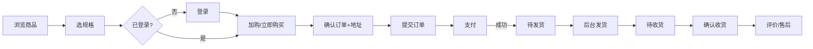

## 6.2 订单状态机

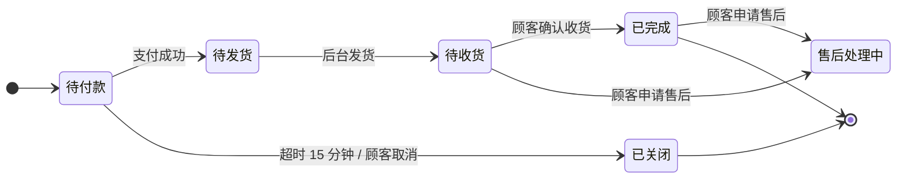

规则：
1. 只有待付款可取消或超时关闭；下单即锁定库存，关闭释放。
2. 发货后不可改地址。
3. 售后处理中不改变订单主状态，结果由售后单决定。

## 6.3 售后状态机

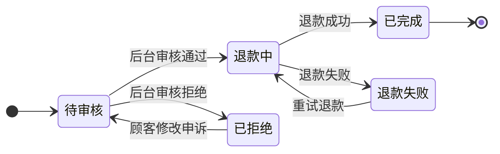

规则：本版本退款为模拟退款；已拒绝的售后单可修改申诉重新提交，回到待审核。

## 6.4 库存规则

- 提交订单锁定库存；取消或超时释放；发货时扣减（总库存与锁定同时减少，并生成销售出库单）。
- 可售库存 = 总库存 − 锁定库存，恒不小于 0。

# 7. 功能需求总览

| ID | 模块 | 功能 | 优先级 | 详设 |
|---|---|---|---|---|
| FR-001 | 账号 | 手机号登录、游客浏览、登录引导、退出 | P0 | §8.1 |
| FR-002 | 账号 | 个人资料 | P1 | §8.1 |
| FR-003 | 首页 | 站点品牌、运营位、推荐流 | P0 | §8.2 |
| FR-004 | 浏览 | 分类导航与商品列表 | P0 | §8.3 |
| FR-005 | 浏览 | 搜索 | P0 | §8.4 |
| FR-006 | 详情 | 商品详情与加购/购买 | P0 | §8.5 |
| FR-007 | 购物车 | 增删改、勾选、失效、角标 | P0 | §8.6 |
| FR-008 | 交易 | 确认订单 | P0 | §8.7 |
| FR-009 | 交易 | 提交订单与待付款倒计时 | P0 | §8.7 |
| FR-010 | 交易 | 模拟支付与结果页 | P0 | §8.7 |
| FR-011 | 订单 | 列表、详情、取消、收货、物流 | P0 | §8.8 |
| FR-012 | 售后 | 申请、列表、详情、凭证上传 | P0 | §8.9 |
| FR-013 | 个人中心 | 首页、收藏、足迹、设置 | P0/P1 | §8.10 |
| FR-014 | 个人中心 | 地址管理 | P0 | §8.11 |
| FR-015 | 评价 | 发表评价与详情页展示 | P1 | §8.12 |
| FR-016 | 多端 | Web/H5 双布局 | P0 | §8.13 |
| FR-017 | 后台 | 会员管理 | P0 | §8.15 |
| FR-018 | 后台 | 站点品牌 | P0 | §8.15 |
| FR-019 | 后台 | 首页运营位 | P0 | §8.15 |
| FR-020 | 后台 | 交易配置 | P0 | §8.15 |
| FR-021 | 后台 | 超时关单与销量回写 | P0 | §8.15 |
| FR-022 | 后台 | 订单增强与导出 | P1 | §8.15 |
| FR-023 | 后台 | 定时上架 | P1 | §8.15 |
| FR-024 | 后台 | 出入库单 | P1 | §8.15 |
| FR-025 | 后台 | 评价管理 | P1 | §8.15 |
| FR-026 | 全局 | 弹窗与提示规范（C 端） | P0 | §8.14 |

# 8. 功能与页面详设

每节结构固定：**截图（Web ∥ H5）→ 规则 → 弹窗与提示 → 交互**。截图目录 [`shots/`](./shots/)，由 `.stitch/原型/render-shots.mjs` 统一渲染。

原型：`.stitch/原型/store/`（Web/H5 可点），后台增量在 `.stitch/原型/admin/`（`p2-` 前缀截图）。C 端弹窗总览：[`shots/store-web-dialogs.png`](./shots/store-web-dialogs.png) 与 [`shots/store-h5-dialogs.png`](./shots/store-h5-dialogs.png)。

## 8.0 全局交互规范

| 场景 | 约定 |
|---|---|
| 主操作 | 暖琥珀主按钮；价格等宽数字并使用珊瑚色 |
| 加载 / 空态 | 商品卡骨架屏；空购物车 / 空列表引导「去逛逛」 |
| 未登录 | 浏览可用；加购 / 结算 / 个人中心等弹出登录，成功后回原场景 |
| H5 | 列表触底加载；登录与规格选择用半屏弹层；底部留安全区 |
| 库存 0 | 详情可看，按钮变「暂时缺货」不可点 |
| 多端 | 同一业务、Web / H5 布局不同，登录态互相隔离（详见 §8.13） |
| 弹窗形态 | Web 用居中对话框；H5 用底部半屏（bottom sheet） |

## 8.1 账号与登录（FR-001、FR-002）

| Web | H5 |
|---|---|
| 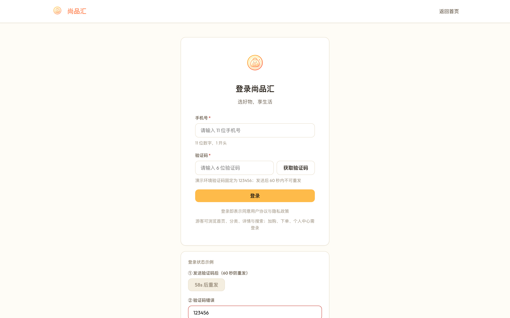 | 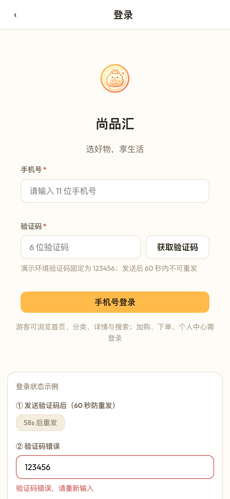 |

### 输入规则

| 字段 | 必填 | 规则 | 错误提示 |
|---|---|---|---|
| 手机号 | 是 | 11 位数字，1 开头 | 请输入正确的手机号 |
| 验证码 | 是 | 6 位数字 | 请输入 6 位验证码 |

### 弹窗与提示

| 触发 | 类型 | 标题 | 内容要点 | 按钮 |
|---|---|---|---|---|
| 未登录点加购/结算/个人中心 | 登录层 | 登录尚品汇 | 手机号 + 验证码；演示环境验证码固定 `123456` 并在页面提示；成功后回原场景 | 取消 / 登录 |
| 点「获取验证码」 | 半屏内状态 | — | 发送后按钮进入 **60 秒倒计时**且不可重发；未填合法手机号时先内联报错 | — |
| 验证码错误或过期 | 内联错误 | — | 验证码输入框下方红字「验证码错误，请重新获取」 | — |
| 手机号未注册 | 提示 | 已为你注册 | 该手机号首次登录将自动注册为会员，无需单独注册 | 知道了 |
| 退出登录 | 确认 | 退出登录 | 仅退出当前端登录态，另一端不受影响 | 取消 / 退出 |

### 规则

1. 手机号未注册时自动注册为会员。
2. 游客可浏览首页、分类、详情、搜索；加购、下单、支付、个人中心需登录。
3. 退出后清除当前端登录态（Web 与 H5 各自独立）。
4. 微信一键登录：V2.1 提供。

### 个人资料（FR-002）

| 字段 | 必填 | 规则 | 错误提示 |
|---|---|---|---|
| 昵称 | 是 | 1～20 字符 | 昵称为 1～20 字符 |
| 头像 | 否 | 1 张；jpeg/png/webp；≤10MB | 图片不符合要求 |

## 8.2 首页（FR-003）

| Web | H5 |
|---|---|
| 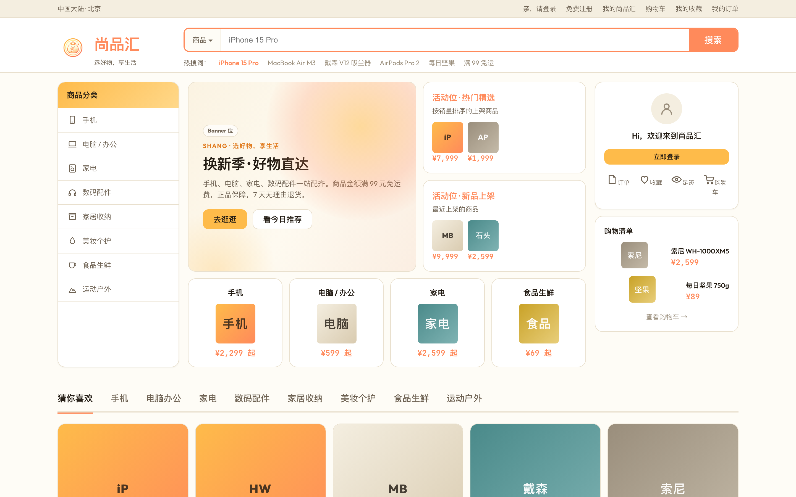 | 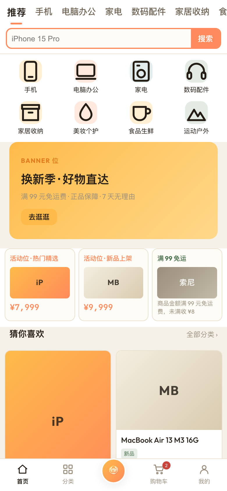 |

页面从上到下：搜索框 + 热搜词、Banner 轮播、活动位、类目入口、推荐商品流。游客可浏览。

1. 顶部 Logo、站点名称、Slogan 由后台「站点品牌」配置；后台修改后顾客端刷新可见（允许 5～10 分钟缓存）。
2. Banner 与活动位选品由后台「首页运营位」配置；**已下架商品自动不展示**；活动位不足时按销量/上新补位。
3. 运营位槽位口径（与后台一致）：**首页 Banner / 活动位 / 搜索热词 / 热门精选**，标题取后台配置。
4. 推荐流只展示上架商品。
5. 搜索框点击进入搜索页；热搜词由后台配置（不足时用兜底词）。

### 弹窗与提示

| 触发 | 类型 | 标题 | 内容要点 | 按钮 |
|---|---|---|---|---|
| 点活动位卡片 | 跳转 | — | 进入活动专区（该槽位的选品列表页） | — |
| 点已下架商品的历史入口 | 空态 | 该商品已下架 | 专区页过滤已下架商品；全被过滤时给出空态与「去逛逛」 | 去逛逛 |

## 8.3 分类与商品列表（FR-004）

| Web | H5 |
|---|---|
| 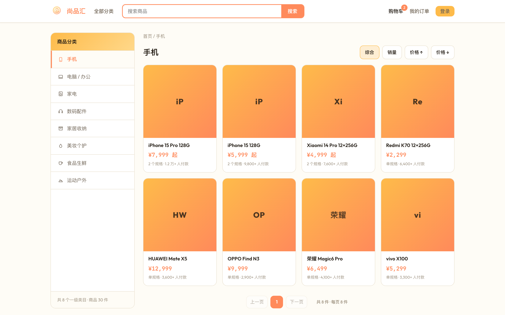 | 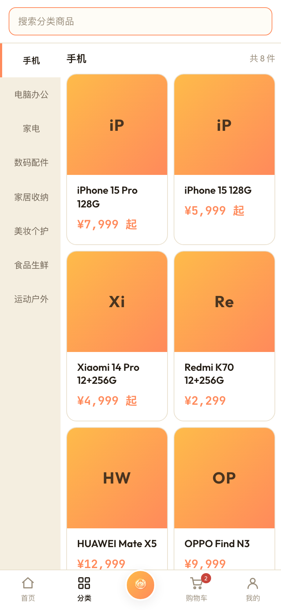 |

1. 左侧一级类目（手机 / 电脑办公 / 家电 / 数码配件 / 家居收纳 / 美妆个护 / 食品生鲜 / 运动户外），点击后右侧展示该类目商品。
2. 商品卡片：主图、名称、价格区间、销量。
3. 排序：综合、销量、价格升/降。
4. 分页：Web 底部页码，H5 触底自动加载。
5. 空类目显示引导文案。

## 8.4 搜索（FR-005）

> 从首页搜索框进入，无单独运营截图；交互随首页 / 列表。

| 字段 | 必填 | 规则 | 提示 |
|---|---|---|---|
| 关键词 | 是 | 1～50 字符 | 请输入搜索关键词 |

1. 搜索范围：商品名称、副标题。
2. 无结果时展示推荐商品与引导文案。
3. 历史搜索保留最近 10 条，可清空。
4. 热搜词由后台运营位配置。

## 8.5 商品详情（FR-006）

| Web | H5 |
|---|---|
| 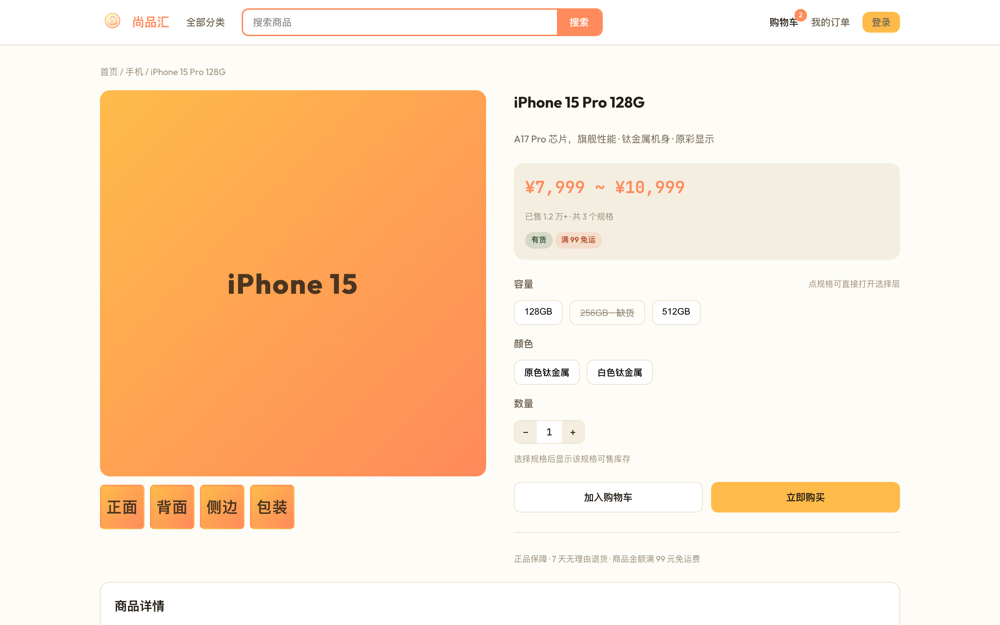 | 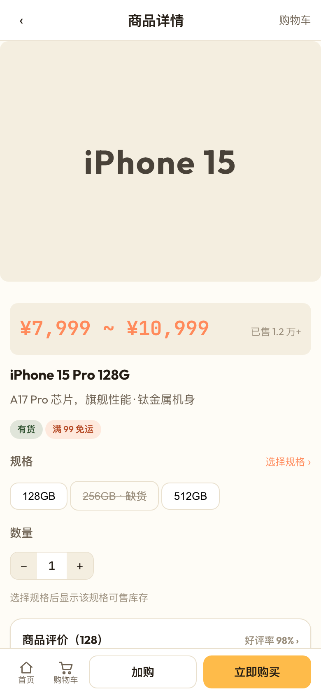 |

页面内容：主图、价格、名称与副标题、规格选择、库存提示、商品详情、评价摘要。

### 弹窗与提示


| 触发 | 类型 | 标题 | 内容要点 | 按钮 |
|---|---|---|---|---|
| 点「加入购物车」/「立即购买」 | 规格层 | 选择规格 | 规格维度与可选值、数量步进、库存提示；点「加入购物车」后可在层内直接去购物车 | 加入购物车 / 立即购买 |
| 未选规格就加购/购买 | 提示 | 请选择规格 | 先选齐规格再操作；层内高亮未选维度 | 知道了 |
| 数量超过可售库存 | 提示 | 库存不足 | 数量停在最大可售；显示当前可售数量 | 知道了 |
| 可售库存为 0 | 页面态 | — | 按钮变「暂时缺货」且不可点；可浏览详情 | — |
| 已登录加购成功 | Toast | — | 「已加入购物车」，提供「去购物车」入口 | — |
| 未登录点加购/购买 | 登录层 | 登录尚品汇 | 见 §8.1；成功后回本页并保留已选规格 | — |

### 规则

1. 仅展示上架商品；下架商品提示「商品已下架」。
2. 规格切换后价格与库存提示同步刷新。
3. 底部操作栏：购物车（带角标）、加购、立即购买。
4. 浏览商品详情自动记录足迹（登录后可用）。

## 8.6 购物车（FR-007）

| Web | H5 |
|---|---|
| 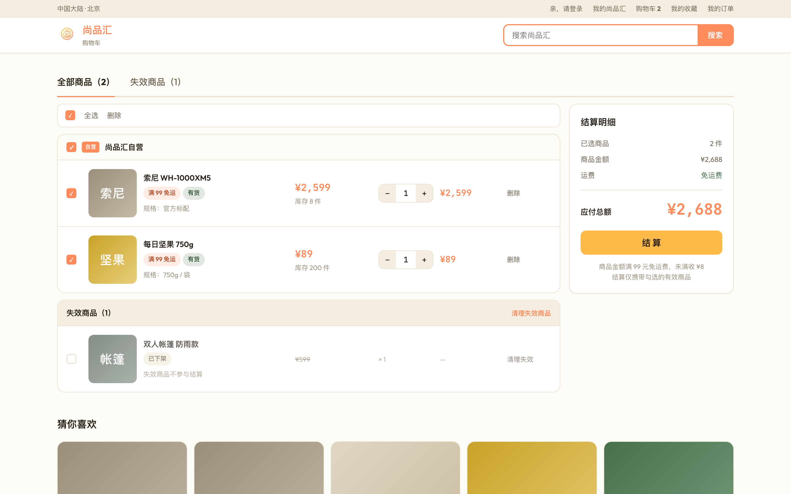 | 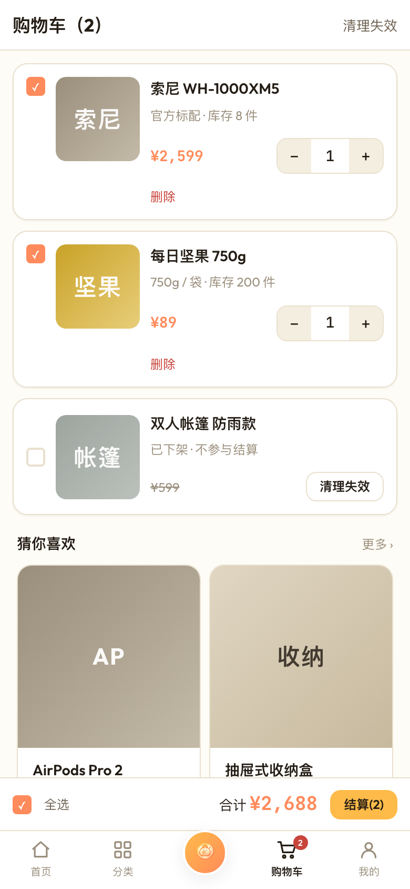 |

| 项 | 规则 |
|---|---|
| 展示 | SKU 图、名称、规格、单价、数量步进器、小计 |
| 勾选 | 单选与全选；结算栏只合计选中且有效的商品 |
| 数量 | 步进 ±1，可输入；范围 1～可售库存，超限提示「库存不足」 |
| 删除 | 左滑（H5）或编辑模式（Web）删除，需确认 |
| 失效 | 已下架或库存为 0 的条目标记失效：置灰、不可勾选、可一键清理 |
| 角标 | TabBar 购物车角标与购物车数量一致 |

### 弹窗与提示

| 触发 | 类型 | 标题 | 内容要点 | 按钮 |
|---|---|---|---|---|
| 删除单条商品 | 确认 | 删除商品 | 文案含商品名；删除后需重新加购 | 取消 / 删除 |
| 「清理失效商品」 | 确认 | 清理失效商品 | 列出失效原因（已下架 / 库存为 0）与条数 | 取消 / 清理 |
| 数量超过可售库存 | 提示 | 库存不足 | 数量停在最大可售 | 知道了 |
| 购物车为空 | 空态 | — | 引导「去逛逛」 | 去逛逛 |

### 规则

1. 加购成功 Toast，可跳转购物车。
2. 结算仅携带选中的有效商品。

## 8.7 下单与支付（FR-008～010）

| Web | H5 |
|---|---|
| 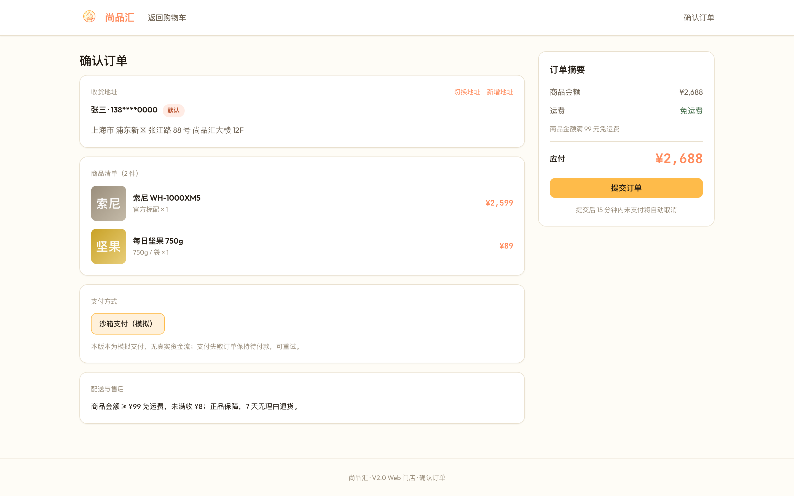 | 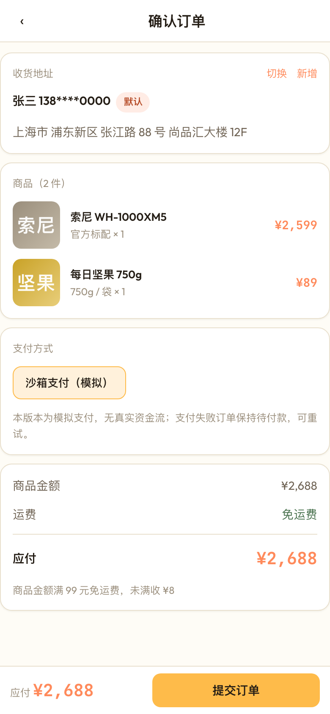 |

### 确认订单

| 项 | 规则 |
|---|---|
| 地址 | 默认选中默认地址；无地址时引导新增 |
| 商品 | 选中商品的快照（图、名称、规格、单价、数量） |
| 运费 | 商品金额 ≥ 免运门槛（默认 99 元）免运费，否则默认运费（默认 8 元）；两项均后台可配 |
| 金额明细 | 商品金额、运费、实付 |

### 提交订单

1. 提交时校验库存，不足则提示并停留。
2. 提交后生成待付款订单、锁定库存、清除已购的购物车条目。
3. 重复点击提交只生成一个订单（幂等键去重）。
4. 待付款页显示倒计时（默认 15 分钟，后台可配 5～120 分钟）；倒计时结束自动关单并释放库存。
5. 待付款可手动取消，关单并释放库存。

### 支付（模拟）

1. 支付页展示订单金额；确认后 1 秒内返回结果。
2. 成功 → 订单变待发货，跳转订单详情；失败 → 订单保持待付款，可重试。
3. 本版本为模拟支付，无真实资金流。

### 弹窗与提示


| 触发 | 类型 | 标题 | 内容要点 | 按钮 |
|---|---|---|---|---|
| 点「提交订单」 | 确认 | 提交订单 | 地址 + 商品 + 金额明细复核；说明提交后将锁定库存并生成待付款订单 | 取消 / 确认提交 |
| 提交时库存不足 | 提示 | 库存不足 | 指出具体商品与当前可售数量；停留本页，可调整数量后重试 | 知道了 |
| 无收货地址 | 引导 | 请先添加收货地址 | 直接拉起地址表单（§8.11） | 取消 / 去新增 |
| 切换收货地址 | 选择层 | 选择收货地址 | 地址列表，可设为默认 | 取消 / 确定 |
| 点「去支付」 | 支付层 | 支付中 | 展示订单金额与 loading；随后进入成功或失败态 | — |
| 支付成功 | 结果页 | 支付成功 | 展示订单号与金额，入口：查看订单 / 继续逛逛 | 查看订单 |
| 支付失败 | 结果页 | 支付失败 | 说明订单仍为待付款、未扣款；提供「重新支付」与「稍后再说」 | 重新支付 / 稍后再说 |
| 待付款倒计时归零 | 提示 | 订单已关闭 | 超时未支付已自动关闭并释放库存；可重新下单 | 知道了 |

## 8.8 订单（FR-011）

| Web | H5 |
|---|---|
| 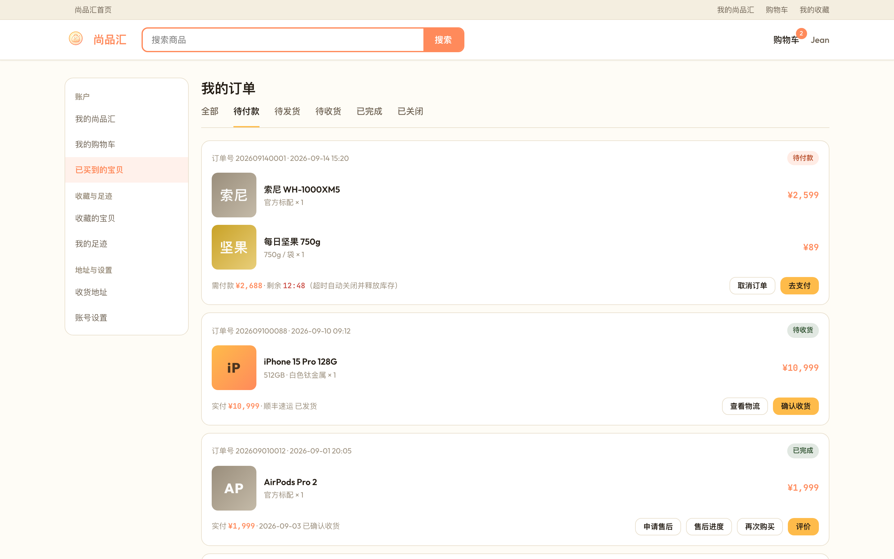 | 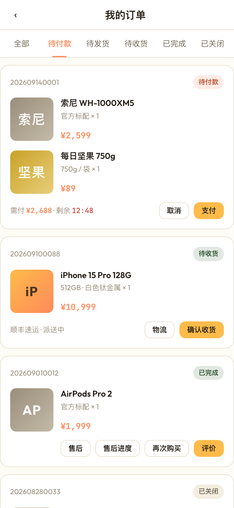 |

### 列表

| 项 | 规则 |
|---|---|
| Tab | 全部 / 待付款 / 待发货 / 待收货 / 已完成（及已关闭） |
| 卡片 | 商品缩略与名称、数量、实付金额、状态、可用操作 |
| 操作 | 待付款：取消、去支付；待收货：确认收货；已完成：评价、售后、再次购买 |

### 详情与物流

1. 详情：状态步骤条、地址、商品项、金额明细、订单号、下单时间、状态时间线。
2. 物流：发货后可查运单号与轨迹节点（模拟数据）。
3. 再次购买：按原订单商品重新加购；失效商品提示。

### 弹窗与提示

| 触发 | 类型 | 标题 | 内容要点 | 按钮 |
|---|---|---|---|---|
| 「取消订单」 | 确认 | 取消订单 | 仅待付款可取消；取消后订单关闭并释放锁定库存 | 取消 / 确认取消 |
| 「确认收货」 | 确认 | 确认收货 | 确认后订单完成，可评价、售后、再次购买；操作不可撤销 | 取消 / 确认收货 |
| 「查看物流」 | 半屏 / 抽屉 | 物流轨迹 | 承运商、运单号与轨迹节点（模拟） | 关闭 |
| 「再次购买」 | 提示 | 部分商品不可购买 | 失效商品（已下架 / 无库存）不计入，其余加入购物车 | 知道了 |

## 8.9 售后（FR-012）

> 申请入口在订单详情；列表与进度在个人中心链路（`/after-sales`），原型以同一弹窗图鉴表达。

### 申请

| 字段 | 必填 | 规则 | 提示 |
|---|---|---|---|
| 售后类型 | 是 | 仅退款 / 退货退款 | — |
| 售后原因 | 是 | 下拉选择 + 补充说明 ≤200 字符 | 请选择售后原因 |
| 凭证图片 | 否 | 1～3 张；jpeg/png/webp；单张 ≤10MB | 凭证最多 3 张 |

### 列表与详情

1. 列表按状态 Tab：全部 / 待审核 / 退款中 / 已完成 / 已拒绝。
2. 详情：类型、原因、凭证（可预览）、协商记录、退款金额、进度。
3. 已拒绝的单可修改申诉后重新提交，回到待审核。

### 弹窗与提示

| 触发 | 类型 | 标题 | 内容要点 | 按钮 |
|---|---|---|---|---|
| 「申请售后」 | 表单层 | 申请售后 | 类型 / 原因 / 凭证（≤3 张）/ 补充说明（≤200 字）；说明退款为模拟退款 | 取消 / 提交 |
| 未选售后原因 | 内联错误 | — | 原因下方红字「请选择售后原因」 | — |
| 重复申请 | 拒绝 | 已有进行中的售后 | 同一订单同时只允许一个进行中的售后单 | 知道了 |
| 已拒绝单「修改申诉」 | 表单层 | 修改申诉 | 可改类型/原因/凭证，提交后回到待审核 | 取消 / 重新提交 |

### 规则

1. 仅待收货、已完成订单可申请售后。
2. 凭证图为私有，仅顾客本人与售后审核人员可见。

## 8.10 个人中心（FR-013）

| Web | H5 |
|---|---|
| 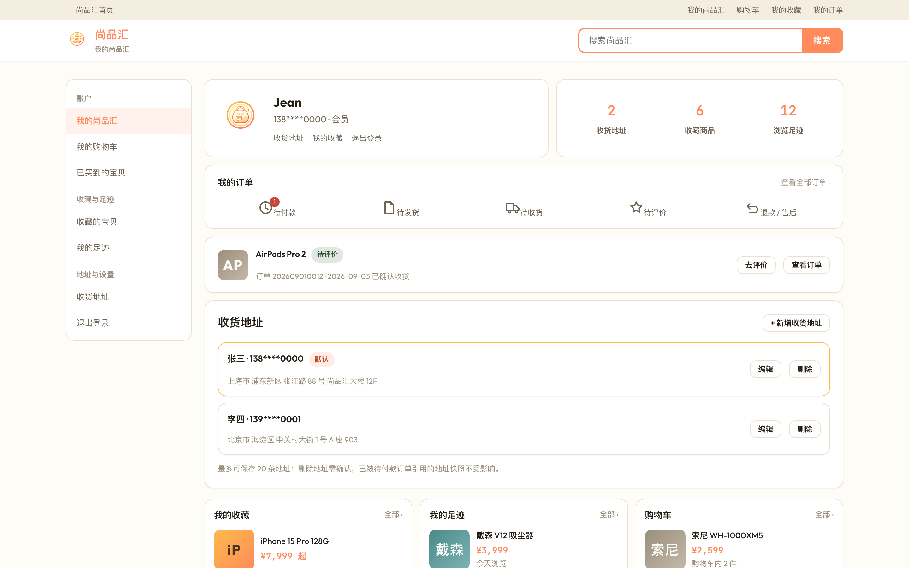 | 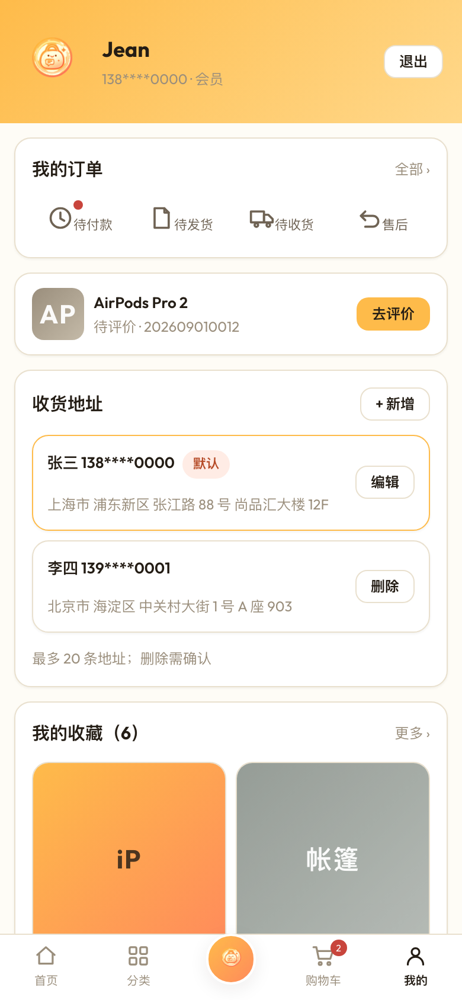 |

**收藏（Web 独立页）**

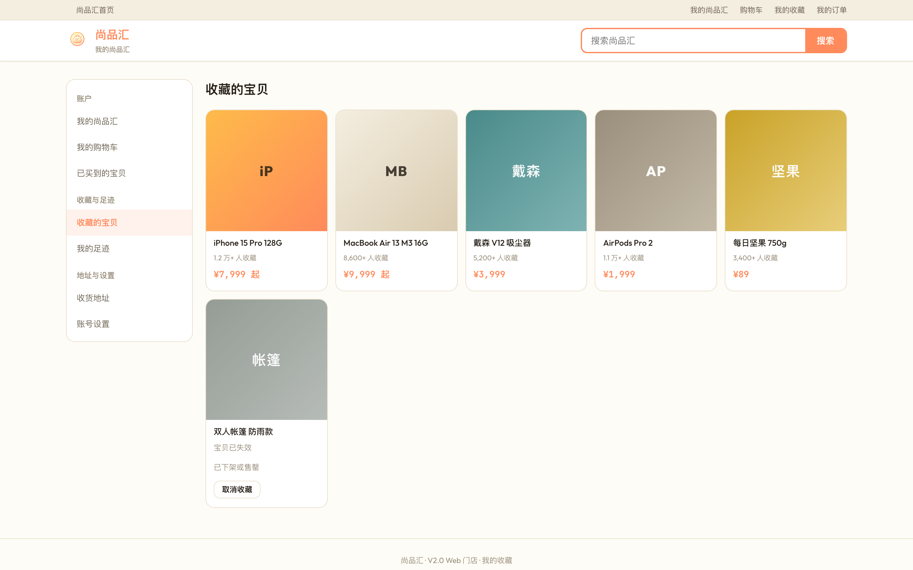

1. 首页：头像昵称、订单入口（各状态）、地址、收藏、足迹、设置。
2. 未登录显示登录按钮。
3. 收藏（P1）：商品收藏列表，可取消收藏，失效商品置灰。
4. 足迹（P1）：浏览历史按时间倒序，保留最近 100 条，可清空。
5. 设置：退出登录（清除登录态）。

## 8.11 地址管理（FR-014）

> 从个人中心进入；确认订单无地址时引导新增。

| 字段 | 必填 | 规则 | 提示 |
|---|---|---|---|
| 收货人 | 是 | 1～25 字符 | 请输入收货人 |
| 手机号 | 是 | 11 位数字，1 开头 | 手机号格式不正确 |
| 所在地区 | 是 | 省/市/区三级选择 | 请选择地区 |
| 详细地址 | 是 | 1～100 字符 | 请输入详细地址 |
| 设为默认 | 否 | 默认地址仅一个，设置新默认自动取消旧默认 | — |

### 弹窗与提示

| 触发 | 类型 | 标题 | 内容要点 | 按钮 |
|---|---|---|---|---|
| 「新增地址」 | 表单层 | 新增收货地址 | 上述字段；校验失败内联报错 | 取消 / 保存 |
| 「编辑」 | 表单层 | 编辑收货地址 | 同上，带出原值 | 取消 / 保存 |
| 「删除」 | 确认 | 删除地址 | 文案含收货人与地址摘要；已下单订单保存的是地址快照，不受影响 | 取消 / 删除 |
| 地址达上限 | 拒绝 | 地址数量已达上限 | 每个会员最多 20 条地址 | 知道了 |

## 8.12 评价（FR-015）

> 发表入口在已完成订单；展示在商品详情评价区。

| 字段 | 必填 | 规则 | 提示 |
|---|---|---|---|
| 星级 | 是 | 1～5 星 | 请选择星级 |
| 评价内容 | 否 | ≤500 字符 | 评价不超过 500 字 |
| 晒图 | 否 | ≤3 张；jpeg/png；单张 ≤10MB | 最多 3 张图 |

### 弹窗与提示


| 触发 | 类型 | 标题 | 内容要点 | 按钮 |
|---|---|---|---|---|
| 「评价」 | 表单层 | 发表评价 | 星级 / 内容 / 晒图；提交后不可修改 | 取消 / 提交 |
| 未选星级 | 内联错误 | — | 「请选择星级」 | — |
| 已评价过 | 拒绝 | 该订单项已评价 | 每个订单项一次，提交后不可修改 | 知道了 |

### 规则

1. 仅已完成订单可评价。
2. 商品详情展示通过状态的评价列表，分页加载；被后台隐藏的不展示。
3. 评价默认直接展示（无需审核）。

## 8.13 多端差异（FR-016）

同一网址按屏幕宽度切换布局，业务一致。

| 能力 | Web（≥768px） | H5（<768px） |
|---|---|---|
| 导航 | 顶栏 + 频道栏 + 页脚 | 底部 TabBar |
| 首页商品 | 4 列 | 2 列 |
| 商品详情 | 左图右购 | 上图下购 + 底部操作栏 |
| 购物车 | 表格式 | 卡片列表 + 底部结算栏 |
| 登录 | 居中弹窗或独立页 | 半屏弹层 |
| 列表分页 | 底部页码 | 触底自动加载 |
| 安全区 | — | 底部留出安全距离 |

## 8.14 C 端弹窗与提示规范（FR-026）

全套 C 端弹窗一次性归档在两份图鉴：Web [`shots/store-web-dialogs.png`](./shots/store-web-dialogs.png)（`.stitch/原型/store/web/dialogs.html`，33 个样例）、H5 [`shots/store-h5-dialogs.png`](./shots/store-h5-dialogs.png)（`.stitch/原型/store/h5/dialogs.html`，34 个样例）。

### 形态约定

| 类型 | Web | H5 | Vant 对应 |
|---|---|---|---|
| 登录 / 规格 / 售后申请 / 评价等强交互 | 居中对话框 | 底部半屏（sheet） | `showDialog` / `van-popup`（position=bottom） |
| 二次确认（取消订单、确认收货、删除） | 居中对话框 | `showConfirmDialog` | `showConfirmDialog` |
| 单选类（选地址、选规格） | 抽屉 / 弹窗 | 半屏 | `van-action-sheet` |
| 轻提示（加购成功、库存不足） | Toast | Toast | `showToast` |
| 支付过程 | 独立支付层 → 结果页 | 同左 | — |

### 通用反馈

| 场景 | 处理 |
|---|---|
| 字段不合法 | 内联红字在控件下方，弹层不关闭 |
| 库存不足 / 未选规格 | 轻提示 Toast，必要时同时给出可行动作（如「去购物车」） |
| 需登录 | 拉起登录层，成功后**回到原场景**并保留上下文（已选规格、结算清单） |
| 提交类操作 | 按钮 loading 防重复；成功 Toast + 目标页跳转 |

## 8.15 后台补全（FR-017～025）

后台新增以下功能，支撑真实交易运营。截图前缀 `p2-`，原型文件在 `.stitch/原型/admin/`。

| 功能 | 内容 | 优先级 |
|---|---|---|
| 会员管理 | 列表（手机号脱敏如 `138****0000`、状态、订单数、注册与最近登录）、冻结/解冻、跳转该会员订单 | P0 |
| 站点品牌 | 上传 Logo（1 张，建议 256×256 PNG）、站点名（1～30 字符）、Slogan（≤50 字符）；保存后顾客端生效 | P0 |
| 首页运营位 | 槽位：首页 Banner、活动位、搜索热词、热门精选；每槽位内容上限 10 条；活动位/热门精选从上架商品选品，可启停、排序；下架商品自动过滤 | P0 |
| 交易配置 | **在「系统设置」页新增「交易」分组**：待付款超时（5～120 分钟，默认 15）、免运门槛（≥0 元）、默认运费（≥0 元）、推荐补位排序（sold/new）；保存即对新单生效 | P0 |
| 超时关单/销量回写 | 系统自动关闭超时待付款订单并释放库存；确认收货后累计商品销量 | P0 |
| 订单增强 | 筛选手机尾号（4 位）、来源端（Web/H5）；详情显示支付单号、支付时间、来源端；导出当前筛选 | P1 |
| 定时上架 | 上架方式：立即/定时/仅草稿；定时时间须晚于当前（分钟粒度）；到点自动上架，上架规则与 V1.0 一致 | P1 |
| 出入库单 | 入库单（选 SKU、数量 >0、备注）；盘点调整；销售出库由发货自动生成并关联订单号；按类型/单号/SKU/时间筛选 | P1 |
| 评价管理 | 按可见性筛选（全部/展示中/已隐藏）；隐藏/恢复即时生效；可筛低星 | P1 |

### 8.15.1 会员管理（FR-017）

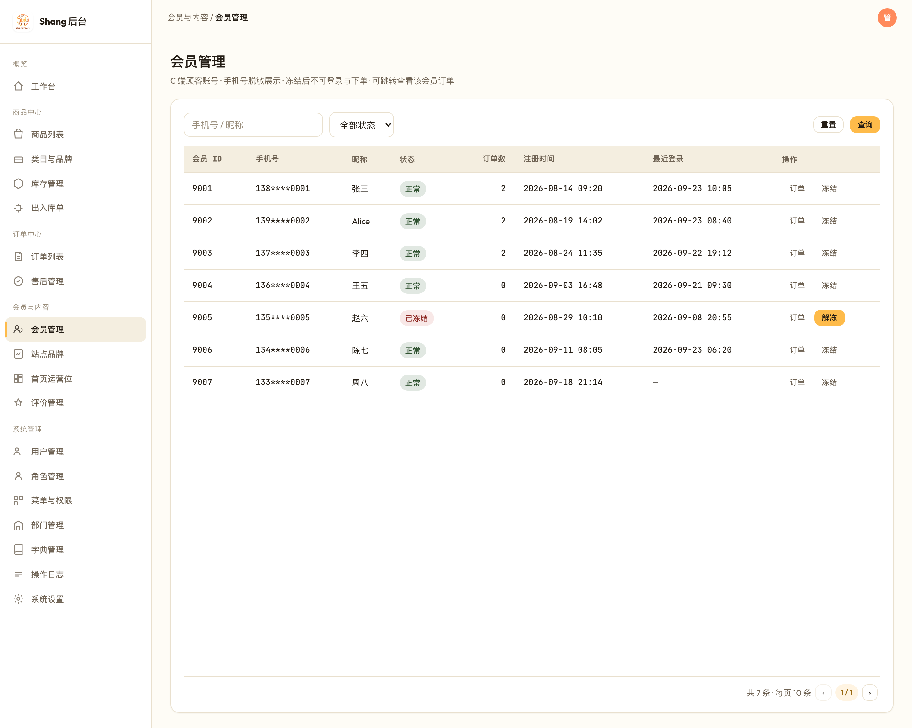

### 8.15.2 站点品牌（FR-018）

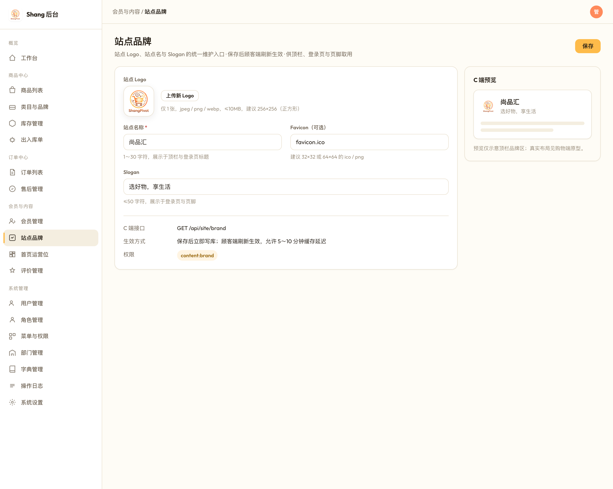

### 8.15.3 首页运营位（FR-019）

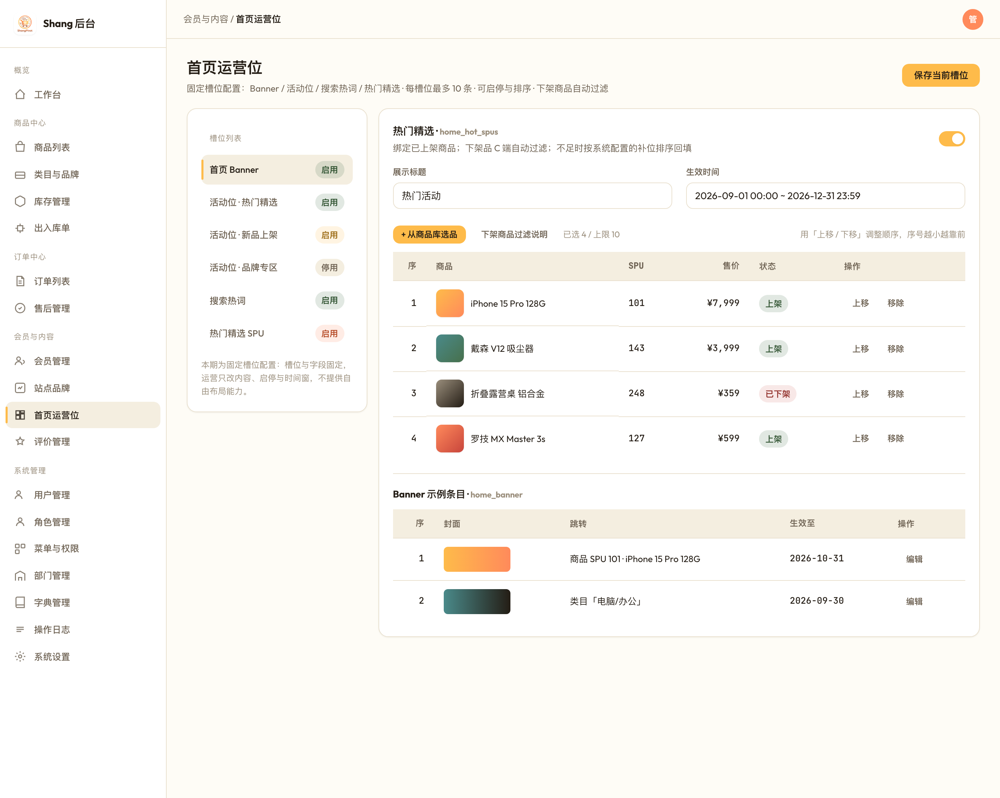

### 8.15.4 交易配置（FR-020）

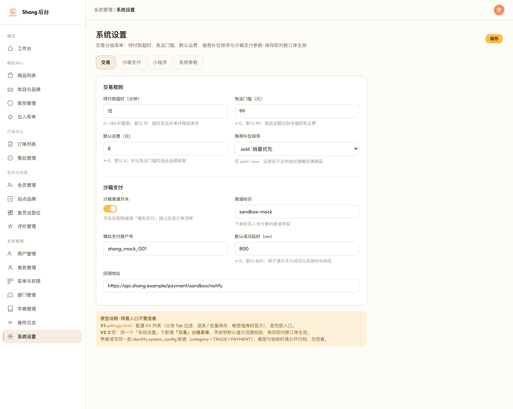

> 关键区分：V1.0 的「系统设置」是 **KV 列表**（逐键编辑、敏感值打码）；V2.0 在**同一个页面**新增「交易」**分组表单**（Tab 切换，整体校验后保存）。两套体验不要混着看 —— 前者逐键编辑，后者按业务分组校验后整体保存。

### 8.15.5 订单增强（FR-022）

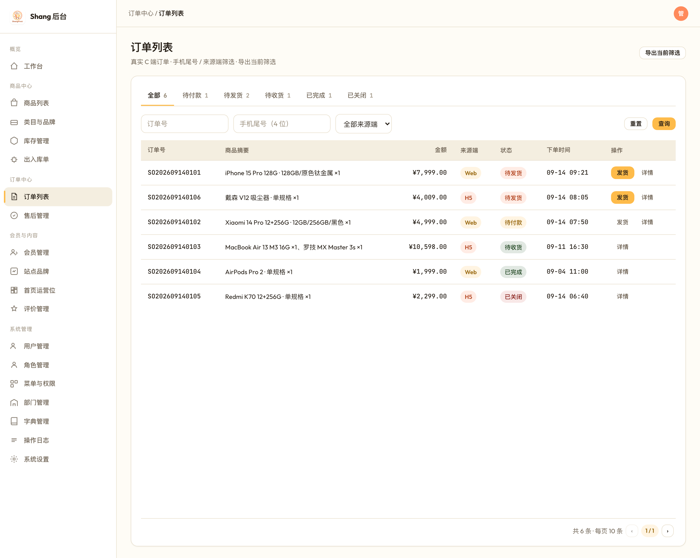

### 8.15.6 定时上架（FR-023）

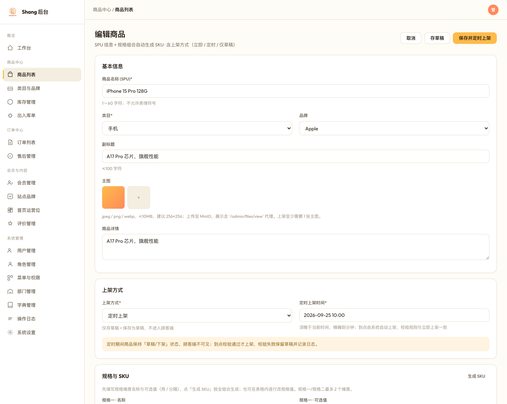

### 8.15.7 出入库单（FR-024）

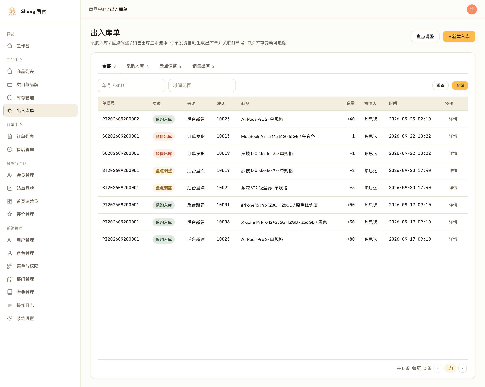

### 8.15.8 评价管理（FR-025）

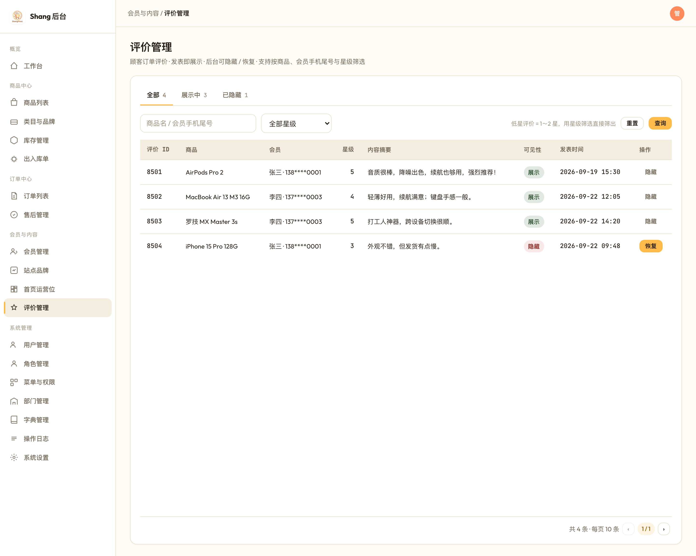

### 8.15.9 后台增量弹窗

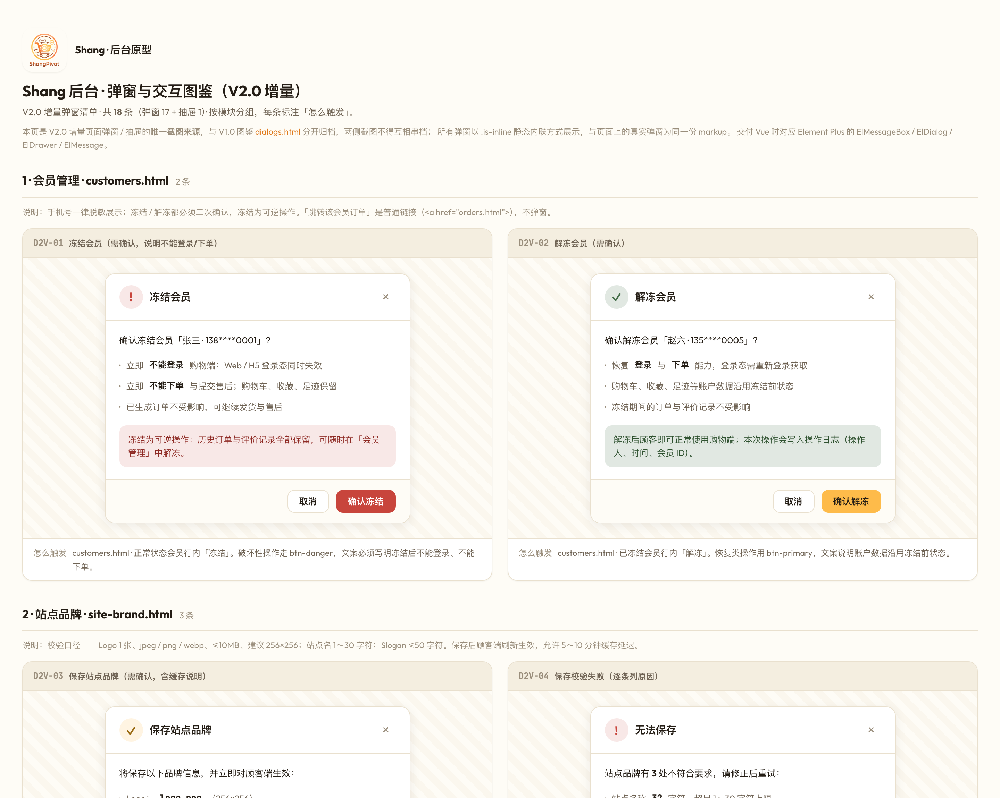

18 个样例（`.stitch/原型/admin/dialogs-v2.html`），关键交互：

| 触发 | 类型 | 内容要点 | 按钮 |
|---|---|---|---|
| 冻结会员 | 危险确认 | 冻结后不能登录、不能下单；解冻即恢复 | 取消 / 确认冻结 |
| 解冻会员 | 确认 | 解冻后该会员可立即登录下单 | 取消 / 确认解冻 |
| 保存站点品牌 | 确认 | 保存后顾客端刷新生效（允许 5～10 分钟缓存）；校验：站点名 1～30 字符、Slogan ≤50 字符、Logo 格式与体积 | 取消 / 保存 |
| 运营位选品 | 表单 | 从商品库勾选加入槽位；下架商品不参与；移除条目需确认；保存即时影响首页 | 取消 / 保存 |
| 隐藏 / 恢复评价 | 确认 | 隐藏后商品详情不再展示；恢复即时生效 | 取消 / 确认 |
| 新建入库单 / 盘点调整 | 表单 | 选 SKU、数量 >0、备注；盘点填数量差异与原因 | 取消 / 保存 |
| 保存交易设置 | 确认 | 校验后整体保存，对新订单生效（不影响已生成订单） | 取消 / 保存 |
| 交易设置校验失败 | 提示 | 逐条列出：待付款超时须 5～120 分钟、金额须 ≥0、补位排序仅 sold/new | 知道了 |
| 导出当前筛选 | 确认 | 导出当前筛选结果为表格文件；导出写操作日志 | 取消 / 开始导出 |
| 定时上架时间不合法 | 提示 | 定时时间须晚于当前时间（分钟粒度） | 重新选择 |


# 9. 非功能需求

## 9.1 性能

- 首屏加载 ≤1.5 秒（常规网络）。
- 图片懒加载。

## 9.2 安全

- 手机号脱敏展示（后台会员列表）。
- 售后凭证仅顾客与审核人员可见。
- Web 与 H5 登录态互相隔离。
- 顾客令牌与后台令牌互不通用（按路径前缀区分校验器）。

## 9.3 兼容

- Web：Chrome、Edge、Safari 最近两个大版本。
- H5：iOS Safari、安卓主流浏览器（微信内置浏览器可打开）。

# 10.A 原型 ↔ 实现一致性台账（V2.0）

> **读法**：本版同样经历了一轮「原型改、实现跟」的对齐。本节把曾经存在的差距逐条留档，标注现在的落地方式。
> 状态口径：`已落地` = 代码可复现且与原型/图鉴一致。

## 10.A.1 已落地的对齐项

| 编号 | 项 | 原型/本文定义 | 本轮落地方式 |
|---|---|---|---|
| FIX-V2-01 | 评价发表表单 | §8.12 与图鉴 RD-06：1～5 星 + ≤500 字 + ≤3 张图 + 提交后不可修改 | 实现为评价层（Web 居中对话框 / H5 半屏）：5 星选择（未选给内联错误）+ 500 字计数 + `van-uploader` 最多 3 图；提交后订单项显示「已评价 · 提交后不可修改」，重复提交由后端 `REVIEW_EXISTS` 拦截 |
| FIX-V2-02 | 支付四态 | §8.7 与图鉴 CO-05～08：支付中 → 成功 / 失败（可重试）→ 支付结果页 | `PayView` 实现四态：进入收银台自动支付并展示 loading（含最少 900ms 让状态可见）→ 成功态 / 失败态（失败原因取接口 `msg`，显示剩余支付倒计时，可「重试支付」）→ 支付结果页（订单号 / 金额 / 支付方式 / 状态 / 收货人） |
| FIX-V2-03 | 规格选择层 | §8.5 与图鉴 PD-01：弹层内选规格 + 数量步进 + 库存提示 + 双按钮 | 去掉「自动选中首个 SKU」，改为点加购/立即购买拉起规格层（H5 底部半屏 / Web 居中）；未选规格时给「请选择规格」层并高亮未选维度（PD-02）；数量越界给「库存不足」并停在最大可售（PD-03） |
| FIX-V2-04 | 缺货态 | §8.5：可售为 0 时按钮变「暂时缺货」且**不可点** | 按钮改为 `disabled`，层内页脚同为禁用的「暂时缺货」，并给出可切换的规格建议（PD-04） |
| FIX-V2-05 | 后台增量弹窗 | §8.15.9 图鉴 18 个样例 | 六页全部改为 `FormDialog` / `NoticeDialog` / `DetailDrawer`：冻结解冻会员、站点品牌保存与逐条校验、从商品库选品（下架不可选）、移除条目、保存槽位、下架过滤说明、评价隐藏/恢复、新建入库单、盘点调整、单据详情抽屉、交易设置保存与逐条校验 |

### 10.A.1.1 第二轮：幽灵功能清理 + 补齐 PRD 已定义但未落地的交互

**从原型移除的幽灵功能**（PRD 未定义、实现也没有 —— 它们原本会被渲进 PRD 图）：

| 位置 | 移除内容 | 判定依据 |
|---|---|---|
| 购物车 | 清空购物车、移入收藏 | §8.6 只定义 增删改 / 勾选结算 / 失效处理（置灰·不可勾选·一键清理） |
| 收藏页 | 收藏后降 ¥100、降价角标、有降价筛选、排序方式 / 收藏时间 | §8.10 只定义 列表 / 取消收藏 / 失效置灰；降价提醒属营销（V4.0） |
| 收藏页 | 找相似、搜收藏夹、清理失效商品按钮 | PRD 未定义 |
| 购物车 / 订单页 | 搜购物车、搜订单 | 未定义（订单页搜索仅保留商品搜索） |

**补齐的实现（这些是 PRD 已定义、实现缺失的真实差距）**：

| 编号 | 项 | PRD 依据 | 落地方式 |
|---|---|---|---|
| FIX-V2-06 | 个人中心 | §8.10：头像昵称、订单各状态入口、地址、收藏、足迹、设置 | 重建 `ProfileView`：订单入口（待付款/待发货/待收货/待评价/全部）+ 服务入口（地址/收藏/足迹/售后/设置）+ 未登录分支；图标全部改为单色描边 SVG（原为 emoji，违反设计系统） |
| FIX-V2-07 | 我的收藏 | §8.10：可取消收藏、失效商品置灰 | 重建 `FavoritesView`：取消收藏（确认层）+ 失效项置灰不可购买并标注原因 |
| FIX-V2-08 | 购物车失效处理 | §8.6：失效条目标记失效、置灰、不可勾选、可一键清理 | `CartView` 补齐：失效分区 + 原因徽标（已下架 / 库存为 0）+ 禁选 + 一键清理确认；单条删除也加确认 |
| FIX-V2-09 | 未登录拦截形态 | §8.1 规则 4 / §8.5：弹出**登录层**，成功后回原场景 | 新增 `LoginForm` + `LoginLayer`（Web 居中 / H5 半屏）与 `useLoginLayer`，接入加购/立即购买/收藏/结算/需要登录的路由；原实现是 Toast + 跳登录页 |
| FIX-V2-10 | 分类排序 | §8.4：综合 / 销量 / 价格升 / 价格降 | 实现 chips 并传 `sort`；**同时修了后端**：`CatalogReadService.applySort` 的 `price_asc/price_desc` 原先直接回落 `id desc`（参数被接受但不生效），现按 SKU 最低价用相关子查询在 SQL 内排序，分页与 COUNT 均正确 |
| FIX-V2-11 | 提交订单确认 | §8.7 与图鉴 CO-01 / CO-02 | `CheckoutView` 补确认层（地址+商品+金额复核，说明「锁定库存、15 分钟未支付自动关闭」）；库存不足（40901）按 CO-02 提示并停留本页；幂等键按提交意图复用，只生成一单 |
| FIX-V2-12 | 售后申请原因 | §8.9 与图鉴 RD-04：类型 / **原因下拉** / 凭证 1~3 张 / 补充说明 ≤200 字 | `AfterSaleApplyView` 改为下拉选原因（未选内联报错）+ 补充说明计数 + 凭证校验；后端 `after_sale.reason` 仍是单一自由文本字段，前端按「原因（补充说明）」合并提交 |
| FIX-V2-13 | 首页用户面板图标 | 设计系统：不用 emoji 当图标 | `HomeView` 用户面板的 📦❤️👀🎫 与 😊 头像占位改为单色描边 SVG |

> **后端能力缺口（已记录，未擅自编造）**：`STOCK_INSUFFICIENT` 只返回「库存不足」不含商品与剩余数量（前端改用购物车失效原因 + 商品详情补齐展示）；运费门槛/默认运费无 C 端配置接口（前端按后端同值 99 / 8 预演）；`after_sale.reason` 无原因字典与独立补充说明字段；「待评价」无服务端标记，入口指向已完成订单。

## 10.A.2 共享地基

后台的弹窗组件与样式为 V1/V2 共用（见 `PRD-V1.0` §10.A.2）：`assets/modal.css` + `FormDialog` / `NoticeDialog` / `DetailDrawer`。C 端使用自身的 `modal.css`（Web 居中 / H5 半屏）与 Vant 反馈组件。

# 10. 边界用例与验收

## 10.1 边界用例

| 场景 | 期望 |
|---|---|
| 游客点结算 | 弹登录，成功后回确认订单页 |
| 加购数量超库存 | 提示「库存不足」，数量停在最大可售 |
| 上架但库存 0 的商品 | 详情可浏览，按钮「暂时缺货」 |
| 待付款超时 | 自动关单并释放库存 |
| 待付款手动取消 | 关单并释放库存 |
| 重复提交订单 | 只生成一个订单（幂等键） |
| 支付失败 | 订单保持待付款，可重试 |
| 发货后申请改地址 | 拒绝 |
| 同一订单重复申请售后 | 拒绝，提示已有进行中售后 |
| 未登录访问个人中心 | 引导登录 |
| 后台改 Logo / 站点名 | 顾客端刷新后生效（缓存内可延迟 ≤10 分钟） |
| 运营位绑定已下架商品 | 首页不展示该商品 |
| 冻结会员登录 | 拒绝并提示「账号不可用」 |
| Web 与 H5 登录态互用 | 互不影响，各自有效 |
| 评价被后台隐藏 | 商品详情不再展示该评价 |

## 10.2 验收矩阵

状态标记：✅ 已实现并可复现（对齐过程见 §10.A）· ⬜ 未实现

| ID | 验收项 | 预期结果 | 关联 | 状态 |
|---|---|---|---|---|
| AC-101 | 手机号登录 | 登录成功回原页面，登录态独立 | FR-001 | ✅ |
| AC-102 | 游客受限操作 | 浏览可用，下单引导登录 | FR-001 | ✅ |
| AC-103 | 布局切换 | 同一网址按宽度切换 Web/H5 布局 | FR-016 | ✅ |
| AC-104 | 后台换 Logo/站点名 | 顾客端刷新生效 | FR-018 | ✅ |
| AC-105 | 运营位配置 | 换品/排序/启停生效，下架品不展示 | FR-019 | ✅ |
| AC-106 | 提交订单锁库存 | 锁定增加；重复提交同单 | FR-009 | ✅ |
| AC-107 | 超时/取消关单 | 状态变已关闭，库存释放 | FR-009/021 | ✅ |
| AC-108 | 模拟支付 | 支付中 → 成功 / 失败（可重试）→ 结果页四态齐备 | FR-010 | ✅ |
| AC-109 | 确认收货 | 变已完成，可评价/售后/再次购买 | FR-011 | ✅ |
| AC-110 | 售后申请与凭证 | 凭证可上传（≤3 张），进度可查 | FR-012 | ✅ |
| AC-111 | 冻结会员 | 不能登录下单，解冻恢复 | FR-017 | ✅ |
| AC-112 | 发货出库流水 | 发货生成销售出库并关联订单号 | FR-024 | ✅ |
| AC-113 | 评价可见性 | 后台隐藏后详情页不展示；发表表单为 1~5 星 + ≤500 字 + ≤3 图 | FR-025/015 | ✅ |
| AC-114 | 定时上架 | 到点自动上架，未到点保持草稿 | FR-023 | ✅ |
| AC-115 | 表单字段规则 | 超长/非法输入被拒并提示 | §8 各输入规则 | ✅ |
| AC-116 | C 端弹窗规范 | Web 居中 / H5 半屏形态一致；规格层、缺货禁用态、评价层均按图鉴落地 | FR-026 | ✅ |
| AC-117 | 交易配置生效 | 改免运门槛/运费/超时后对新订单生效 | FR-020 | ✅ |
| AC-118 | 活动位无营销语义 | 运营位仅 Banner/活动位/热搜词/热门精选，无优惠券/促销/直播 | FR-003/019 | ✅ |

## 10.3 出口 Checklist

- [x] Web 与 H5 均可完成完整购买闭环
- [x] 游客可浏览，会员可下单
- [x] 同一网址布局切换正确
- [x] 后台可换 Logo/站点名/Slogan，顾客端生效
- [x] 后台可配置首页 Banner 与活动位选品，下架品自动过滤
- [x] 后台可冻结会员
- [x] 首页/分类/搜索/详情展示 V1.0 上架商品（同一目录，30 个在售 SPU）
- [x] 购物车增删改查、勾选结算正确
- [x] 提交订单锁库存；超时/取消释放
- [x] 模拟支付 → 待发货；后台可发货
- [x] 确认收货 → 已完成；可评价、售后
- [x] 地址管理可用
- [x] Web 与 H5 登录态隔离
- [x] C 端弹窗规范落地，图鉴与实现一一对应
- [ ] §10.1 边界用例全部通过（建议回归时勾选）

# 11. 里程碑

| 里程碑 | 内容 | 状态 |
|---|---|---|
| M2.0 | 后台补全启动：会员、交易配置 | 已完成 |
| M2.1 | Web+H5 基座、登录、首页/分类/搜索、站点品牌与运营位 | 已完成 |
| M2.2 | 商品详情 + 购物车 | 已完成 |
| M2.3 | 确认订单、提交、支付、关单与销量回写 | 已完成 |
| M2.4 | 订单/物流/售后 + 凭证上传 | 已完成 |
| M2.5 | 个人中心、评价、出入库、定时上架、导出、评价管理 | 已完成 |
| M2.6 | 弹窗与交互规范补齐 + 原型/截图版本化 | 已完成 |
| M2.7（=V2.1） | 微信小程序 | 未开始 |

# 12. 变更记录

| 版本 | 日期 | 修改人 | 内容 |
|---|---|---|---|
| V0.1 | 2026-09-14 | jean | 初稿：C 端功能、多端策略、信息架构 |
| V0.2 | 2026-09-16 | jean | 补 Web/H5 双套原型索引与页面图文、后台补全图文 |
| V1.0 | 2026-09-19 | jean | 按专业模板重构：元信息、角色、场景、FR/AC 编号 |
| V1.1 | 2026-09-19 | jean | 分期命名改为版本管理（P2→V2.0，小程序定为 V2.1） |
| V2.0 | 2026-09-19 | jean | 产品化重构：文档自包含，补齐字段写入规则与组件约束 |
| V2.1 | 2026-09-19 | jean | 原型图修正与统一；原型页数修正为 17 |
| V2.2 | 2026-09-19 | jean | §9 按「截图 → 功能 → 交互」重写 |
| V2.3 | 2026-09-19 | jean | §8 与原 §9 合并为「功能与页面详设」 |
| **V3.0** | **2026-09-23** | **jean** | **版本纪律重构**：删除 V3/V4 内容（客服入口占位、优惠券/促销/秒杀/直播语义），运营位收敛为 V2 槽位口径（Banner/活动位/搜索热词/热门精选）；新增 §1.4 对 V1 的改动范围（仅 3 处）；新增 §8.14 C 端弹窗规范（Web 33 + H5 34 个样例）；每节新增「弹窗与提示」表；交易配置明确为「系统设置」页内的分组 Tab（与实现一致）；新增 §2.4 演示种子数据表；截图全部按 V2 原型重渲；AC 扩至 18 条 |
| **V3.1** | **2026-09-23** | **jean** | **差距登记**：新增 §10.A 实现差距清单（评价表单、支付四态、规格选择层、缺货态、后台增量弹窗精细度 5 项标「原型已定义 · 实现待补」），并在 §8.5/8.7/8.12/8.15.9 内联标注；AC-108/113/116 状态改为 ◐ 部分 |
| **V3.2** | **2026-09-23** | **jean** | **原型→实现全量对齐**：§10.A 改为一致性台账，5 项全部落地（评价表单、支付四态、规格选择层、缺货禁用态、后台增量 18 个弹窗）；AC-108/113/116 恢复 ✅ |
| **V3.3** | **2026-09-23** | **jean** | **幽灵功能清理 + PRD 已定义交互补齐**：从原型移除 清空购物车 / 移入收藏 / 收藏后降 ¥100 / 降价筛选 / 排序方式 / 找相似 / 搜收藏夹 等（PRD 未定义、实现也没有，却被渲进了 PRD 图）；补齐 个人中心、我的收藏、购物车失效处理、登录层、分类排序（含后端价格排序修复）、提交订单确认、售后原因下拉、首页图标去 emoji 共 8 项；§10.A 增补 FIX-V2-06～13 |
