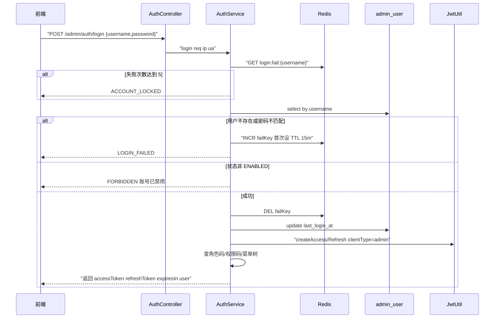
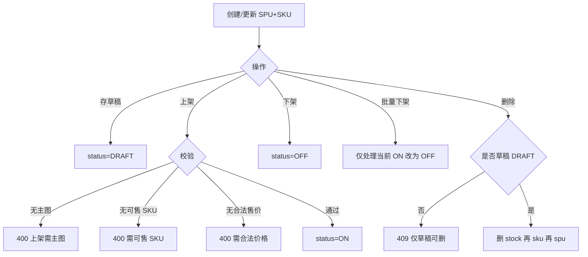
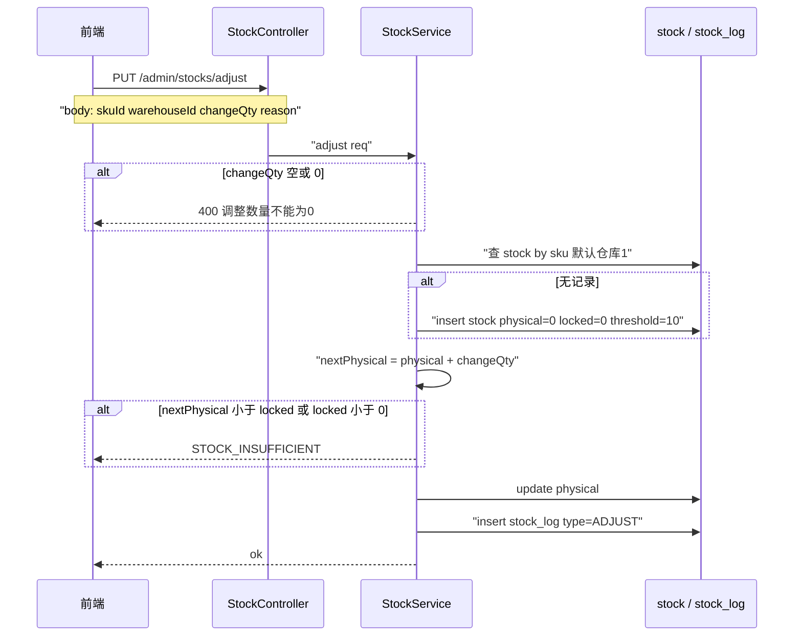
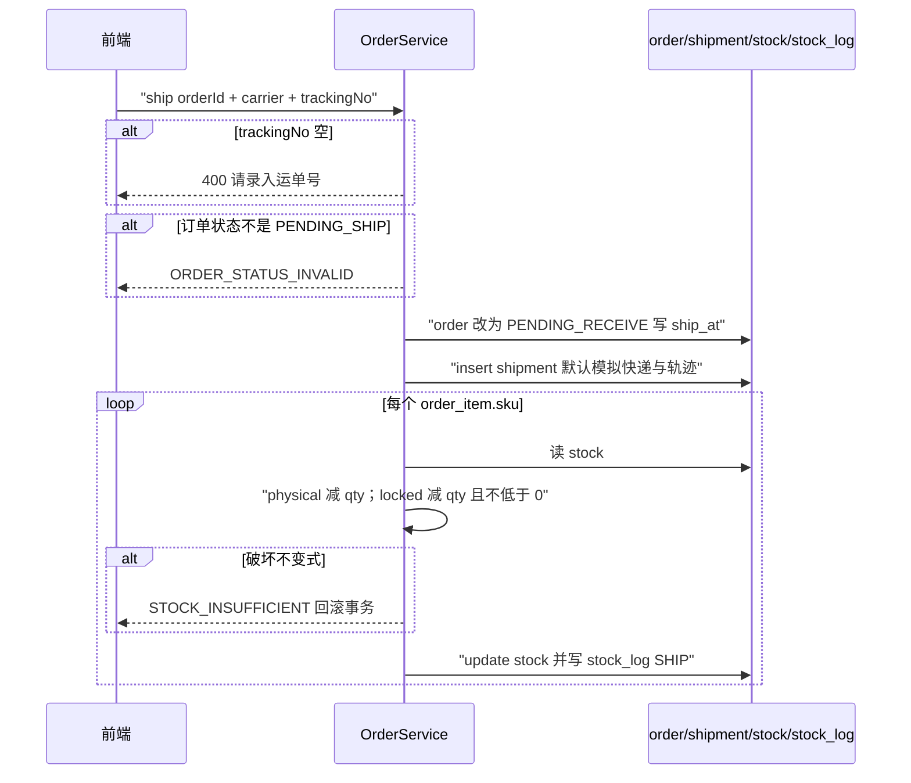
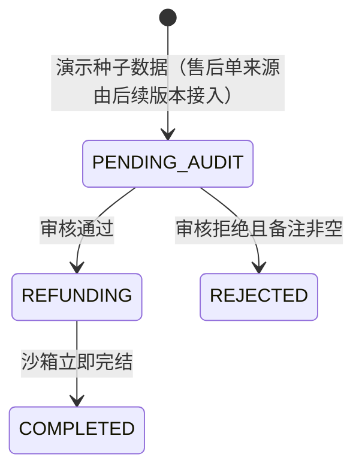
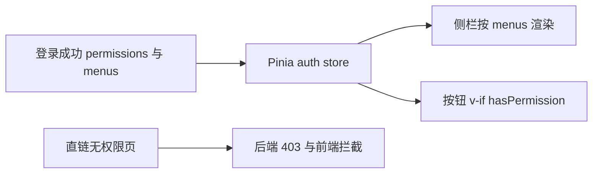

# V1.0 开发设计 — 后台管理（As-built）

| 项 | 内容 |
|---|---|
| 状态 | As-built（对齐当前代码） |
| PRD | `docs/01-requirements/PRD-V1.0-后台管理.md` |
| 数据 | [`数据模型.md`](./数据模型.md) |
| 接口 | [`接口设计.md`](./接口设计.md) |
| ADR | [`../adr/`](../adr/) |
| 运维 | `docs/开发与运维.md` |

> 本文写给**开发 / 测试 / Code Review**：讲清**怎么实现**（模块、类、时序、分支），不是产品验收文。字段见数据模型，契约见接口设计。

---

## 1. 范围

| 做（V1.0） | 不做（目标版本见括号） |
|---|---|
| Admin JWT + RBAC + 动态侧栏 | 顾客端登录 / 购物车 / 支付（V2.0） |
| 类目·品牌·属性·SPU/SKU·上下架·草稿删除·批量下架 | 定时上架、出入库单据（V2.0） |
| 库存查询 / 手工调整 / 低库存 | 仓库管理独立页（延期） |
| 演示订单发货、售后审核 | 真实物流、订单改地址（V2.0） |
| 配置 KV、MinIO、操作日志 | 交易配置分组表单（V2.0） |

---

## 2. 总体架构与模块映射

```text
shang-admin-web（Vue Admin）
    │  Bearer JWT
    ▼
shang-server（Spring Boot 启动模块）
    ├── shang-identity   Auth / User / Role / Permission / Dept / Dict / Config / File / OpLog
    └── shang-commerce   Category / Brand / Attribute / Product / Stock / Order / AfterSale / Dashboard
         ▲
         │ 只依赖 *-api（禁止反向依赖实现包）  ← ADR-0001
PostgreSQL (schema identity + commerce) · Redis · MinIO
```

### 2.1 包与职责（实现落点）

| 能力 | 入口 Controller | 应用服务 | 关键表 |
|---|---|---|---|
| 登录/刷新/登出 | `AuthController` | `AuthService` | `admin_user` + Redis |
| 用户 | `AdminUserController` | `AdminUserService` | `admin_user` · `admin_role` |
| 角色权限 | `RoleController` · `PermissionController` | `RoleService` · `PermissionQueryService` | `role` · `permission` · … |
| 商品 | `ProductController` | `ProductService` | `spu` · `sku` · `stock` |
| 库存 | `StockController` | `StockService` | `stock` · `stock_log` |
| 发货 | `OrderController` | `OrderService` | `order` · `shipment` · `stock` |
| 售后 | `AfterSaleController` | `AfterSaleService` | `after_sale` |

技术栈见 ADR-0002；RBAC 单表模型见 ADR-0003。

---

## 3. 关键实现方案（含逻辑图）

### 3.1 登录锁定与 JWT

**目标**：账密登录；连续失败 5 次锁 15 分钟；成功签发 access/refresh；登出拉黑 access。



**实现要点**

| 项 | 方案 |
|---|---|
| 失败键 | Redis `login:fail:{username}`，`INCR`；首次设 TTL=15min |
| 密码 | BCrypt `PasswordEncoder.matches` |
| JWT | access 短 TTL；refresh 长 TTL；payload 含 userId、username、`clientType=admin` |
| 登出 | 解析 access 的 jti → `TokenBlacklist`；过滤器拒已拉黑令牌 |
| 审计 | `operation_log` 记 login SUCCESS/FAIL（密码不明文） |

**类**：`AuthService` · `JwtUtil` · `TokenBlacklist` · `PermissionQueryService.buildMenuTree`

---

### 3.2 商品创建 / 上架 / 草稿删除 / 批量下架



**实现要点**

| 步骤 | 代码落点 |
|---|---|
| 创建默认草稿 | `ProductService.create` → `spu.status=DRAFT`；SKU 循环 insert；可 `initStock` 写 `stock`+`stock_log(INIT)` |
| 更新 SKU | 先删旧 SKU 再重建（当前实现策略） |
| 上架校验 | `validateOnShelf`：pics 非空、ENABLED SKU≥1、price>0 |
| 批量下架 | `PUT /admin/products/batch-off` body=`[id…]`；跳过非 ON |
| 删除 | 仅 DRAFT；级联删该 SPU 下 stock/sku |

---

### 3.3 库存手工调整



**不变式**：`physical ≥ locked ≥ 0`；可售不落库。  
**原因**：服务端固定写入「后台手工调整」（PRD），忽略客户端随意文案亦可。

---

### 3.4 订单发货（扣库存）



**事务**：整个 `ship` 方法 `@Transactional`，任一 SKU 不足整单回滚。

---

### 3.5 售后审核（沙箱退款）



| 分支 | 校验 | 结果 |
|---|---|---|
| 通过 | 当前必须 `PENDING_AUDIT` | 写 `audit_remark` → `REFUNDING` → `COMPLETED`（同请求内） |
| 拒绝 | `remark` 必填 | `REJECTED` |

---

### 3.6 权限如何落到前端



权限码示例：`product:on` · `product:off` · `order:ship` · `aftersale:audit`。  
超级管理员角色种子拥有全量码（以库内 `role_permission` 为准）。

---

## 4. 数据与接口

| 文档 | 内容 |
|---|---|
| [`数据模型.md`](./数据模型.md) | 24 张表字段 + COMMENT 说明 + 库存不变式 |
| [`接口设计.md`](./接口设计.md) | 约定、完整目录、关键接口请求/响应示例 |

本地调试用 Knife4j：`/doc.html`。

---

## 5. 安全 / 审计 / 观测（实现侧）

| 项 | 做法 |
|---|---|
| 鉴权 | `Authorization: Bearer`；过滤器校验 JWT + 黑名单 |
| 密码 | BCrypt；日志/审计禁止落明文 |
| 敏感配置 | `system_config.is_secret` 掩码展示 |
| 操作日志 | `@OpLog` 异步/同步写 `operation_log` |
| Trace | 响应 `traceId`；便于排障 |

---

## 6. 测试关注点（开发自测）

1. 登录失败 5 次 → 第 6 次锁定；15 分钟后可再试  
2. 上架缺主图/SKU/价格 → 拒绝且状态不变  
3. 非草稿删除 → 409  
4. 调整库存导致 physical < locked → 拒绝  
5. 发货无运单号 → 400；非待发货 → 状态码错误  
6. 售后拒绝无备注 → 400  

验收矩阵见 PRD §10。

---

## 变更记录

| 版本 | 日期 | 内容 |
|---|---|---|
| V1.0 | 2026-09-19 | As-built 索引稿 |
| V2.0 | 2026-09-19 | 补齐主路径时序图、状态图与类级实现方案 |
| V3.0 | 2026-09-23 | 版本纪律：范围表标注目标版本；售后状态图去掉越版来源说明；页面标题与菜单名对齐 |
