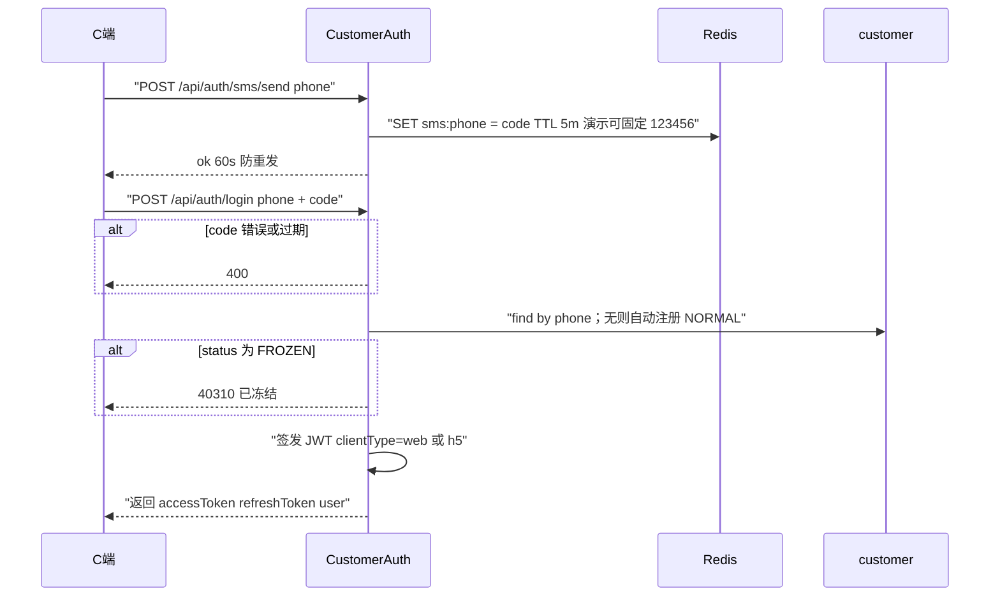
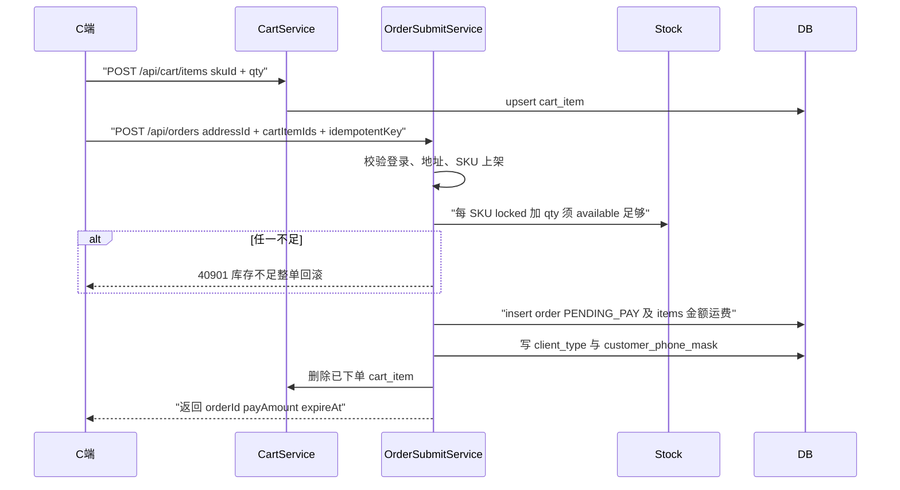
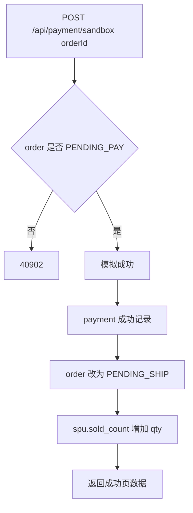
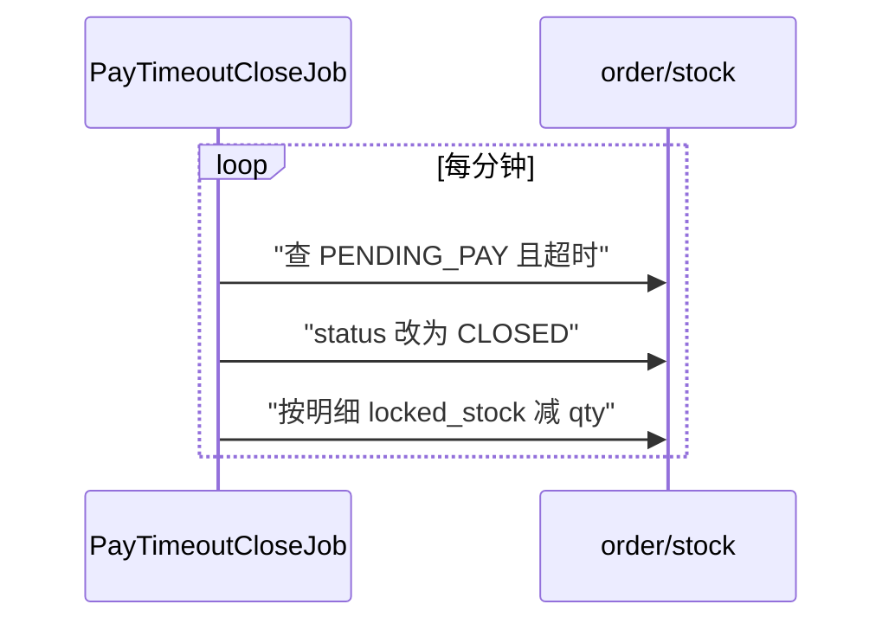
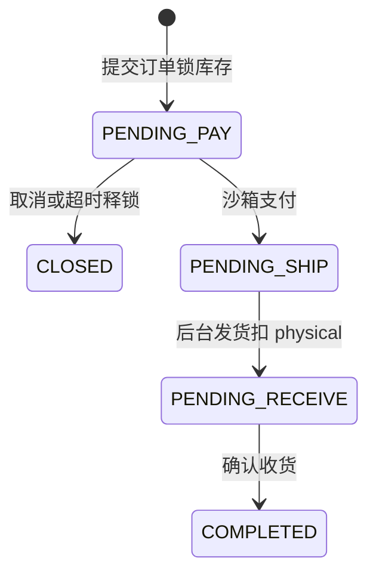
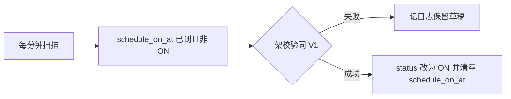

# V2.0 开发设计 — 购物交易闭环

| 项 | 内容 |
|---|---|
| 状态 | Implementing（后端已落地 Flyway V8～V11 + 核心服务） |
| PRD | `docs/01-requirements/PRD-V2.0-购物网站.md` |
| 体验 | `docs/02-design/v2.0/体验设计.md` |
| 基座 | [`../v1.0/开发设计.md`](../v1.0/开发设计.md) + ADR |
| 数据 | [`数据模型.md`](./数据模型.md) |
| 接口 | [`接口设计.md`](./接口设计.md) |

> 写给开发：增量**怎么落地**（模块、时序、事务、Job）。产品规则以 PRD 为准。

---

## 1. 范围与结论

V2 = **C 端交易闭环** + **后台运营补丁**。

| 做（V2.0） | 不做（目标版本见括号） |
|---|---|
| 顾客手机号登录；浏览/加购/下单/沙箱支付/收货 | 真支付、微信一键登录（V2.1） |
| 购物车、地址、收藏、足迹、评价 | 智能客服（V3.0） |
| 后台：会员冻结、站点品牌、运营位、交易配置 | 优惠券 / 促销 / 自由装修（V4.0） |
| 超时关单、定时上架、出入库、订单导出 | — |

后台补全优先级 A1～A11 见下节实现清单。

---

## 2. 架构增量

```text
shang-mall（Web/H5）
    │  Bearer JWT  clientType=web|h5
    ▼
shang-server
    ├ identity：CustomerAuth / Customer / SiteBrand /（复用 file、config）
    └ commerce：CatalogRead / Cart / Address / Order / Pay / Review / HomeSlot / InOut
shang-admin-web 继续 admin JWT（V1 路径不变）。
Flyway：**V8+**；禁止改 V1～V7。
```

### 2.1 建议新增包 / 服务（实现清单）

| ID | 能力 | 建议服务 | 依赖表 |
|---|---|---|---|
| C 端登录 | 手机号+验证码 | `CustomerAuthService` | `customer` + Redis 验证码 |
| 加购/结算 | | `CartService` · `OrderSubmitService` | `cart*` · `stock` · `order*` |
| 沙箱支付 | | `PaymentSandboxService` | `payment` · `order` · `spu.sold_count` |
| 超时关单 | Job | `PayTimeoutCloseJob` | `order` · `stock` |
| 定时上架 | Job | `ScheduleOnShelfJob` | `spu.schedule_on_at` |
| 运营位 | | `HomeSlotService` | 新建槽位表（见数据模型） |
| 出入库 | | `InOutOrderService` | `in_out_*` · `stock` |

跨模块仍只依赖 `*-api`（ADR-0001）。

---

## 3. 关键实现方案（逻辑图）

### 3.1 顾客登录（与 Admin JWT 隔离）



**要点**：Admin Token 与顾客 Token **互不通用**；过滤器按 path 前缀 `/api` vs `/admin` 选校验器。

---

### 3.2 加购 → 提交订单（锁库存）



**事务边界**：锁库存 + 写订单 + 清购物车 **同一本地事务**。  
**幂等**：`idempotentKey`（客户维度唯一）重复提交返回同一 `orderId`。  
**运费**：`goodsAmount >= freeThreshold ? 0 : defaultFreight`（读 `system_config` TRADE）。

---

### 3.3 沙箱支付 → 待发货



失败分支：保持 `PENDING_PAY`，可重试。本版无真实资金流。

---

### 3.4 取消 / 超时关单（释放锁）



手动取消：`POST /api/orders/{id}/cancel` 仅待付款；逻辑与 Job 相同，需幂等（已关闭直接成功）。

---

### 3.5 确认收货 / 发货出库（与 V1 衔接）

- **发货**：仍走 Admin `POST /admin/orders/{id}/ship`；V2 **同事务**再写 `SALE_OUT` 出入库单（A7）。  
- **确认收货**：C 端 `POST /api/orders/{id}/confirm`：`PENDING_RECEIVE` → `COMPLETED`。


---

### 3.6 定时上架 Job



---

## 4. 数据 / 接口

| 文档 | 内容 |
|---|---|
| [`数据模型.md`](./数据模型.md) | ALTER + 新建表字段说明、索引 |
| [`接口设计.md`](./接口设计.md) | `/api/**` 与新增 Admin 接口的字段与示例 |

---

## 5. 出口

1. PRD-V2 §10 验收矩阵可测  
2. 空库 Flyway 含 V8+ 可重放  
3. 回归 PRD-V1 §10 P0（发货/库存/权限不被破坏）  

---

## 变更记录

| 版本 | 日期 | 内容 |
|---|---|---|
| V0.1 | 2026-09-19 | 初稿 |
| V0.2 | 2026-09-19 | 拆出数据/接口文档 |
| V1.0 | 2026-09-19 | 补齐登录/下单/支付/关单/上架 Job 时序与事务方案 |
| V2.0 | 2026-09-23 | 版本纪律：范围表标注目标版本；运营位槽位口径收敛为 V2（Banner/活动位/搜索热词/热门精选）；页面标题与菜单名对齐 |
