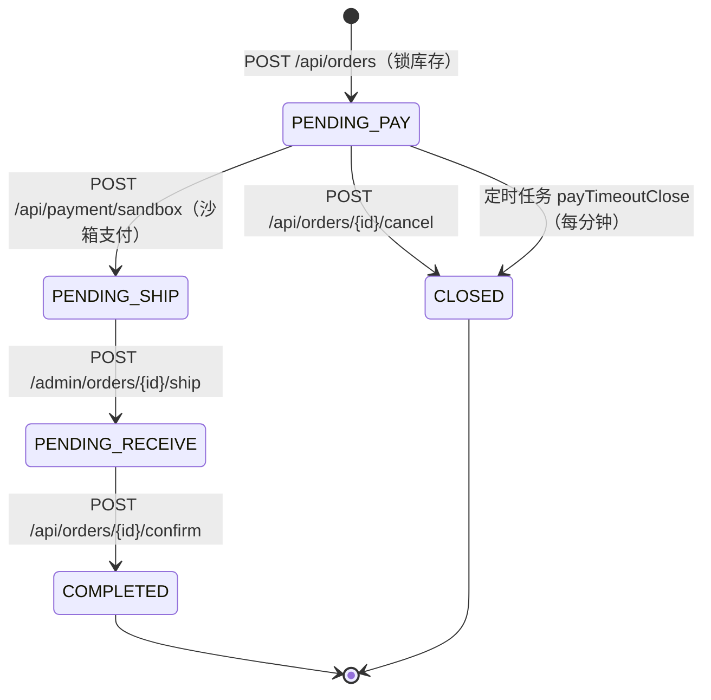
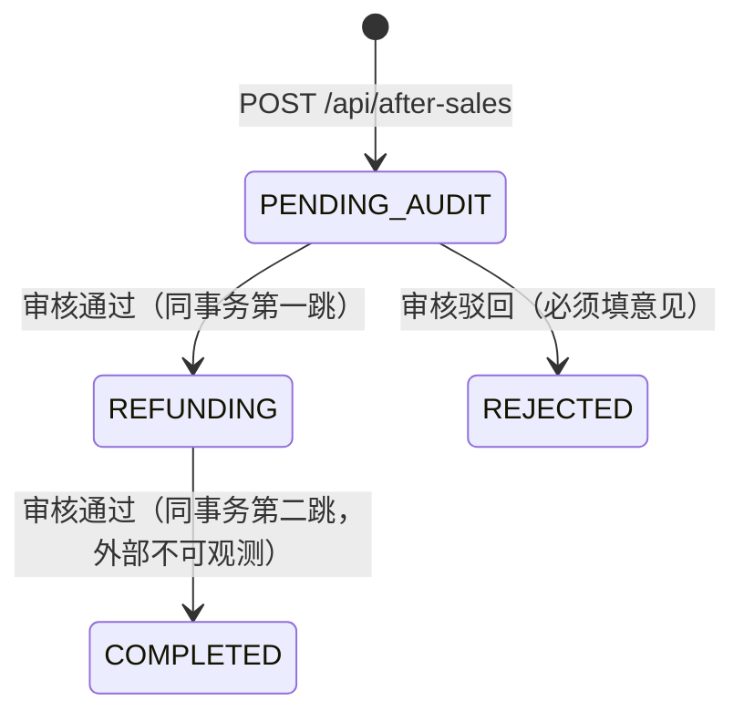

# 02 · 业务规则与状态机（实现真值）

> **判断区文档**（人工维护）。规则来自源码实测，非 PRD 转抄。
> 版本指纹：**`810986c`**　·　核对日期：2026-10-10
> 证据格式：`路径:行号 @ 810986c`。行号会随提交失效，**符号名比行号可靠**，复核时以符号为准。
> 置信度：`已确认` = 两处以上独立证据 / `高置信` = 单点源码证据 / `推测` / `未知`

---

## 0. 先读这一节：四条会误导你的前提

| # | 前提 | 含义 | 证据 |
|---|---|---|---|
| 0.1 | **状态值是裸字符串，没有枚举/常量类** | 全仓唯一的 `enum` 是 `ErrorCode`。订单/售后/SPU/评价状态全部是字符串字面量，没有编译期约束，**也没有 DB CHECK 兜底**（全库仅 3 个 CHECK，且都与状态无关） | `ErrorCode.java:9-25` 是唯一 enum；`V1__init.sql:245`、`V8__v2_customer_cart_address.sql:49`、`V10__v2_review_site_home.sql:20` 是全部 CHECK |
| 0.2 | **业务失败返回 HTTP 200** + 业务码 ≠ 0 | 只断言 HTTP 状态码会把几乎所有业务错误判成通过；必须同时断言 `code` | `GlobalExceptionHandler.java:31-39`（源码注释原文：「业务失败是 HTTP 200 + code≠0 的静默失败」） |
| 0.3 | **迁移注释与代码不一致** | `stock_log.type` 的 DB 注释写 `INIT/ADJUST/IN/OUT/ORDER_LOCK/ORDER_UNLOCK/SHIP`，**代码实际只写 `INIT`/`ADJUST`/`LOCK`/`UNLOCK`/`SHIP`** —— `IN`/`OUT`/`ORDER_LOCK`/`ORDER_UNLOCK` 从未被写入 | 注释：`V1__init.sql:570`；实际写入点：`StockService.java:118`、`OrderSubmitService.java:222`（`LOCK`）、`:243`（`UNLOCK`）、`OrderService.java:159`（`SHIP`）、`ProductService.java:317`（`INIT`）；全仓 `setType("` 仅此 5 处 |
| 0.4 | **所有 `Long`/`long` 序列化成 JSON 字符串** | 全局 `ToStringSerializer`。`id`、`total`、`customerId`、`soldCount` 回来都是 `"9001"`、`"3"` 这样的**字符串**。按数字断言（`total == 3`）会假失败；按字符串断言（`total == "3"`）才是对的。**反向**：入参里数字仍按数字传 | `JacksonConfig.java:17-22`；实测 `GET /api/addresses` → `"customerId":"9001"`；`GET /api/favorites` → `"total":"3"`；`GET /api/cart` → `"quantity":49`（数字）、`"spuId":"246"`（字符串） |

> 另一处同类陷阱：`InOutOrderService.java:135` 的 Javadoc 写「生成 SALE_OUT 并扣减 physical/locked」，但 `createSaleOut` 只插单据与明细，**不碰库存**；真正的扣减发生在 `OrderService.ship:142-154`。读代码注释前先读实现。

---

## 1. 订单状态机

### 1.1 状态值

| 值 | 语义 |
|---|---|
| `PENDING_PAY` | 待付款（下单后初始态） |
| `PENDING_SHIP` | 待发货（支付成功） |
| `PENDING_RECEIVE` | 待收货（已发货） |
| `COMPLETED` | 已完成（确认收货） |
| `CLOSED` | 已关闭（取消 / 超时） |

### 1.2 状态机

**没有其他转移。** 不存在：管理端取消/关单、超时自动确认收货、`PENDING_SHIP`/`PENDING_RECEIVE` 超时任务、支付失败回退。全仓定时任务只有 2 个（`CommerceJobs.java:30`、`:48`）。→ 已确认

### 1.3 转移明细

| 规则 | 转移 | 触发入口 | 守卫 | 副作用 | 失败 |
|---|---|---|---|---|---|
| OT-01 | → `PENDING_PAY` | `POST /api/orders` → `OrderSubmitService.submit` | 见 §1.4 | 锁库存、建单/明细、删购物车项、地址快照、算运费 | 见 §1.4 |
| OT-02 | `PENDING_PAY` → `PENDING_SHIP` | `POST /api/payment/sandbox` → `PaymentSandboxService.pay` | 沙箱开启；活跃顾客；订单归属；状态 == `PENDING_PAY` | 插 `payment`(PAID)、`paid_at`、`spu.sold_count += qty` | 状态不符 → `40902`；未开启 → `40900`「沙箱支付未开启」；非本人 → `40400`「订单不存在」 |
| OT-03 | `PENDING_PAY` → `CLOSED` | `POST /api/orders/{id}/cancel` | 归属；状态 == `PENDING_PAY` | `close_reason`「用户取消」、`locked -= qty`（下限 0）、`stock_log` `UNLOCK` | 状态不符 → `40902`「订单状态不允许」 |
| OT-04 | `PENDING_PAY` → `CLOSED` | 定时任务 `payTimeoutClose` | 状态 == `PENDING_PAY` 且 `created_at < now - 配置分钟`，`LIMIT 100`，无 `ORDER BY` | `close_reason`「支付超时自动关闭」、解锁同上 | 单条异常 `log.warn` 后继续，不影响其他单 |
| OT-05 | `PENDING_SHIP` → `PENDING_RECEIVE` | `POST /admin/orders/{id}/ship` | 订单存在；状态 == `PENDING_SHIP`；`trackingNo` 非空 | `ship_at`、插 `shipment`（`carrier` 缺省「模拟快递」、`SHIPPED`、2 条 traces）、扣 `physical`+`locked`、`stock_log` `SHIP`、生成 `SALE_OUT` 出入库单 | 状态不符 → `40902`；无单号 → `40000`「请录入运单号」；扣减不足 → `40901`「发货库存不足」 |
| OT-06 | `PENDING_RECEIVE` → `COMPLETED` | `POST /api/orders/{id}/confirm` | 归属；状态 == `PENDING_RECEIVE` | `received_at` | 状态不符 → `40902` |
| OT-07 | `CLOSED` 重复取消 | 同上 cancel | 状态 == `CLOSED` | **直接 return**：不二次释放库存、不写流水（幂等） | 无 |

> `CLOSED` 幂等成功而其他非法状态显式报错，是**有意设计**（源码注释指明为需求 MALL-08：拒绝「静默幂等」以免误导调用方）→ 已确认，`OrderSubmitService.java:135-143`。

### 1.4 提交订单完整序列（`OrderSubmitService.submit`）

| 步骤 | 规则 | 失败码/消息 |
|---|---|---|
| OS-01 | 顾客必须 `NORMAL`（`isActive`） | `40310`「账号不可用」 |
| OS-02 | `idempotentKey` **必填** | `40000`「idempotentKey 必填」 |
| OS-03 | 幂等命中 → 直接返回既有订单（**不校验本次请求参数是否与首次一致**；返回体**不含** `expireAt`） | — |
| OS-04 | 地址必须存在且属于本人 | `40000`「收货地址无效」 |
| OS-05 | 行解析：购物车路径（`cartItemIds` 优先）或立即购买（`quantity >= 1`）；SKU 必须 `ENABLED` 且 SPU `ON` | `40410`「商品不存在或未上架」；`40000`「数量须 ≥ 1」「购物车为空」「购物车项无效」「请选择购物车项或立即购买 SKU」 |
| OS-06 | 锁库存：`SELECT ... FOR UPDATE`（悲观行锁）；`physical - locked < qty` 拒绝 | `40901`「库存不足」 |
| OS-07 | 运费：`goodsAmount >= 免运门槛 ? 0 : 默认运费`；`payAmount = goodsAmount + freight` | — |
| OS-08 | `expireAt = now + 超时分钟`，**仅用于响应，不落库** | — |
| OS-09 | 订单号 `"O" + yyyyMMddHHmmss + %04d`，序号来自 JVM 内 `AtomicInteger` | 进程重启或同秒并发可能撞号，靠 DB 唯一索引 `uk_order_no` 兜底（会抛异常 → 500） |
| OS-10 | `address_snapshot` 仅存 name/phone/province/city/district/detail | — |
| OS-11 | `clientType` 取自 JWT；`customer_phone_mask` 由顾客手机脱敏（前 3 + `****` + 后 4） | — |
| OS-12 | 逐行插 `order_item`（快照 title/pic/price/specs/subtotal）；来自购物车则删对应 `cart_item`；整单同一本地事务 | — |

**锁库存先于插订单**（`OrderSubmitService.java:71-83`）：任一行失败整单回滚。→ 已确认

### 1.5 关单与发货的库存语义

- **关单**（`closeAndUnlock`）：再次守卫 `PENDING_PAY`；`locked = max(0, locked - qty)`，写 `stock_log` `UNLOCK` / `change_qty = -qty` / reason「关单释锁」。**无退款、无 `sold_count` 回退**（此路径未支付，符合语义）。
- **发货**（`OrderService.ship`）：`nextLocked = max(0, locked - qty)`；`nextPhysical = physical - qty`；若 `nextPhysical < nextLocked || nextPhysical < 0` → `40901`「发货库存不足」。写 `stock_log` `SHIP` / `-qty` / reason「订单发货出库 {orderNo}」。
- **静默跳过**：`ship` 中 `order_item.skuId` 为空、或找不到 `stock` 行 → `continue`，**库存未扣也照样发货成功**（`OrderService.java:142-143`）。→ 已确认，列为缺口候选 NEG-S01。

---

## 2. 售后状态机

### 2.1 状态与转移

| 规则 | 条件 | 动作 | 失败 |
|---|---|---|---|
| AS-01 | `apply` 仅 `requireUserId`，**不校验 `isActive`** | — | 缺项 → `40000`「订单、类型、原因必填」 |
| AS-02 | `type ∈ {REFUND, RETURN_REFUND, EXCHANGE}` | 原值落库 | `40000`「type 无效」 |
| AS-03 | 订单存在且属于本人 | — | `40400`「订单不存在」 |
| AS-04 | 订单状态 ∈ {`PENDING_RECEIVE`, `COMPLETED`} | — | `40902`「当前订单状态不可申请售后」 |
| AS-05 | 同订单无进行中售后（`PENDING_AUDIT`/`REFUNDING`） | — | `40000`「该订单已有进行中的售后」 |
| AS-06 | 单号 `"AS" + yyyyMMddHHmmss + %04d(Math.random())` | — | 无唯一索引，重复由概率兜底 |
| AS-07 | `refundAmount` 为空则默认 `order.payAmount` | 直接落库 | **无任何校验**（可为负、可超额）→ NEG-S02 |
| AS-08 | 审核仅 `PENDING_AUDIT` 可操作 | — | `40903`「售后状态不允许」 |
| AS-09 | `approved` 非空；驳回必须填 `remark` | `audit_remark` 落库 | `40000`「请选择通过或拒绝」「拒绝时请填写处理意见」 |
| AS-10 | 通过 | 同一方法内先写 `REFUNDING` 再写 `COMPLETED`（同一事务） | — |
| AS-11 | 驳回 | `REJECTED` | — |

### 2.2 售后必须知道的三件事

1. **`REFUNDING` 是瞬态、外部永不可观测**（同一事务内立即被 `COMPLETED` 覆盖）。它只在 AS-05 的「进行中」判定里被引用，而 `PENDING_AUDIT` 已覆盖该场景 → **装饰性/僵尸状态**，见 NEG-S03。
2. **三种 `type` 行为完全一致**：代码中无任何按 `type` 分支的逻辑，`EXCHANGE`（换货）也走退款流程；**售后审核不退货入库**（`StockService` 无退货路径）。→ 已确认
3. **审核通过不产生任何资金/库存/销量副作用**：不写 `payment`、不改订单状态、不退库存、不减 `sold_count`。所谓「沙箱退款」只在代码注释里。

> **文案不一致**：`AfterSaleController.java:33` 的 Swagger 注释写「REFUND / RETURN」，实现白名单是 `RETURN_REFUND`（`AfterSaleService.java:89`）→ 接口文档如照抄注释会错。

---

## 3. 库存规则

### 3.1 不变式 `physical >= locked >= 0`（`available = physical - locked`）

**双重保障**：

| 层 | 内容 | 证据 |
|---|---|---|
| DB | `CONSTRAINT ck_stock_invariant CHECK (physical_stock >= locked_stock AND locked_stock >= 0)` | `V1__init.sql:245` |
| 代码 | 4 个显式检查点：下单锁库存、手工调整、手工出入库、发货 | `OrderSubmitService.java:213-215`、`StockService.java:106-110`、`InOutOrderService.java:182-185`、`OrderService.java:147-151` |

### 3.2 所有改库存路径与其 `stock_log.type`

| 操作 | 实际 `type` | `change_qty` 符号 | reason | 证据 |
|---|---|---|---|---|
| 新建 SKU 初始库存 | `INIT` | `+qty`（仅 `qty > 0` 写流水） | 「SKU初始化」 | `ProductService.java:303-321` |
| 后台手工调整 | `ADJUST` | 请求值（正入负出） | 硬编码「后台手工调整」（**请求的 `reason` 被忽略**） | `StockService.java:89-122`、`:118` |
| 下单锁库存 | `LOCK` | `+qty` | 「下单锁库存」 | `OrderSubmitService.java:218-225` |
| 关单释放 | `UNLOCK` | `-qty` | 「关单释锁」 | `OrderSubmitService.java:239-245` |
| 发货出库 | `SHIP` | `-qty` | 「订单发货出库 {orderNo}」 | `OrderService.java:155-162` |
| 手工采购入 / 盘点 | `PURCHASE_IN` / `STOCKTAKE`（= 单据 type 原值传入） | `PURCHASE_IN` 取 `abs`；`STOCKTAKE` 可正负 | 「出入库单 {billNo}」 | `InOutOrderService.java:118-124`、`:193` |
| 发货 `SALE_OUT` 单 | **不写 `stock_log`**（仅 `in_out_order` + `in_out_item`） | `in_out_item.qty = -abs(qty)` | — | `InOutOrderService.java:137-151` |

> 见 §0.3：`IN`/`OUT`/`ORDER_LOCK`/`ORDER_UNLOCK` 只在 DB 注释里存在。

### 3.3 两级低库存阈值

| 档位 | 条件 | 排序 | 证据 |
|---|---|---|---|
| 低库存（`lowOnly`） | `physical - locked <= low_threshold` | `(physical-locked-threshold) ASC, id ASC` | `StockService.java:50-56` |
| 关注（`warnOnly`，**含低库存**） | `physical - locked <= low_threshold * 1.5` | 同上 | `StockService.java:57-60`（注释「预警档（低库存 + 关注）」） |
| 都不传 | — | `id DESC` | `StockService.java:61-63` |

- 两者同时传时 **`lowOnly` 优先**（if/else，非叠加）。
- `low_threshold` 列默认 10；手工建库存行时默认取 10。
- Dashboard 的 `lowStockCount` 用**低库存口径**遍历全部 stock 行，`threshold` 为 null 时视为 0（`DashboardController.java:46-52`）。

### 3.4 并发保护：不一致，需注意

| 路径 | 保护 | 证据 |
|---|---|---|
| 下单锁库存 / 关单解锁 | `SELECT ... FOR UPDATE` **悲观行锁** | `OrderSubmitService.java:207`、`:232` |
| 发货、手工调整、手工出入库 | 普通 `select` + `updateById`；**未检查影响行数、未做乐观锁失败处理或重试** | `OrderService.java:142-154`、`StockService.java:112`、`InOutOrderService.java:181-186` |
| `stock.version` | 有 `@Version` 且拦截器已注册 | `Stock.java:19`、`MybatisPlusConfig.java:37-40` |

→ 结论：乐观锁冲突时 `updateById` 影响 0 行而**静默丢失更新**，调用方察觉不到。列为 NEG-S04（缺口）。

---

## 4. 商品与可见性规则

### 4.1 SPU 状态与守卫

状态：`DRAFT`（新建默认） / `ON` / `OFF`。

| 规则 | 动作 | 守卫 | 失败消息 | 证据 |
|---|---|---|---|---|
| PR-01 新建 | `scheduleOnAt` 必须晚于当前 | `!isAfter(now)` | `40000`「定时上架时间须晚于当前」 | `ProductService.java:173-189` |
| PR-02 更新 | 有 `skus` 则删旧建新 | **无状态白名单、无上架校验**（可直接写入 `ON`） | — | `ProductService.java:191-225` → NEG-S05 |
| PR-03 上架 | 校验①主图非空 ②至少 1 个 `ENABLED` SKU ③`ENABLED` SKU 中至少 1 个 `price > 0` | 三个 fail-fast | 「上架需至少一张主图」/「上架需至少一个可售SKU」/「上架需合法价格」 | `ProductService.java:227-237`、`:272-286` |
| PR-04 上架清定时 | `status = ON` 时 `schedule_on_at = null` | — | — | `ProductService.java:231-234` |
| PR-05 下架 | 任意状态可直接置 `OFF`，无守卫 | — | — | `ProductController.java:70-78` |
| PR-06 删除 | **仅 `DRAFT` 可删** | 非 DRAFT | `40900`「仅草稿商品可删除，上架/下架请先处理状态」 | `ProductService.java:239-251` |
| PR-07 删除副作用 | 先删各 SKU 的 `stock` 行，再删 SKU、SPU；**不校验订单引用** | — | — | `ProductService.java:245-250` |
| PR-08 批量下架 | 仅处理当前 `ON`；缺失/非 `ON` **静默跳过** | 空 `ids` | `40000`「请选择要下架的商品」 | `ProductService.java:253-270` |
| PR-09 定时上架任务 | cron 每分钟；`scheduleOnAt <= now` 且 `status != ON`，`LIMIT 50` | 走 PR-03 校验 | 失败 `log.warn`；**`scheduleOnAt` 不清除 → 每分钟重试** | `CommerceJobs.java:47-63` → NEG-S06 |
| PR-10 类目删除守卫 | 有子类目 / 商品引用 / 属性引用均拒绝 | — | 「存在子类目，请先处理」/「类目已被商品引用，请先处理引用」/「类目已被属性引用，请先处理引用」 | `CategoryController.java:88-98` |
| PR-11 品牌删除守卫 | 被商品引用拒绝 | — | 「品牌已被商品引用，请先处理引用」 | `BrandController.java:79-81` |

### 4.2 C 端可见性（什么让商品对顾客不可见）

| 位置 | 过滤条件 | 证据 |
|---|---|---|
| 列表 `/api/products` | 仅 `status = 'ON'`；**不校验类目 status**（类目 DISABLED 不影响商品可见） | `CatalogReadService.java:50-57` |
| 搜索 `/api/search` | 关键词空白直接返回 `total = 0`；`ON` + `name`/`subtitle` like，按 `sold_count DESC` | `CatalogReadService.java:59-68` |
| 详情 `/api/products/{spuId}` | SPU 非 `ON` → 不可见；SKU 仅 `ENABLED` | `CatalogReadService.java:71-78` |
| 分类树 `/api/categories` | 仅 `ENABLED` 类目 | `CatalogReadService.java:42-48` |
| 首页运营位 | slot `ON` + 时间窗 + item `ON` + **SPU `ON`** | `HomeSlotService.java:138-196` |
| 卡片价格 | `ENABLED` SKU 最低价；无可售 SKU 时 **`price = 0`**（不报错） | `CatalogReadService.java:130` |

排序：`sold` → `sold_count DESC`；`new`/`comp` → `id DESC`；`price_asc`/`price_desc` → `ENABLED` SKU 最低价子查询；**未知取值回落 `sold_count DESC`**（`CatalogReadService.java:102-118`）。

### 4.3 `sold_count` 规则

- **唯一递增点**：沙箱支付成功时按 `order_item.quantity` 累加到对应 SPU（`PaymentSandboxService.java:73-86`）。
- **不回退**：售后通过、关单（未支付）均不改 `sold_count`；支付成功后订单不可取消，故无回退路径。→ 已确认

---

## 5. 认证与会员规则

### 5.1 管理端登录

| 规则 | 内容 | 证据 |
|---|---|---|
| 锁定键 | Redis `login:fail:{username}` | `AuthService.java:36` |
| 阈值/时长 | **5 次失败锁 15 分钟**；`count >= 5` 即锁 | `AuthService.java:37-38`、`:55-61` |
| 锁定错误 | `40104`「登录失败次数过多，请15分钟后再试」（仍写 FAIL 操作日志） | `AuthService.java:57-60` |
| TTL 语义 | **仅第一次失败**（`count == 1`）时设 15 分钟过期，后续失败**不续期** → 滚动窗口不成立，是固定窗口 | `AuthService.java:66-69` |
| 密码校验 | BCrypt；失败累加计数并返回 `40101` | `AuthService.java:65-75` |
| 禁用账号 | 密码正确后校验 `status == 'ENABLED'`，否则 `40300`「账号已禁用」；**禁用账号输错密码也会累计失败次数** | `AuthService.java:76-82` |
| 成功副作用 | 删失败计数、写 `last_login_at`、签发 access(900s)+refresh(7d)、加载角色/权限/菜单、写 SUCCESS 日志 | `AuthService.java:84-110` |
| 登出 | access 的 `jti` 入黑名单，TTL = access-ttl | `AuthService.java:116-137` |
| 刷新 | 必须 `tokenType = refresh`；**已在黑名单则拒绝**；用户存在且 `ENABLED`；旧 refresh `jti` 入黑名单（TTL = refresh-ttl）；换发新双 token | `AuthService.java:142-171` |

### 5.2 顾客短信登录

| 规则 | 内容 | 证据 |
|---|---|---|
| 固定演示码 | `DEMO_CODE = "123456"`（**public 常量**） | `CustomerAuthService.java:34` |
| 发送 | `sms:phone:{phone}` = 验证码，TTL **5 分钟**；冷却键 `sms:cooldown:{phone}` TTL **60 秒**；冷却中 → `40000`「发送过于频繁，请{n}秒后再试」 | `CustomerAuthService.java:35-56` |
| 登录校验 | `if (!DEMO_CODE.equals(code) && (cached == null \|\| !cached.equals(code)))` → **固定码 `123456` 永远通过，无需先发短信**（演示后门） | `CustomerAuthService.java:65-68` |
| 验证码消费 | 登录成功后删除 `sms` 键（不删冷却键） | `CustomerAuthService.java:69` |
| 自动注册 | 手机号不存在则新建：`nickname = "用户" + phone.substring(7)`（后 4 位）、`gender = 0`、`status = NORMAL` | `CustomerAuthService.java:71-81` |
| 冻结拒绝 | 已有顾客 `FROZEN` → `40310`「账号不可用」（发生在自动注册之后） | `CustomerAuthService.java:82-84` |
| `clientType` | 仅 `web` / `h5`（DTO 正则 + 服务端二次校验） | `CustomerLoginRequest.java:20-23`、`CustomerAuthService.java:60-64` |
| 顾客刷新 | 必须 refresh 且 `clientType ∈ {web,h5}`；顾客存在且非 `FROZEN`；旧 `jti` 入黑名单；**未检查该 refresh 是否已在黑名单**（与管理端不同） | `CustomerAuthService.java:98-127` |
| 手机号格式 | `^1\d{10}$` | `SmsSendRequest.java:12-13` |

### 5.3 令牌与鉴权（全站）

- JWT payload：`uid` / `uname` / `clientType` / `tokenType` / `jti`；access 900s、refresh 604800s（`JwtUtil.java:39-50`）。
- 只接受 `tokenType = access`；黑名单命中 → `40103`（`JwtAuthFilter.java:53-61`）。
- **`clientType` 严格单向隔离**：`/admin/**` 只接受 `admin` token，`/api/**` 拒绝 `admin` token；越界一律 HTTP 401 + `40103`（`JwtAuthFilter.java:63-75`）。连白名单 GET 也拦。
- **全站无接口级授权**：`@EnableMethodSecurity` 已开启，但全仓 **零** `@PreAuthorize`/`hasAuthority`/`hasRole`；权限码只用于构建菜单树 → **任何管理员 token 可调用任意 `/admin/**` 接口**（`SecurityConfig.java:21`、`:68-69`；全仓 grep 命中 0）。
- 会员冻结/解冻：`PUT /admin/customers/{id}/status`，白名单 `NORMAL`/`FROZEN`，否则 `40000`「status 须为 NORMAL 或 FROZEN」（`CustomerAdminService.java:73-79`）。

---

## 6. 支付（沙箱）规则

| 规则 | 内容 | 证据 |
|---|---|---|
| 开关 | 配置 `payment.sandbox.enabled`，代码默认 `"true"`（大小写不敏感）；关闭 → `40900`「沙箱支付未开启」 | `PaymentSandboxService.java:44-46` |
| 守卫顺序 | 活跃顾客 → 订单归属 → 状态 == `PENDING_PAY` | `:47-57` |
| 写入 | `payment`：`channel = "SANDBOX"`、`amount = order.payAmount`、`status = "PAID"`、`trade_no = "SANDBOX-{orderId}"`、`paid_at = now` | `:59-67` |
| 订单副作用 | `status = PENDING_SHIP`、`paid_at = now` | `:69-71` |
| 销量 | 按 `order_item` 累加 `spu.sold_count` | `:73-86` |
| 二次调用 | 状态已是 `PENDING_SHIP` → `40902`，**不会重复插 `payment`**（靠顺序守卫天然幂等） | `:55-57` |
| **无真实支付** | 应用内沙箱，无第三方网关（`channel` 恒为 `SANDBOX`） | `:33-115` |
| **未接线的配置** | `payment.sandbox.delay-ms`(=800)、`channel`(=sandbox-mock)、`merchant`、`notify-url` 在 `V12` 有种子，**Java 代码零引用** | `V12__sandbox_payment_config.sql:6-9`；全仓 grep 无引用 |
| 无唯一约束 | `payment.order_id` 无唯一索引 → 并发双支付理论上可双插 | `V1__init.sql:302-315` → NEG-S07 |

---

## 7. 评价规则

| 规则 | 条件 | 失败 |
|---|---|---|
| RV-01 | 活跃顾客（`isActive`） | `40310` |
| RV-02 | 订单项存在 | `40400`「订单项不存在」 |
| RV-03 | 订单存在 **且属于本人** **且** `status == COMPLETED` | `40902`「仅已完成订单可评价」 |
| RV-04 | 同 `orderItemId` 无既有评价 | `40904`「评价已存在」；DB 唯一索引 `uk_review_order_item` 兜底 |
| RV-05 | `rating` 直接 `Integer.parseInt(body.get("rating"))`，**无 1–5 代码校验** | 缺失字段 → NPE → 500；越界 → DB CHECK `rating BETWEEN 1 AND 5` 抛异常 → 500 `SYSTEM_ERROR`（而非 400）→ NEG-S08 |
| RV-06 | C 端仅展示 `VISIBLE`；详情页预览 `LIMIT 5` | — |
| RV-07 | 管理端改状态白名单 `VISIBLE`/`HIDDEN`，否则 `40000`「status 须为 VISIBLE 或 HIDDEN」 | — |

**创建逻辑内联在控制器**（`StorefrontController.java:270-302`），没有独立 `ReviewService`。

---

## 8. 购物车 / 地址 / 收藏

### 8.1 购物车

| 规则 | 内容 | 证据 |
|---|---|---|
| 加购数量 | `< 1` → `40000`「数量须 ≥ 1」 | `CartService.java:52-55` |
| 加购在售 | SKU `ENABLED` 且 SPU `ON`，否则 `40410` | `CartService.java:57`、`:152-162` |
| 库存上限 | `existing.qty + qty > available` → `40901` | `CartService.java:63-66` |
| 合并 | 同 `cart + sku` 累加；新项 `selected = true` | `CartService.java:63-77` |
| 归属 | `CartItem` 必须属于本人购物车 | `40400`「购物车项不存在」 |
| **invalid 定义** | ① SKU 不存在（「SKU 不存在」）② 非（SPU `ON` 且 SKU `ENABLED`）（「商品已下架」）③ `qty > available`（「库存不足」） | `CartService.java:173-205` |
| `clear-invalid` | 逐项若 `valid = false` 则**物理删除**（含数量超库存的行） | `CartService.java:111-123` |
| 合计 | `selectedAmount` 仅累加 `selected && valid` 的行；`available` 字段**恒为 true（硬编码）** | `CartService.java:36-48` |
| DB 约束 | `CHECK (quantity >= 1)`；唯一 `(cart_id, sku_id)`；唯一 `(customer_id)` → 一人一车 | `V8__v2_customer_cart_address.sql:39,49,51` |

### 8.2 地址

| 规则 | 内容 | 证据 |
|---|---|---|
| 上限 | 已有 ≥ 20 条 → `40000`「每个会员最多 20 条地址」 | `AddressService.java:23`、`:39-42` |
| 默认地址 | 首条强制默认；`isDefault = true` 时先批量清旧默认再设新 | `AddressService.java:45-50` |
| 更新 | **仅当** `req.isDefault = true` 才清旧默认 → **无法取消默认** | `AddressService.java:55-64` |
| 删除 | **无任何守卫**（可删默认地址、可删已被订单引用的地址） | `AddressService.java:66-70` → NEG-S09 |
| 必填 | name/phone/province/city/district/detail 任一为空 → `40000`「收货信息不完整」；**无手机号格式校验** | `AddressService.java:109-121` |
| 归属 | 非本人 → `40400`「地址不存在」 | `AddressService.java:86-93` |

### 8.3 收藏与足迹

- 收藏去重：已存在则直接 return（幂等）（`FavoriteBrowseService.java:52-66`）。
- **收藏不要求 SPU 在售**：只校验 SPU 存在（`40400`「商品不存在」），可收藏下架商品（`:141-146`）。
- 足迹记录条件：仅登录态（`optionalUserId() != null`）记录；已有记录只更新 `last_at`（`StorefrontController.java:76-82`、`FavoriteBrowseService.java:106-124`）。
- 足迹清空：删本人全部（`:126-131`）。
- 收藏列表**无 SPU 状态过滤**，展示下架商品；缺失 SPU 被过滤掉但 `total` 仍为原始值（`:37-50`）。

---

## 9. 配置键与硬编码阈值（全量）

| 项 | 值 | 键/位置 |
|---|---|---|
| 免运门槛 | **99 元**（含等于即免） | `freight.free-threshold`，代码默认 `"99"`；`OrderSubmitService.java:76`；种子 `V11:38` |
| 默认运费 | **8 元** | `freight.default-amount`，默认 `"8"`；`OrderSubmitService.java:77`；种子 `V11:39` |
| 支付超时 | **15 分钟** | `order.pay-timeout-minutes`；`OrderSubmitService.java:80`、`CommerceJobs.java:32`；种子 `V11:37` |
| 首页 feed 排序 | `sold` | `home.feed-sort`；`CatalogReadService.java:37`；种子 `V11:40` |
| 沙箱支付开关 | `true` | `payment.sandbox.enabled`；`PaymentSandboxService.java:44` |
| 订单导出上限 | `LIMIT 5000` | `OrderService.java:80` |
| 关单任务批量 | `LIMIT 100`/分钟 | `CommerceJobs.java:37` |
| 定时上架批量 | `LIMIT 50`/分钟 | `CommerceJobs.java:54` |
| 评价预览条数 | `LIMIT 5` | `CatalogReadService.java:93` |
| 地址条数上限 | 20 | `AddressService.java:23` |
| 运营位单项上限 | 10 | `HomeSlotService.java:28`、`:115-116` |
| 上传大小上限 | 10,485,760 B（10 MiB） | `shang.oss.max-size-bytes`；`application.yaml:100` |
| 上传类型白名单 | `image/jpeg`、`image/png`、`image/webp`、`video/mp4`（后台）；C 端无 mp4 | `FileController.java:40-41`、`CustomerFileController.java:34-36` |
| 预签名有效期 | 600 s | `application.yaml:99` |
| JWT access / refresh | 900 s / 604800 s | `application.yaml:85-86` |
| 短信 TTL / 冷却 | 5 分钟 / 60 秒 | `CustomerAuthService.java:37-38` |
| 管理员锁定 | 5 次 / 15 分钟 | `AuthService.java:37-38` |
| 访问日志 body 截断 | 2048 | `AccessLogFilter.java:33` |
| 操作日志参数截断 | 2000 | `OperationLogService.java:31` |
| 站点名 / Slogan 长度 | 1–30 / ≤50 字符 | `SiteBrandService.java:44-53` |
| **分页大小上限** | **无上限**（`PaginationInnerInterceptor` 未 `setMaxLimit`） | `MybatisPlusConfig.java:25-36` → NEG-S10 |

配置读取语义：`SystemConfigApiImpl.getValue` 查 `identity.system_config`，不存在或为空返回默认；`getInt` 解析失败也回默认（`SystemConfigApiImpl.java:14-38`）。

---

## 10. 负面清单：缺口与无守卫路径

> 每条标 **有意 / 缺口 / 待确认**。三者处置完全不同：缺口进缺陷流程，有意写进文档，待确认进 §11 台账。

### 10.1 非法转移可达 / 状态无守卫

| 编号 | 问题 | 证据 | 判定 |
|---|---|---|---|
| NEG-S05 | `PUT /admin/products/{id}` 可把 SPU `status` 写成**任意字符串**，且**完全绕过 PR-03 上架校验**（无图/无 SKU/价格 0 也能直接置 `ON`） | `ProductService.java:202-204` 对比 `:227-237` | 缺口（一致性漏洞） |
| NEG-S11 | `changeStatus` 自身不校验 `status` 白名单，仅靠控制器只传 `ON`/`OFF` | `ProductService.java:229-237` | 有意（接口层封死），低风险 |
| NEG-S12 | 支付/发货/售后审核均为「读-改-写」且无行锁、`Order`/`AfterSale` 无 `@Version` → 并发双请求可双双通过守卫（双 `payment`、双 `shipment`、双扣库存、双审核） | `PaymentSandboxService.java:51-71`、`OrderService.java:110-119`、`AfterSaleService.java:58-79` | 待确认（演示环境或许可接受） |

### 10.2 库存相关

| 编号 | 问题 | 证据 | 判定 |
|---|---|---|---|
| NEG-S01 | 发货时 `order_item.skuId` 为空或 `stock` 行缺失 → **静默跳过，库存未扣仍发货成功** | `OrderService.java:142-143` | 缺口 |
| NEG-S04 | `stock.version` 乐观锁已注册，但所有 `updateById` 返回值被忽略；非 `FOR UPDATE` 路径冲突时静默 0 行更新 | `OrderService.java:142-154`、`StockService.java:112` | 缺口（数据可能不一致） |
| NEG-S13 | `initStock` 可写负数 `physical` → 违反 `ck_stock_invariant` → 500 而非 400 | `ProductService.java:307-311` | 缺口 |
| NEG-S14 | 商品更新重建 SKU 时**旧 SKU 的 `stock` 行不删除**（孤儿库存）；而 `delete()` 会删 | `ProductService.java:218-224` 对比 `:245-249` | 缺口 |
| NEG-S15 | 手工调整请求的 `reason` 被忽略，固定写「后台手工调整」 | `StockService.java:114-120` | 有意（源码注释称 V1 固定文案） |

### 10.3 校验缺失

| 编号 | 问题 | 证据 | 判定 |
|---|---|---|---|
| NEG-S02 | 退款金额不校验 `> 0`、不校验 `<= order.payAmount`；可为负或超额 | `AfterSaleService.java:114` | 缺口 |
| NEG-S08 | 评价 `rating` 无代码校验；缺失字段 NPE→500，越界触发 DB CHECK→500（错误码应为 400） | `StorefrontController.java:294`、`V10:20` | 缺口 |
| NEG-S16 | SKU `price`/`cost_price` 无 `>= 0` 校验；仅上架时要求「至少一个 SKU `price > 0`」→ **负价可入库** | `ProductService.java:282-285`、`V1:206-215` | 缺口 |
| NEG-S17 | 地址 `phone` 无格式校验（任意字符串可存） | `AddressService.java:109-121` | 缺口 |
| NEG-S09 | 地址删除无守卫（可删默认地址、可删已被订单引用的地址） | `AddressService.java:66-70` | 缺口 |
| NEG-S18 | 商品更新可写入不存在的 `categoryId`/`brandId`（无外键、无存在性校验） | `ProductService.java:195-196` | 缺口 |
| NEG-S19 | `/admin/files/confirm`、`/api/files/confirm` 不校验 `objectKey` 归属/大小/类型，可登记任意 key | `FileController.java:127-145`、`CustomerFileController.java:116-137` | 待确认 |
| NEG-S20 | 幂等键「查后插」无唯一冲突捕获 → 并发同 key 触发唯一索引异常 → 500（而非返回既有单） | `OrderSubmitService.java:54-59`、`:102`；`V9:26-28` | 缺口 |
| NEG-S21 | `OrderService.ship` 的 `carrier` 任意字符串，不校验 `carrier` 字典 | `OrderService.java:123` | 轻微 |
| NEG-S28 | **缺必填 query 参数返回 HTTP 500 而非 400**：`MissingServletRequestParameterException` 未被 `GlobalExceptionHandler` 处理，落到兜底 `handleOther` → `50000 系统异常`。实测：`GET /admin/dict-items`（不带 `dictId`）与 `GET /admin/dict-items/by-code`（不带 `code`）均返回 500。**这类参数校验错误不该是 5xx**（会污染错误率告警，也让客户端无法区分「我传错了」和「服务崩了」） | `GlobalExceptionHandler.java:27-79`（无该异常的 `@ExceptionHandler`）；实测复现 HTTP 500 + code 50000 | **缺口**，已由契约用例 `GET_ADMIN_DICT_ITEMS-003`、`GET_ADMIN_DICT_ITEMS_BY_CODE-003` 钉死 |
| NEG-S29 | 同类风险面：凡是用 `@RequestParam` 必填 / `@PathVariable` 类型不匹配的端点，都会走同一条 500 路径（Spring 抛 `MissingServletRequestParameterException` / `MethodArgumentTypeMismatchException`） | 同上 | 缺口（**推测**：需逐个端点实测确认影响面，NEG-S28 已确认两例） |

### 10.4 校验不一致（写路径 vs 读路径）

| 编号 | 问题 | 证据 | 判定 |
|---|---|---|---|
| NEG-S22 | 读接口普遍只 `requireUserId` **不查 `isActive`**（订单/售后/支付状态查询/`PUT /api/me`）→ 冻结用户持旧 token 仍可读、可改昵称头像；而所有写路径均校验 `isActive` | `StorefrontController.java:196,207,233`、`PaymentSandboxService.java:98-99`、`AfterSaleService.java:120`、`CustomerAuthService.java:156-171` | 推测有意（「冻结只禁写」）→ 待确认 |
| NEG-S23 | `AfterSale.apply` **不校验 `isActive`**，与其他写路径不一致 | `AfterSaleService.java:85` | 缺口 |
| NEG-S24 | 全部 `/admin/**` 只认证不鉴权；登录返回的 `permissions` 未用于授权 | `SecurityConfig.java:68`；全仓 `@PreAuthorize` 命中 0 | 待确认（演示级 RBAC） |

### 10.5 死代码 / 未接线 / 死字段

| 编号 | 项 | 证据 |
|---|---|---|
| NEG-S03 | `REFUNDING` 同事务被 `COMPLETED` 覆盖，外部不可观测 | `AfterSaleService.java:71-75`、`:101` |
| NEG-S06 | 定时上架校验失败时 `scheduleOnAt` 不清除 → 每分钟失败重试、日志噪声 | `CommerceJobs.java:55-62`、`ProductService.java:231-234` |
| NEG-S07 | `payment.order_id` 无唯一索引；且 `payment.sandbox.delay-ms`/`channel`/`merchant`/`notify-url` 四个配置零引用 | `V1:302-315`、`V12:6-9` |
| NEG-S25 | `order.remark` 字段 DDL/实体存在，但下单从不写入，请求 DTO 也无该字段 | `Order.java:26`、`V1:272`、`OrderSubmitService.SubmitReq` |
| NEG-S26 | `StockApi` 空接口零实现；`shang-customerservice` 空模块 | `StockApi.java`、`CustomerServiceModule.java` |
| NEG-S27 | `V9:20` 注释写 `client_type` 为「web / h5 / mp」，但顾客登录只允许 `web`/`h5` | `V9__v2_spu_order_alter.sql:20`、`CustomerAuthService.java:60-64` |
| NEG-S10 | 分页无上限、`/api/home` 的 `feedSize` 无上限、购物车项数无上限 | `MybatisPlusConfig.java:25-36`、`StorefrontController.java:54-57` |

---

## 11. 待确认单

| 编号 | 问题 | 影响 | 置信度 | 需决策人 | 处置结论 |
|---|---|---|---|---|---|
| Q-01 | 编辑商品时直接置 `ON` 绕过上架校验（NEG-S05），是有意（编辑页可发布）还是缺口？ | 商品可「无图无价上架」 | 高置信（代码事实）/ 未知（意图） | 产品 | 未处置 |
| Q-02 | 并发无双支付/双发货保护（NEG-S12），演示项目是否接受？ | 数据一致性 | 高置信 | 技术负责人 | 未处置 |
| Q-03 | 退款金额无校验（NEG-S02）：是简化还是待补？ | 资金正确性 | 高置信 | 产品/财务 | 未处置 |
| Q-04 | `REFUNDING` 是预留状态吗？（NEG-S03）若否则应从状态机文档删除 | 状态机准确性 | 推测（预留） | 产品 | 未处置 |
| Q-05 | 定时上架失败后不清 `scheduleOnAt`（NEG-S06）是设计还是缺陷？ | 日志噪声/重试风暴 | 高置信 | 技术负责人 | 未处置 |
| Q-06 | 冻结用户「可读不可写」（NEG-S22）是明确规则吗？`/api/me` 不校验冻结是否例外？ | 冻结语义与验收标准 | 推测有意 | 产品 | 未处置 |
| Q-07 | `AfterSale.apply` 不校验 `isActive`（NEG-S23）是遗漏吗？ | 冻结用户可提售后 | 高置信 | 技术负责人 | 未处置 |
| Q-08 | `/admin/**` 只认证不鉴权（NEG-S24）是演示约定还是待补缺陷？ | 安全结论定性 | 高置信（事实）/ 未知（意图） | 项目负责人 | 未处置（与基线 B-03 同源） |
| Q-09 | 三种售后 `type` 行为完全一致（含 `EXCHANGE` 走退款），是否符合预期？ | 售后验收标准 | 高置信 | 产品 | 未处置 |
| Q-10 | 收藏允许下架商品（`FavoriteBrowseService.java:141-146`），是否有意？ | 收藏语义 | 高置信 | 产品 | 未处置 |
| Q-11 | 商品更新产生孤儿库存行（NEG-S14）是否需清理？ | 库存准确性 | 高置信 | 技术负责人 | 未处置 |

---

## 12. 已宣称 vs 已实现（差集）

> 反推需求的首要用途。**左边是仓库/文档里的宣称，右边是可演示的事实。**

| 宣称（来源） | 已实现？ | 事实 |
|---|---|---|
| 「支付」 | **否**（沙箱） | 应用内沙箱，无网关、无回调、无对账；`channel` 恒 `SANDBOX`，`trade_no = "SANDBOX-"+orderId` |
| 「短信登录」 | **降级** | 无短信服务商；固定码 `123456` 写 Redis，且校验逻辑允许固定码**绕过**下发直接登录 |
| 「退款」 | **否** | 审核通过只改状态；无退款对象、无资金动作、不改订单状态、不退库存/销量 |
| 「换货 EXCHANGE」 | **否** | 白名单里有，逻辑上走退款一致流程 |
| 「物流跟踪」 | **降级** | `shipment.traces` 为发货时生成的 2 条模拟轨迹（「商家已发货」+ 2 小时后「运输中（模拟）」），无承运商对接 |
| 「RBAC 权限」 | **半实现** | 角色/权限/菜单数据模型与菜单树完整；**后端零接口级鉴权**，权限只影响前端菜单可见性 |
| 「库存预警」 | **已实现** | 两级阈值（`<= threshold` 低库存、`<= threshold*1.5` 关注）+ Dashboard 计数；种子有 5 个低库存 SKU 可演示 |
| 「定时上架」 | **已实现** | 每分钟扫描，`LIMIT 50`，走上架校验；种子 SPU 104 有 `schedule_on_at` |
| 「支付超时自动关单」 | **已实现** | 每分钟扫描，`LIMIT 100`，默认 15 分钟，reason「支付超时自动关闭」 |
| 「幂等下单」 | **已实现（有洞）** | `(customer_id, idempotent_key)` 唯一索引 + 查后返回既有单；并发同 key 会 500（NEG-S20） |
| 「操作审计」 | **已实现（有盲区）** | 48 个方法带 `@OpLog`，异步落库 + 敏感字段打码 + 参数截断 2000；登录/登出/刷新为程序化写入；**Storefront（C 端）无审计**，`/admin/files/presign` 也未标注 |
| 「AI 智能客服」 | **否** | `shang-customerservice` 为空 `@Configuration` 占位；`LLM_*` 配置无代码引用；仅有 `docs/03-ai/` 设计文档 |
| 「小程序端」 | **否** | `MINIAPP_*` 配置无引用；`client_type` 注释提到 `mp` 但登录只允许 `web`/`h5` |
| 「可观测性」 | **已实现** | Actuator + Prometheus（独立端口 8087 仅本机）+ `business_failures` 计数器 + traceId 贯穿 MDC/响应头/日志 |

---

## 13. 规则 → 用例追溯（缺口提示）

| 规则域 | 契约用例 ID 前缀 | UI 用例 ID 前缀 | 覆盖判断 |
|---|---|---|---|
| 认证/令牌 | `POST_ADMIN_AUTH_LOGIN-*`、`POST_ADMIN_AUTH_REFRESH-*`、`POST_API_AUTH_LOGIN-*` 等 | `UI-ADMIN-LOGIN-001`、`UI-MALL-LOGIN-001..003` | 登录正/反向已覆盖；**锁定 5 次**、**固定码后门**、**refresh 黑名单**未见专用用例 → 待补 |
| 订单状态机 | `BUS-订单-*` 系列 | `UI-MALL-ORDER-001`（取消→CLOSED） | 取消已覆盖；**OT-04 超时关单**、**OT-05 发货**、**OT-06 确认收货** 未见 UI 端到端用例 → 待补 |
| 库存两级阈值 | `GET_ADMIN_STOCKS-*` | — | `lowOnly`/`warnOnly` 语义（含 `*1.5`）**无专用断言** → 待补 |
| 售后状态机 | `BUS-售后-*`、`POST_ADMIN_AFTER_SALES_ID_AUDIT-*` | — | 审计路径有契约用例；**REFUNDING 瞬态**、**type 三值等价** 无断言 → 待补 |
| 商品上架校验 | `PUT_ADMIN_PRODUCTS_ID_ON-*` | `UI-ADMIN-PRODUCT-001/002` | 上架三校验待确认是否有断言；**NEG-S05 绕过路径无用例** → 待补（该缺口本身应有用例钉死） |
| 评价 | `POST_API_REVIEWS-*` | — | **越界 rating → 500（应为 400）** 无用例 → 待补 |
| 沙箱支付 | `POST_API_PAYMENT_SANDBOX-*` | — | 二次支付幂等、开关关闭 → 待确认是否已断言 |

> 说明：上表的「未见/待补」是基于用例清单 ID 前缀的**初筛**，不是穷尽核对。补用例前请用 `api_testcases/scripts/coverage_report.py` 与 `case_lint.py` 复核，避免与既有用例重复。
