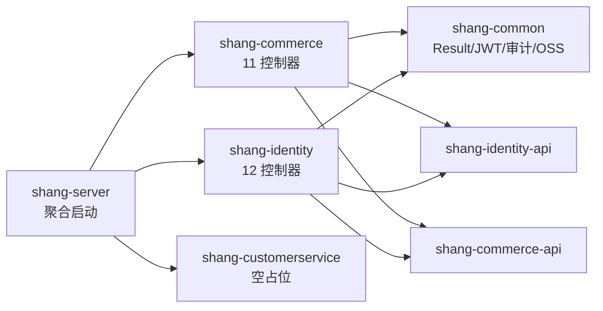
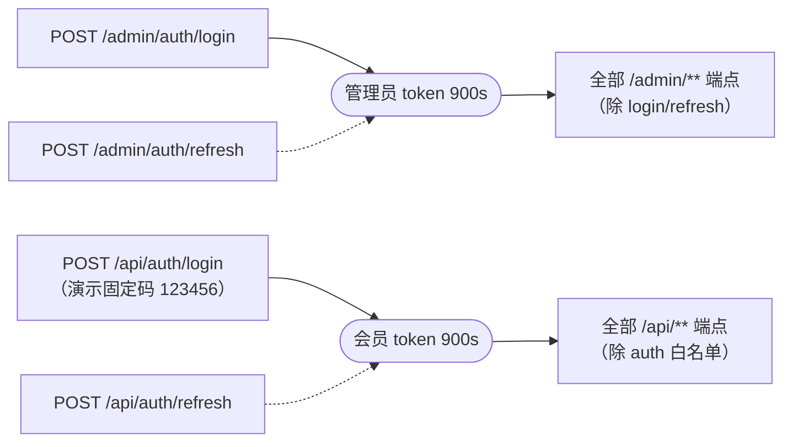

# 调用链路（前端 → 端点 → 控制器 → 服务 → 表）

> **机制区文档（禁止手改）**。由 `api_testcases/scripts/build_call_graph.py` 解析后端 Java 源码、
> 两个前端 `src/api/*.ts`、以及 `endpoint-model.json` / `field-map.json` 生成。
>
> 生成命令：`python3 api_testcases/scripts/build_call_graph.py`  
> 版本指纹：`810986c (main, 2026-10-09)`  ·  生成时间：2026-10-10 18:57:43  
> 规模：292 节点 / 656 边 / 135 端点链路

## 0. 先读：本项目**没有**「接口调接口」

这是**模块化单体**（`shang-server` 聚合启动，7 个 Maven 模块同进程）。全仓无 `RestTemplate` /
`WebClient` / `Feign` / Dubbo / MQ —— 所以通用 API 图工具里那些「服务间调用」关系在本项目**不存在**，
硬套只会画出一张空图。真实链路只有这五类：

| 关系 | 形态 | 本图怎么表示 |
|---|---|---|
| 前端调用 | `http({url,method})` → 端点 | `fe:*.ts → ep:*`（`fetches`） |
| 端点 → 控制器 | 映射注解 → 方法 | `ep:* → ctrl:*`（`handled_by`） |
| 调用 | 控制器/服务方法体内调用注入的 Bean | `calls` / `injects` |
| 数据访问 | 服务 → Mapper → 表 | `mapper:* → table:*`（`accesses`） |
| **跨上下文** | 同进程 `*-api` 接口（**非 HTTP**） | `svc:* → api:*`（`cross_api`） |
| 鉴权前置 | 受保护端点 → 登录端点 | `requires_auth` |

## 1. 模块依赖（构建期，来自各 pom.xml）



跨上下文的**唯一**通道是 `*-api` 接口：`commerce → identity-api`（`CustomerQueryApi`、`SystemConfigApi`），
`identity → commerce-api`（`OrderQueryApi`）。`commerce-api` 里的 `StockApi` 是空接口、零实现零引用。

## 2. 分层链路聚合图（按业务域分图）

节点类型：`控制器` → `服务` → `表`。表用圆角节点表示。

```mermaid
flowchart LR
  subgraph D_admin_catalog["admin-catalog"]
    direction LR
    C_AdminOpsController["AdminOpsController"]
    C_AttributeController["AttributeController"]
    C_BrandController["BrandController"]
    C_CategoryController["CategoryController"]
    C_ProductController["ProductController"]
    C_StockController["StockController"]
    C_WarehouseController["WarehouseController"]
    S_AttributeService["AttributeService"]
    S_BrandService["BrandService"]
    S_InOutOrderService["InOutOrderService"]
    S_ProductService["ProductService"]
    S_StockService["StockService"]
    T_commerce_attribute[("commerce.attribute")]
    T_commerce_brand[("commerce.brand")]
    T_commerce_category[("commerce.category")]
    T_commerce_in_out_item[("commerce.in_out_item")]
    T_commerce_in_out_order[("commerce.in_out_order")]
    T_commerce_sku[("commerce.sku")]
    T_commerce_spu[("commerce.spu")]
    T_commerce_stock[("commerce.stock")]
    T_commerce_stock_log[("commerce.stock_log")]
    T_commerce_warehouse[("commerce.warehouse")]
  end
  subgraph D_admin_content["admin-content"]
    direction LR
    C_AdminOpsController["AdminOpsController"]
    C_DashboardController["DashboardController"]
    S_HomeSlotService["HomeSlotService"]
    S_SiteBrandService["SiteBrandService"]
    T_commerce_home_slot[("commerce.home_slot")]
    T_commerce_home_slot_item[("commerce.home_slot_item")]
    T_commerce_site_brand[("commerce.site_brand")]
    T_commerce_sku[("commerce.sku")]
    T_commerce_spu[("commerce.spu")]
  end
  subgraph D_admin_identity["admin-identity"]
    direction LR
    C_AdminUserController["AdminUserController"]
    C_AuthController["AuthController"]
    C_DeptController["DeptController"]
    C_DictController["DictController"]
    C_FileController["FileController"]
    C_OperationLogController["OperationLogController"]
    C_PermissionController["PermissionController"]
    C_RoleController["RoleController"]
    C_SystemConfigController["SystemConfigController"]
    S_AdminUserService["AdminUserService"]
    S_AuthService["AuthService"]
    S_OperationLogService["OperationLogService"]
    S_PermissionQueryService["PermissionQueryService"]
    S_RoleService["RoleService"]
    T_identity_admin_role[("identity.admin_role")]
    T_identity_admin_user[("identity.admin_user")]
    T_identity_operation_log[("identity.operation_log")]
    T_identity_permission[("identity.permission")]
    T_identity_role[("identity.role")]
    T_identity_role_permission[("identity.role_permission")]
  end
  subgraph D_admin_trade["admin-trade"]
    direction LR
    C_AdminOpsController["AdminOpsController"]
    C_AfterSaleController["AfterSaleController"]
    C_CustomerAdminController["CustomerAdminController"]
    C_OrderController["OrderController"]
    S_AfterSaleService["AfterSaleService"]
    S_CustomerAdminService["CustomerAdminService"]
    S_OrderService["OrderService"]
    S_ReviewAdminService["ReviewAdminService"]
    T_commerce_after_sale[("commerce.after_sale")]
    T_commerce_order[("commerce.order")]
    T_commerce_order_item[("commerce.order_item")]
    T_commerce_payment[("commerce.payment")]
    T_commerce_review[("commerce.review")]
    T_commerce_shipment[("commerce.shipment")]
    T_commerce_spu[("commerce.spu")]
    T_commerce_stock[("commerce.stock")]
    T_commerce_stock_log[("commerce.stock_log")]
    T_identity_customer[("identity.customer")]
  end
  subgraph D_storefront_auth["storefront-auth"]
    direction LR
    C_CustomerAuthController["CustomerAuthController"]
    C_CustomerFileController["CustomerFileController"]
    S_CustomerAuthService["CustomerAuthService"]
    T_identity_customer[("identity.customer")]
  end
  subgraph D_storefront_browse["storefront-browse"]
    direction LR
    C_StorefrontController["StorefrontController"]
    S_CatalogReadService["CatalogReadService"]
    S_FavoriteBrowseService["FavoriteBrowseService"]
    S_SiteBrandService["SiteBrandService"]
    T_commerce_browse_history[("commerce.browse_history")]
    T_commerce_category[("commerce.category")]
    T_commerce_favorite[("commerce.favorite")]
    T_commerce_review[("commerce.review")]
    T_commerce_site_brand[("commerce.site_brand")]
    T_commerce_sku[("commerce.sku")]
    T_commerce_spu[("commerce.spu")]
    T_commerce_stock[("commerce.stock")]
  end
  subgraph D_storefront_trade["storefront-trade"]
    direction LR
    C_StorefrontController["StorefrontController"]
    S_AddressService["AddressService"]
    S_AfterSaleService["AfterSaleService"]
    S_CartService["CartService"]
    S_FavoriteBrowseService["FavoriteBrowseService"]
    S_OrderSubmitService["OrderSubmitService"]
    S_PaymentSandboxService["PaymentSandboxService"]
    T_commerce_address[("commerce.address")]
    T_commerce_after_sale[("commerce.after_sale")]
    T_commerce_browse_history[("commerce.browse_history")]
    T_commerce_cart[("commerce.cart")]
    T_commerce_cart_item[("commerce.cart_item")]
    T_commerce_favorite[("commerce.favorite")]
    T_commerce_order[("commerce.order")]
    T_commerce_order_item[("commerce.order_item")]
    T_commerce_payment[("commerce.payment")]
    T_commerce_sku[("commerce.sku")]
    T_commerce_spu[("commerce.spu")]
    T_commerce_stock[("commerce.stock")]
    T_commerce_stock_log[("commerce.stock_log")]
  end
  C_AdminOpsController --> S_HomeSlotService
  C_AdminOpsController --> S_InOutOrderService
  C_AdminOpsController --> S_ReviewAdminService
  C_AdminOpsController --> S_SiteBrandService
  C_AdminUserController --> S_AdminUserService
  C_AfterSaleController --> S_AfterSaleService
  C_AttributeController --> S_AttributeService
  C_AuthController --> S_AuthService
  C_BrandController --> S_BrandService
  C_CustomerAdminController --> S_CustomerAdminService
  C_CustomerAuthController --> S_CustomerAuthService
  C_OperationLogController --> S_OperationLogService
  C_OrderController --> S_OrderService
  C_PermissionController --> S_PermissionQueryService
  C_ProductController --> S_ProductService
  C_RoleController --> S_RoleService
  C_StockController --> S_StockService
  C_StorefrontController --> S_AddressService
  C_StorefrontController --> S_AfterSaleService
  C_StorefrontController --> S_CartService
  C_StorefrontController --> S_CatalogReadService
  C_StorefrontController --> S_FavoriteBrowseService
  C_StorefrontController --> S_OrderSubmitService
  C_StorefrontController --> S_PaymentSandboxService
  C_StorefrontController --> S_SiteBrandService
  S_AddressService --> T_commerce_address
  S_AdminUserService --> T_identity_admin_user
  S_AfterSaleService --> T_commerce_after_sale
  S_AfterSaleService --> T_commerce_order
  S_AttributeService --> T_commerce_attribute
  S_AuthService --> T_identity_admin_user
  S_BrandService --> T_commerce_brand
  S_BrandService --> T_commerce_category
  S_BrandService --> T_commerce_spu
  S_CartService --> T_commerce_cart
  S_CartService --> T_commerce_cart_item
  S_CartService --> T_commerce_sku
  S_CartService --> T_commerce_spu
  S_CartService --> T_commerce_stock
  S_CatalogReadService --> T_commerce_browse_history
  S_CatalogReadService --> T_commerce_category
  S_CatalogReadService --> T_commerce_favorite
  S_CatalogReadService --> T_commerce_review
  S_CatalogReadService --> T_commerce_sku
  S_CatalogReadService --> T_commerce_spu
  S_CatalogReadService --> T_commerce_stock
  S_CustomerAdminService --> T_identity_customer
  S_CustomerAuthService --> T_identity_customer
  S_FavoriteBrowseService --> T_commerce_browse_history
  S_FavoriteBrowseService --> T_commerce_category
  S_FavoriteBrowseService --> T_commerce_favorite
  S_FavoriteBrowseService --> T_commerce_review
  S_FavoriteBrowseService --> T_commerce_sku
  S_FavoriteBrowseService --> T_commerce_spu
  S_FavoriteBrowseService --> T_commerce_stock
  S_HomeSlotService --> T_commerce_home_slot
  S_HomeSlotService --> T_commerce_home_slot_item
  S_HomeSlotService --> T_commerce_sku
  S_HomeSlotService --> T_commerce_spu
  S_InOutOrderService --> T_commerce_in_out_item
  S_InOutOrderService --> T_commerce_in_out_order
  S_InOutOrderService --> T_commerce_sku
  S_InOutOrderService --> T_commerce_spu
  S_InOutOrderService --> T_commerce_stock
  S_InOutOrderService --> T_commerce_stock_log
  S_OperationLogService --> T_identity_operation_log
  S_OrderService --> T_commerce_order
  S_OrderService --> T_commerce_order_item
  S_OrderService --> T_commerce_payment
  S_OrderService --> T_commerce_shipment
  S_OrderService --> T_commerce_stock
  S_OrderService --> T_commerce_stock_log
  S_OrderSubmitService --> T_commerce_address
  S_OrderSubmitService --> T_commerce_cart
  S_OrderSubmitService --> T_commerce_cart_item
  S_OrderSubmitService --> T_commerce_order
  S_OrderSubmitService --> T_commerce_order_item
  S_OrderSubmitService --> T_commerce_sku
  S_OrderSubmitService --> T_commerce_spu
  S_OrderSubmitService --> T_commerce_stock
  S_OrderSubmitService --> T_commerce_stock_log
  S_PaymentSandboxService --> T_commerce_order
  S_PaymentSandboxService --> T_commerce_order_item
  S_PaymentSandboxService --> T_commerce_payment
  S_PaymentSandboxService --> T_commerce_spu
  S_PermissionQueryService --> T_identity_admin_role
  S_PermissionQueryService --> T_identity_permission
  S_PermissionQueryService --> T_identity_role
  S_PermissionQueryService --> T_identity_role_permission
  S_ProductService --> T_commerce_category
  S_ProductService --> T_commerce_sku
  S_ProductService --> T_commerce_spu
  S_ProductService --> T_commerce_stock
  S_ProductService --> T_commerce_stock_log
  S_ReviewAdminService --> T_commerce_review
  S_ReviewAdminService --> T_commerce_spu
  S_RoleService --> T_identity_role
  S_SiteBrandService --> T_commerce_site_brand
  S_StockService --> T_commerce_sku
  S_StockService --> T_commerce_stock
  S_StockService --> T_commerce_stock_log
  S_StockService --> T_commerce_warehouse
```



## 3. 端点级链路明细

逐端点的完整链路。**这一节是「追踪」的主表**：改一个服务/表，按 `表` 列反查即可定位受影响端点。

### admin-catalog（28 个端点）

| 端点 | 控制器.方法 | 服务 | 触及的表 | 跨上下文 API | 前端调用方 |
|---|---|---|---|---|---|
| `DELETE /admin/attributes/{id}` | `AttributeController.delete` | — | — | — | shang-admin-web/categories.ts |
| `DELETE /admin/brands/{id}` | `BrandController.delete` | — | — | — | shang-admin-web/categories.ts |
| `DELETE /admin/categories/{id}` | `CategoryController.delete` | — | — | — | shang-admin-web/categories.ts |
| `DELETE /admin/products/{id}` | `ProductController.delete` | `ProductService` | `commerce.category`、`commerce.sku`、`commerce.spu`、`commerce.stock`、`commerce.stock_log` | — | shang-admin-web/products.ts |
| `GET /admin/attributes` | `AttributeController.list` | `AttributeService` | `commerce.attribute` | — | shang-admin-web/categories.ts |
| `GET /admin/brands` | `BrandController.page` | `BrandService` | `commerce.brand`、`commerce.category`、`commerce.spu` | — | shang-admin-web/categories.ts |
| `GET /admin/categories` | `CategoryController.list` | — | — | — | shang-admin-web/categories.ts |
| `GET /admin/categories/tree` | `CategoryController.tree` | — | — | — | shang-admin-web/categories.ts |
| `GET /admin/in-out` | `AdminOpsController.inOutPage` | `InOutOrderService` | `commerce.in_out_item`、`commerce.in_out_order`、`commerce.sku`、`commerce.spu`、`commerce.stock`、`commerce.stock_log` | — | shang-admin-web/inout.ts |
| `GET /admin/products` | `ProductController.page` | `ProductService` | `commerce.category`、`commerce.sku`、`commerce.spu`、`commerce.stock`、`commerce.stock_log` | — | shang-admin-web/products.ts |
| `GET /admin/products/{id}` | `ProductController.detail` | `ProductService` | `commerce.category`、`commerce.sku`、`commerce.spu`、`commerce.stock`、`commerce.stock_log` | — | shang-admin-web/products.ts |
| `GET /admin/stocks` | `StockController.page` | `StockService` | `commerce.sku`、`commerce.stock`、`commerce.stock_log`、`commerce.warehouse` | — | shang-admin-web/dashboard.ts、shang-admin-web/inventory.ts |
| `GET /admin/warehouses` | `WarehouseController.list` | — | — | — | — |
| `POST /admin/attributes` | `AttributeController.create` | — | — | — | shang-admin-web/categories.ts |
| `POST /admin/brands` | `BrandController.create` | — | — | — | shang-admin-web/categories.ts |
| `POST /admin/categories` | `CategoryController.create` | — | — | — | shang-admin-web/categories.ts |
| `POST /admin/in-out` | `AdminOpsController.createInOut` | `InOutOrderService` | `commerce.in_out_item`、`commerce.in_out_order`、`commerce.sku`、`commerce.spu`、`commerce.stock`、`commerce.stock_log` | — | shang-admin-web/inout.ts |
| `POST /admin/products` | `ProductController.create` | `ProductService` | `commerce.category`、`commerce.sku`、`commerce.spu`、`commerce.stock`、`commerce.stock_log` | — | shang-admin-web/products.ts |
| `POST /admin/warehouses` | `WarehouseController.create` | — | — | — | — |
| `PUT /admin/attributes/{id}` | `AttributeController.update` | — | — | — | shang-admin-web/categories.ts |
| `PUT /admin/brands/{id}` | `BrandController.update` | — | — | — | shang-admin-web/categories.ts |
| `PUT /admin/categories/{id}` | `CategoryController.update` | — | — | — | shang-admin-web/categories.ts |
| `PUT /admin/products/batch-off` | `ProductController.batchOff` | `ProductService` | `commerce.category`、`commerce.sku`、`commerce.spu`、`commerce.stock`、`commerce.stock_log` | — | shang-admin-web/products.ts |
| `PUT /admin/products/{id}` | `ProductController.update` | `ProductService` | `commerce.category`、`commerce.sku`、`commerce.spu`、`commerce.stock`、`commerce.stock_log` | — | shang-admin-web/products.ts |
| `PUT /admin/products/{id}/off` | `ProductController.off` | `ProductService` | `commerce.category`、`commerce.sku`、`commerce.spu`、`commerce.stock`、`commerce.stock_log` | — | shang-admin-web/products.ts |
| `PUT /admin/products/{id}/on` | `ProductController.on` | `ProductService` | `commerce.category`、`commerce.sku`、`commerce.spu`、`commerce.stock`、`commerce.stock_log` | — | shang-admin-web/products.ts |
| `PUT /admin/stocks/adjust` | `StockController.adjust` | `StockService` | `commerce.sku`、`commerce.stock`、`commerce.stock_log`、`commerce.warehouse` | — | shang-admin-web/inventory.ts |
| `PUT /admin/warehouses/{id}` | `WarehouseController.update` | — | — | — | — |

### admin-content（6 个端点）

| 端点 | 控制器.方法 | 服务 | 触及的表 | 跨上下文 API | 前端调用方 |
|---|---|---|---|---|---|
| `GET /admin/dashboard/stats` | `DashboardController.stats` | — | — | — | shang-admin-web/dashboard.ts |
| `GET /admin/home/slots` | `AdminOpsController.listSlots` | `HomeSlotService` | `commerce.home_slot`、`commerce.home_slot_item`、`commerce.sku`、`commerce.spu` | — | shang-admin-web/homeSlots.ts |
| `GET /admin/home/slots/{code}` | `AdminOpsController.getSlot` | `HomeSlotService` | `commerce.home_slot`、`commerce.home_slot_item`、`commerce.sku`、`commerce.spu` | — | shang-admin-web/homeSlots.ts |
| `GET /admin/site/brand` | `AdminOpsController.getBrand` | `SiteBrandService` | `commerce.site_brand` | — | shang-admin-web/content.ts |
| `PUT /admin/home/slots/{code}` | `AdminOpsController.saveSlot` | `HomeSlotService` | `commerce.home_slot`、`commerce.home_slot_item`、`commerce.sku`、`commerce.spu` | — | shang-admin-web/homeSlots.ts |
| `PUT /admin/site/brand` | `AdminOpsController.updateBrand` | `SiteBrandService` | `commerce.site_brand` | — | shang-admin-web/content.ts |

### admin-identity（44 个端点）

| 端点 | 控制器.方法 | 服务 | 触及的表 | 跨上下文 API | 前端调用方 |
|---|---|---|---|---|---|
| `DELETE /admin/depts/{id}` | `DeptController.delete` | — | — | — | shang-admin-web/depts.ts |
| `DELETE /admin/dict-items/{id}` | `DictController.deleteItem` | — | — | — | shang-admin-web/dicts.ts |
| `DELETE /admin/dicts/{id}` | `DictController.deleteDict` | — | — | — | shang-admin-web/dicts.ts |
| `DELETE /admin/permissions/{id}` | `PermissionController.delete` | — | — | — | shang-admin-web/menus.ts |
| `DELETE /admin/roles/{id}` | `RoleController.delete` | `RoleService` | `identity.role` | — | shang-admin-web/roles.ts |
| `DELETE /admin/users/{id}` | `AdminUserController.delete` | `AdminUserService` | `identity.admin_user` | — | shang-admin-web/users.ts |
| `GET /admin/auth/me` | `AuthController.me` | `AuthService` | `identity.admin_user` | — | shang-admin-web/auth.ts |
| `GET /admin/depts` | `DeptController.list` | — | — | — | shang-admin-web/depts.ts |
| `GET /admin/depts/tree` | `DeptController.tree` | — | — | — | shang-admin-web/depts.ts |
| `GET /admin/dict-items` | `DictController.items` | — | — | — | shang-admin-web/dicts.ts |
| `GET /admin/dict-items/by-code` | `DictController.itemsByCode` | — | — | — | shang-admin-web/dicts.ts |
| `GET /admin/dicts` | `DictController.page` | — | — | — | shang-admin-web/dicts.ts |
| `GET /admin/files/view` | `FileController.view` | — | — | — | — |
| `GET /admin/operation-logs` | `OperationLogController.page` | — | — | — | shang-admin-web/logs.ts |
| `GET /admin/operation-logs/export` | `OperationLogController.export` | — | — | — | shang-admin-web/logs.ts |
| `GET /admin/operation-logs/{id}` | `OperationLogController.detail` | `OperationLogService` | `identity.operation_log` | — | shang-admin-web/logs.ts |
| `GET /admin/permissions` | `PermissionController.list` | — | — | — | shang-admin-web/menus.ts |
| `GET /admin/permissions/tree` | `PermissionController.tree` | `PermissionQueryService` | `identity.admin_role`、`identity.permission`、`identity.role`、`identity.role_permission` | — | shang-admin-web/menus.ts |
| `GET /admin/roles` | `RoleController.page` | `RoleService` | `identity.role` | — | shang-admin-web/roles.ts |
| `GET /admin/roles/all` | `RoleController.all` | `RoleService` | `identity.role` | — | shang-admin-web/roles.ts、shang-admin-web/users.ts |
| `GET /admin/system-configs` | `SystemConfigController.list` | — | — | — | shang-admin-web/settings.ts |
| `GET /admin/users` | `AdminUserController.page` | `AdminUserService` | `identity.admin_user` | — | shang-admin-web/users.ts |
| `GET /admin/users/{id}` | `AdminUserController.get` | `AdminUserService` | `identity.admin_user` | — | shang-admin-web/users.ts |
| `POST /admin/auth/login` | `AuthController.login` | `AuthService` | `identity.admin_user` | — | shang-admin-web/auth.ts |
| `POST /admin/auth/logout` | `AuthController.logout` | `AuthService` | `identity.admin_user` | — | shang-admin-web/auth.ts |
| `POST /admin/auth/refresh` | `AuthController.refresh` | `AuthService` | `identity.admin_user` | — | — |
| `POST /admin/depts` | `DeptController.create` | — | — | — | shang-admin-web/depts.ts |
| `POST /admin/dict-items` | `DictController.createItem` | — | — | — | shang-admin-web/dicts.ts |
| `POST /admin/dicts` | `DictController.createDict` | — | — | — | shang-admin-web/dicts.ts |
| `POST /admin/files/confirm` | `FileController.confirm` | — | — | — | — |
| `POST /admin/files/presign` | `FileController.presign` | — | — | — | — |
| `POST /admin/files/upload` | `FileController.upload` | — | — | — | shang-admin-web/files.ts |
| `POST /admin/permissions` | `PermissionController.create` | — | — | — | shang-admin-web/menus.ts |
| `POST /admin/roles` | `RoleController.create` | `RoleService` | `identity.role` | — | shang-admin-web/roles.ts |
| `POST /admin/users` | `AdminUserController.create` | `AdminUserService` | `identity.admin_user` | — | shang-admin-web/users.ts |
| `PUT /admin/depts/{id}` | `DeptController.update` | — | — | — | shang-admin-web/depts.ts |
| `PUT /admin/dict-items/{id}` | `DictController.updateItem` | — | — | — | shang-admin-web/dicts.ts |
| `PUT /admin/dicts/{id}` | `DictController.updateDict` | — | — | — | shang-admin-web/dicts.ts |
| `PUT /admin/permissions/{id}` | `PermissionController.update` | — | — | — | shang-admin-web/menus.ts |
| `PUT /admin/roles/{id}` | `RoleController.update` | `RoleService` | `identity.role` | — | shang-admin-web/roles.ts |
| `PUT /admin/system-configs/{id}` | `SystemConfigController.update` | — | — | — | shang-admin-web/settings.ts |
| `PUT /admin/users/{id}` | `AdminUserController.update` | `AdminUserService` | `identity.admin_user` | — | shang-admin-web/users.ts |
| `PUT /admin/users/{id}/password` | `AdminUserController.resetPassword` | — | — | — | shang-admin-web/users.ts |
| `PUT /admin/users/{id}/status` | `AdminUserController.status` | — | — | — | shang-admin-web/users.ts |

### admin-trade（12 个端点）

| 端点 | 控制器.方法 | 服务 | 触及的表 | 跨上下文 API | 前端调用方 |
|---|---|---|---|---|---|
| `GET /admin/after-sales` | `AfterSaleController.page` | `AfterSaleService` | `commerce.after_sale`、`commerce.order` | — | shang-admin-web/aftersales.ts |
| `GET /admin/after-sales/{id}` | `AfterSaleController.detail` | `AfterSaleService` | `commerce.after_sale`、`commerce.order` | — | shang-admin-web/aftersales.ts |
| `GET /admin/customers` | `CustomerAdminController.page` | `CustomerAdminService` | `identity.customer` | — | shang-admin-web/customers.ts |
| `GET /admin/customers/{id}` | `CustomerAdminController.detail` | `CustomerAdminService` | `identity.customer` | — | shang-admin-web/customers.ts |
| `GET /admin/orders` | `OrderController.page` | `OrderService` | `commerce.order`、`commerce.order_item`、`commerce.payment`、`commerce.shipment`、`commerce.stock`、`commerce.stock_log` | — | shang-admin-web/orders.ts |
| `GET /admin/orders/export` | `OrderController.export` | `OrderService` | `commerce.order`、`commerce.order_item`、`commerce.payment`、`commerce.shipment`、`commerce.stock`、`commerce.stock_log` | — | shang-admin-web/orders.ts |
| `GET /admin/orders/{id}` | `OrderController.detail` | `OrderService` | `commerce.order`、`commerce.order_item`、`commerce.payment`、`commerce.shipment`、`commerce.stock`、`commerce.stock_log` | — | shang-admin-web/orders.ts |
| `GET /admin/reviews` | `AdminOpsController.reviews` | `ReviewAdminService` | `commerce.review`、`commerce.spu` | — | shang-admin-web/reviews.ts |
| `POST /admin/after-sales/{id}/audit` | `AfterSaleController.audit` | `AfterSaleService` | `commerce.after_sale`、`commerce.order` | — | shang-admin-web/aftersales.ts |
| `POST /admin/orders/{id}/ship` | `OrderController.ship` | `OrderService` | `commerce.order`、`commerce.order_item`、`commerce.payment`、`commerce.shipment`、`commerce.stock`、`commerce.stock_log` | — | shang-admin-web/orders.ts |
| `PUT /admin/customers/{id}/status` | `CustomerAdminController.updateStatus` | `CustomerAdminService` | `identity.customer` | — | shang-admin-web/customers.ts |
| `PUT /admin/reviews/{id}/status` | `AdminOpsController.reviewStatus` | `ReviewAdminService` | `commerce.review`、`commerce.spu` | — | shang-admin-web/reviews.ts |

### storefront-auth（11 个端点）

| 端点 | 控制器.方法 | 服务 | 触及的表 | 跨上下文 API | 前端调用方 |
|---|---|---|---|---|---|
| `GET /api/files/view` | `CustomerFileController.view` | — | — | — | — |
| `GET /api/me` | `CustomerAuthController.me` | `CustomerAuthService` | `identity.customer` | — | shang-mall/auth.ts |
| `POST /api/auth/login` | `CustomerAuthController.login` | `CustomerAuthService` | `identity.customer` | — | shang-mall/auth.ts |
| `POST /api/auth/logout` | `CustomerAuthController.logout` | `CustomerAuthService` | `identity.customer` | — | shang-mall/auth.ts |
| `POST /api/auth/phone` | `CustomerAuthController.login` | `CustomerAuthService` | `identity.customer` | — | — |
| `POST /api/auth/refresh` | `CustomerAuthController.refresh` | `CustomerAuthService` | `identity.customer` | — | — |
| `POST /api/auth/sms/send` | `CustomerAuthController.sendSms` | `CustomerAuthService` | `identity.customer` | — | shang-mall/auth.ts |
| `POST /api/files/confirm` | `CustomerFileController.confirm` | — | — | — | — |
| `POST /api/files/presign` | `CustomerFileController.presign` | — | — | — | — |
| `POST /api/files/upload` | `CustomerFileController.upload` | — | — | — | shang-mall/customer.ts |
| `PUT /api/me` | `CustomerAuthController.updateMe` | `CustomerAuthService` | `identity.customer` | — | shang-mall/auth.ts |

### storefront-browse（7 个端点）

| 端点 | 控制器.方法 | 服务 | 触及的表 | 跨上下文 API | 前端调用方 |
|---|---|---|---|---|---|
| `GET /api/categories` | `StorefrontController.categories` | `CatalogReadService` | `commerce.category`、`commerce.review`、`commerce.sku`、`commerce.spu`、`commerce.stock` | — | shang-mall/catalog.ts |
| `GET /api/home` | `StorefrontController.home` | `CatalogReadService` | `commerce.category`、`commerce.review`、`commerce.sku`、`commerce.spu`、`commerce.stock` | — | shang-mall/catalog.ts |
| `GET /api/products` | `StorefrontController.products` | `CatalogReadService` | `commerce.category`、`commerce.review`、`commerce.sku`、`commerce.spu`、`commerce.stock` | — | shang-mall/catalog.ts |
| `GET /api/products/{spuId}` | `StorefrontController.productDetail` | `CatalogReadService`、`FavoriteBrowseService` | `commerce.browse_history`、`commerce.category`、`commerce.favorite`、`commerce.review`、`commerce.sku`、`commerce.spu`、`commerce.stock` | — | shang-mall/catalog.ts |
| `GET /api/products/{spuId}/reviews` | `StorefrontController.productReviews` | — | — | — | shang-mall/catalog.ts |
| `GET /api/search` | `StorefrontController.search` | `CatalogReadService` | `commerce.category`、`commerce.review`、`commerce.sku`、`commerce.spu`、`commerce.stock` | — | shang-mall/catalog.ts |
| `GET /api/site/brand` | `StorefrontController.brand` | `SiteBrandService` | `commerce.site_brand` | — | shang-mall/catalog.ts |

### storefront-trade（27 个端点）

| 端点 | 控制器.方法 | 服务 | 触及的表 | 跨上下文 API | 前端调用方 |
|---|---|---|---|---|---|
| `DELETE /api/addresses/{id}` | `StorefrontController.deleteAddress` | `AddressService` | `commerce.address` | — | shang-mall/customer.ts |
| `DELETE /api/cart/items/{id}` | `StorefrontController.removeCart` | `CartService` | `commerce.cart`、`commerce.cart_item`、`commerce.sku`、`commerce.spu`、`commerce.stock` | — | shang-mall/cart.ts |
| `DELETE /api/favorites/{spuId}` | `StorefrontController.removeFavorite` | `FavoriteBrowseService` | `commerce.browse_history`、`commerce.favorite`、`commerce.spu` | — | shang-mall/customer.ts |
| `DELETE /api/history` | `StorefrontController.clearHistory` | `FavoriteBrowseService` | `commerce.browse_history`、`commerce.favorite`、`commerce.spu` | — | shang-mall/customer.ts |
| `GET /api/addresses` | `StorefrontController.addresses` | `AddressService` | `commerce.address` | — | shang-mall/customer.ts |
| `GET /api/after-sales` | `StorefrontController.myAfterSales` | `AfterSaleService` | `commerce.after_sale`、`commerce.order` | — | shang-mall/order.ts |
| `GET /api/after-sales/{id}` | `StorefrontController.afterSaleDetail` | `AfterSaleService` | `commerce.after_sale`、`commerce.order` | — | shang-mall/order.ts |
| `GET /api/cart` | `StorefrontController.cart` | `CartService` | `commerce.cart`、`commerce.cart_item`、`commerce.sku`、`commerce.spu`、`commerce.stock` | — | shang-mall/cart.ts |
| `GET /api/favorites` | `StorefrontController.favorites` | `FavoriteBrowseService` | `commerce.browse_history`、`commerce.favorite`、`commerce.spu` | — | shang-mall/customer.ts |
| `GET /api/history` | `StorefrontController.history` | `FavoriteBrowseService` | `commerce.browse_history`、`commerce.favorite`、`commerce.spu` | — | shang-mall/customer.ts |
| `GET /api/orders` | `StorefrontController.myOrders` | — | — | — | shang-mall/order.ts |
| `GET /api/orders/{id}` | `StorefrontController.orderDetail` | — | — | — | shang-mall/order.ts |
| `GET /api/orders/{id}/logistics` | `StorefrontController.logistics` | — | — | — | shang-mall/order.ts |
| `GET /api/payment/{orderId}/status` | `StorefrontController.payStatus` | `PaymentSandboxService` | `commerce.order`、`commerce.order_item`、`commerce.payment`、`commerce.spu` | — | — |
| `POST /api/addresses` | `StorefrontController.createAddress` | `AddressService` | `commerce.address` | — | shang-mall/customer.ts |
| `POST /api/after-sales` | `StorefrontController.applyAfterSale` | `AfterSaleService` | `commerce.after_sale`、`commerce.order` | — | shang-mall/order.ts |
| `POST /api/cart/clear-invalid` | `StorefrontController.clearInvalid` | `CartService` | `commerce.cart`、`commerce.cart_item`、`commerce.sku`、`commerce.spu`、`commerce.stock` | — | shang-mall/cart.ts |
| `POST /api/cart/items` | `StorefrontController.addCart` | `CartService` | `commerce.cart`、`commerce.cart_item`、`commerce.sku`、`commerce.spu`、`commerce.stock` | — | shang-mall/cart.ts |
| `POST /api/favorites/{spuId}` | `StorefrontController.addFavorite` | `FavoriteBrowseService` | `commerce.browse_history`、`commerce.favorite`、`commerce.spu` | — | shang-mall/customer.ts |
| `POST /api/orders` | `StorefrontController.submit` | `OrderSubmitService` | `commerce.address`、`commerce.cart`、`commerce.cart_item`、`commerce.order`、`commerce.order_item`、`commerce.sku`、`commerce.spu`、`commerce.stock`、`commerce.stock_log` | — | shang-mall/order.ts |
| `POST /api/orders/{id}/cancel` | `StorefrontController.cancel` | `OrderSubmitService` | `commerce.address`、`commerce.cart`、`commerce.cart_item`、`commerce.order`、`commerce.order_item`、`commerce.sku`、`commerce.spu`、`commerce.stock`、`commerce.stock_log` | — | shang-mall/order.ts |
| `POST /api/orders/{id}/confirm` | `StorefrontController.confirm` | `OrderSubmitService` | `commerce.address`、`commerce.cart`、`commerce.cart_item`、`commerce.order`、`commerce.order_item`、`commerce.sku`、`commerce.spu`、`commerce.stock`、`commerce.stock_log` | — | shang-mall/order.ts |
| `POST /api/payment/sandbox` | `StorefrontController.sandboxPay` | `PaymentSandboxService` | `commerce.order`、`commerce.order_item`、`commerce.payment`、`commerce.spu` | — | shang-mall/order.ts |
| `POST /api/reviews` | `StorefrontController.createReview` | — | — | `CustomerQueryApi` | shang-mall/order.ts |
| `PUT /api/addresses/{id}` | `StorefrontController.updateAddress` | `AddressService` | `commerce.address` | — | shang-mall/customer.ts |
| `PUT /api/addresses/{id}/default` | `StorefrontController.defaultAddress` | `AddressService` | `commerce.address` | — | shang-mall/customer.ts |
| `PUT /api/cart/items/{id}` | `StorefrontController.updateCart` | `CartService` | `commerce.cart`、`commerce.cart_item`、`commerce.sku`、`commerce.spu`、`commerce.stock` | — | shang-mall/cart.ts |

## 4. 鉴权前置链路

所有受保护端点都依赖登录端点产出的 token。**这决定了自动化的执行顺序**：
先登录拿 token，再打业务端点；token 按 `clientType` 单向隔离（admin token 打 `/api/**` 会被 401）。



受保护端点：**119/135**（其余为免认证白名单）。

## 5. 未经服务层的端点（逻辑直接落在控制器 / 直接注入 Mapper）

**52/135** 个端点在方法体内没有调用到应用服务——要么逻辑内联在控制器里（如 C 端评价创建），要么该端点直接操作注入的 Mapper。

⚠️ 注意这是**按端点**判定，不是按控制器：
其中 `AdminUserController`、`AttributeController`、`BrandController`、`OperationLogController`、`PermissionController`、`StorefrontController` 是**混合型**——同一控制器下部分端点走服务、部分不走，不能整类归为「无服务层」。

| 控制器 | 无服务端点 | 端点 |
|---|---|---|
| `AdminUserController` | 2 | `PUT /admin/users/{id}/password`、`PUT /admin/users/{id}/status` |
| `AttributeController` | 3 | `DELETE /admin/attributes/{id}`、`POST /admin/attributes`、`PUT /admin/attributes/{id}` |
| `BrandController` | 3 | `DELETE /admin/brands/{id}`、`POST /admin/brands`、`PUT /admin/brands/{id}` |
| `CategoryController` | 5 | `DELETE /admin/categories/{id}`、`GET /admin/categories`、`GET /admin/categories/tree`、`POST /admin/categories`、`PUT /admin/categories/{id}` |
| `CustomerFileController` | 4 | `GET /api/files/view`、`POST /api/files/confirm`、`POST /api/files/presign`、`POST /api/files/upload` |
| `DashboardController` | 1 | `GET /admin/dashboard/stats` |
| `DeptController` | 5 | `DELETE /admin/depts/{id}`、`GET /admin/depts`、`GET /admin/depts/tree`、`POST /admin/depts`、`PUT /admin/depts/{id}` |
| `DictController` | 9 | `DELETE /admin/dict-items/{id}`、`DELETE /admin/dicts/{id}`、`GET /admin/dict-items`、`GET /admin/dict-items/by-code`、`GET /admin/dicts`、`POST /admin/dict-items`、`POST /admin/dicts`、`PUT /admin/dict-items/{id}`、`PUT /admin/dicts/{id}` |
| `FileController` | 4 | `GET /admin/files/view`、`POST /admin/files/confirm`、`POST /admin/files/presign`、`POST /admin/files/upload` |
| `OperationLogController` | 2 | `GET /admin/operation-logs`、`GET /admin/operation-logs/export` |
| `PermissionController` | 4 | `DELETE /admin/permissions/{id}`、`GET /admin/permissions`、`POST /admin/permissions`、`PUT /admin/permissions/{id}` |
| `StorefrontController` | 5 | `GET /api/orders`、`GET /api/orders/{id}`、`GET /api/orders/{id}/logistics`、`GET /api/products/{spuId}/reviews`、`POST /api/reviews` |
| `SystemConfigController` | 2 | `GET /admin/system-configs`、`PUT /admin/system-configs/{id}` |
| `WarehouseController` | 3 | `GET /admin/warehouses`、`POST /admin/warehouses`、`PUT /admin/warehouses/{id}` |

读图表时的含义：这类端点在图上是 `端点 → 控制器 → Mapper → 表` 的短链，
它们的业务规则**不会**出现在服务层，追溯规则时要直接读控制器方法。

## 6. 怎么用它做跨版本追踪

`call-graph.json` 与其它机制区产物同构，可交给 `baseline_diff.py` 比对：

```bash
cp artifacts/call-graph.json /tmp/old-call-graph.json   # 旧版本留档
python3 scripts/build_call_graph.py                     # 新版本重新生成
diff <(python3 -c "import json;d=json.load(open('/tmp/old-call-graph.json'));print('\n'.join(sorted(e['from']+' -> '+e['to'] for e in d['edges'])))") \
     <(python3 -c "import json;d=json.load(open('artifacts/call-graph.json'));print('\n'.join(sorted(e['from']+' -> '+e['to'] for e in d['edges'])))")
```

新增/消失的边 = 链路变化，比逐接口比对更容易发现「悄悄改了调用路径」。

