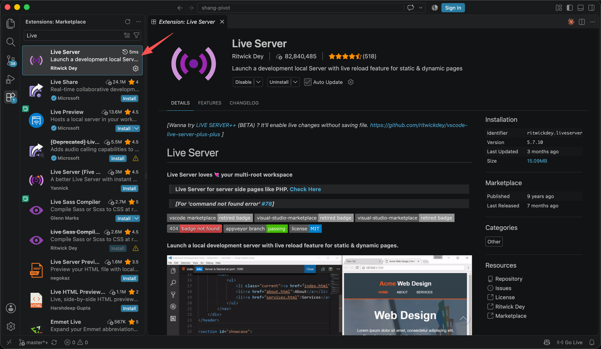
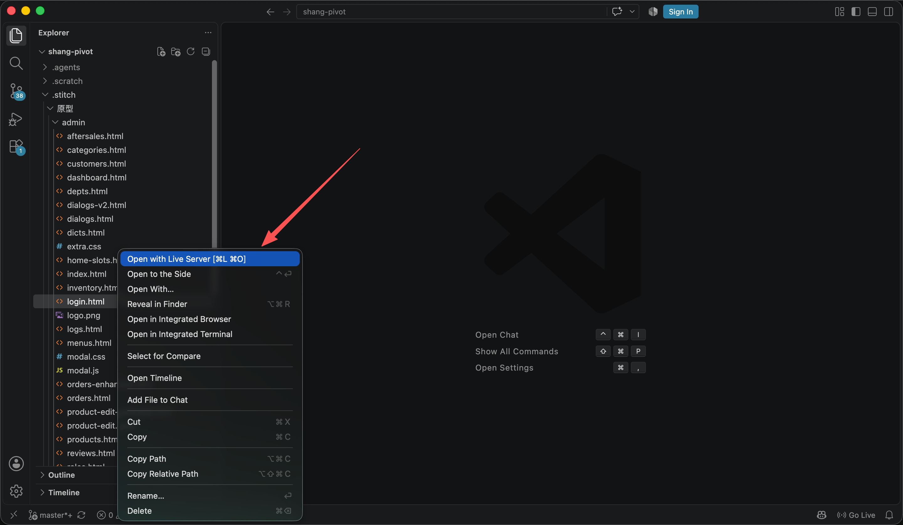
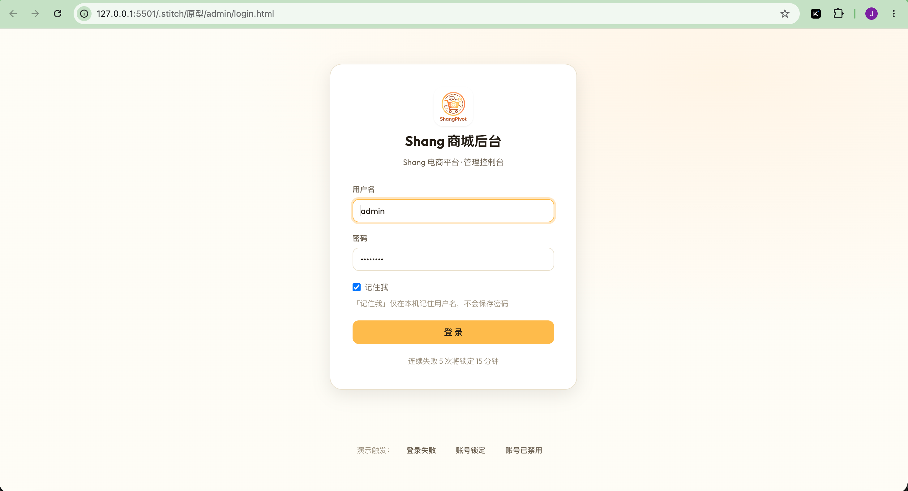

# VSCode 本地预览原型

> Stitch 生成的原型是**纯静态 HTML**，无构建步骤（本项目在 `.stitch/原型/`），本地起个静态服务即可查看。用 VSCode 的 **Live Server** 插件最省事：保存文件浏览器自动刷新，适合边改原型边看效果。

## 步骤

1. **打开原型目录**：用 VSCode 打开 `.stitch/原型/`（也可以只打开其子目录 `admin/` 或 `store/`）。

2. **安装 Live Server 插件**：扩展面板搜索 "Live Server"（作者 Ritwick Dey），安装并启用。

   

3. **从入口页启动**：在起始原型（`.html`）上右键 → **Open with Live Server**；也可以直接点 VSCode 状态栏的 **Go Live**。

   

4. **浏览器查看**：默认地址 `http://127.0.0.1:5500`，之后每次保存文件浏览器都会自动重载。

   

## 入口页与侧栏版本

| 原型 | 入口页 |
|---|---|
| 后台（V1 / V2） | `admin/index.html`（另有登录页 `login.html`、工作台 `dashboard.html`） |
| C 端（V2.0） | `store/index.html`（索引页，链接到 `store/web/` 与 `store/h5/`） |

后台原型的侧栏菜单由 `admin/sidebar.js` 顶部的 `window.__NAV_VERSION__` 裁剪，**默认 `'v1'`**。想看 V2 菜单，把页面里该值改成 `'v2'`；反之，V1 页面的截图必须保持 `v1`，否则会混入后续版本菜单（版本纪律，见 [`00-product/roadmap.md`](./00-product/roadmap.md)）。

## 相关

- 不装插件也可以：`python3 -m http.server 8765`（后台）/ `8766`（C 端），见 [`开发与运维.md`](./开发与运维.md) §5。
- 改完原型重放文档截图：`node .stitch/原型/render-shots.mjs`（依赖全局 playwright）。
- **交互要在生成阶段说清楚**（弹窗、空态、加载态……）：原型表达不了交互，等于没验证到那个设计问题。Stitch 提示词里要写明。
